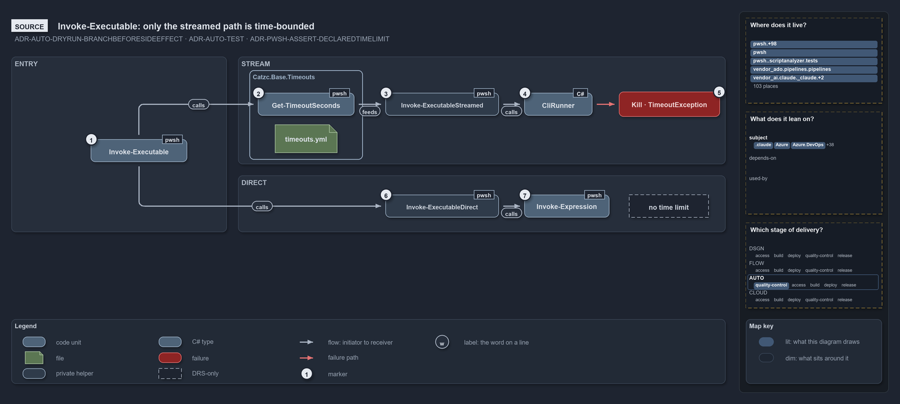

---
catzc:
  warning: "Header is generated by Format-FileMeta via Format-Code; do not change it"
  edges:
    cites:
      - ADR-AUTO-ENGINE
    drs_total: 4
---

# Catzc.Base.Execution

The external-process boundary module. It **owns the complete lifecycle of running an external tool from PowerShell** — logging the exact
command before it executes (see [log-before-invoke](../../drs/automation/log-before-invoke.md)), capturing separated standard output and
error through the native `CliRunner` C# type (see [native-csharp-types](../../drs/automation/BCL/native-csharp-types.md)), managing the
exit-code boundary so a stale code can never leak across a call, and returning a structured `CliResult` when the caller needs to inspect
output programmatically. It also locates an executable and confirms its version before anything runs it, so a caller runs a managed tool by
its path and never by a bare name. Every CLI wrapper in the platform funnels through this module; no feature module ever spawns a process
directly. It is a member of the `Base` group alongside [Catzc.Base.Writers](catzc-base-writers.md),
[Catzc.Base.Repository](catzc-base-repository.md), and [Catzc.Base.Asserts](catzc-base-asserts.md).

## Responsibilities

| Responsibility   | Area      | Name                                                                       |
| ---------------- | --------- | -------------------------------------------------------------------------- |
| responsibility:1 | execution | [External process execution](#responsibility1--external-process-execution) |
| responsibility:2 | location  | [Executable location](#responsibility2--executable-location)               |
| responsibility:3 | exit-code | [Exit-code lifecycle](#responsibility3--exit-code-lifecycle)               |

### responsibility:1 — External process execution

How an external process is run. One wrapper owns the whole invocation lifecycle: it logs the exact command before it runs (see
[log-before-invoke](../../drs/automation/log-before-invoke.md)), captures separated standard output and error via the native `CliRunner`
type, resets and re-checks the exit code so a stale code can never leak across a call boundary, and supports a dry-run mode that returns the
command string instead of executing it — giving callers a testable, side-effect-free path through the same code. When a call is expected to
run long, a companion function wraps it with a liveness indicator. The `-PassThru` switch returns a `CliResult` object that separates stdout
from stderr for callers that need to inspect output programmatically, and `-AsBytes` returns stdout as its exact bytes for a binary stream
such as `git cat-file --batch`. Every run is bounded twice: a process that outlives its time limit is killed with its whole tree, and a
process that exits while something it started still holds its output open fails at once with an error that names the cause, instead of
hanging for that holder's lifetime.

### responsibility:2 — Executable location

Where an executable is and which version it is, answered cheaply and timed. The locate step starts no process: the first existing candidate
path wins, then PATH, and an excluded path never counts (for bash on Windows, the WSL launcher). Only a located executable runs its version
command, once per executable file per session (a lazy cache entry keyed by its path and last write time, see
[script-scope-caching](../../drs/automation/pwsh/script-scope-caching.md)), so a reinstall is seen on the next check. The answer is one
record: found, path, method, version against the required one, the two timings, and the session actor. For a tool declared in `tools.yml`,
the module reads the entry itself — the candidates for the running platform and run environment, the exclusions, the version command and
pin, and the devbox version lever outside a pipeline — so a Base module locates a managed tool without depending on the tooling modules. The
module owns `tools.yml` and its `ToolsConfig`/`ToolConfig` types: the module furthest down the stack that reads the lock file owns it, so
every bundle that can run a process can also resolve the tools it runs. An execution engine's executable is located the way the engine model
says ([ADR-AUTO-ENGINE](../../drs/automation/execution-engines.md)): pwsh beside the running PowerShell, never through PATH, and bash
through its `tools.yml` entry.

### responsibility:3 — Exit-code lifecycle

How the exit-code boundary is managed. `$LASTEXITCODE` in PowerShell is global and mutable: a prior external command can leave a non-zero
code that the next call inherits. This responsibility provides the two primitives the execution responsibility relies on internally, and
that any caller can use when orchestrating multiple commands: read the current code and reset it to a known state before a new invocation.
Together they are the mechanism that keeps each `Invoke-Executable` call exit-code-clean regardless of what ran before it.

## What the module does

The module is the platform's external-process boundary, and it is built around one invariant: before any tool runs, its full command is
logged. That rule — from [log-before-invoke](../../drs/automation/log-before-invoke.md) — means a failing run is always diagnosable from the
log alone, without reconstructing what was called. `Invoke-Executable` enforces it unconditionally; `Invoke-WithProgress` inherits it by
delegating there.

The process-running machinery lives in the native C# type `Catzc.Base.Execution.CliRunner` (see
[native-csharp-types](../../drs/automation/BCL/native-csharp-types.md)). `CliRunner` is what actually spawns the subprocess and captures its
streams; `Invoke-Executable` is the PowerShell wrapper that adds logging, exit-code hygiene, and dry-run. When the caller passes
`-PassThru`, the result comes back as `Catzc.Base.Execution.CliResult` — a typed object with separated `.Stdout` and `.Stderr` properties
rather than a mixed output stream. Feature module wrappers such as `Invoke-AzCli` use `-PassThru` when they need to parse tool output; plain
script calls omit it and let the streams flow through.

Executable location sits in front of execution. The generic check takes plain inputs and returns the `Catzc.Base.Execution.ExecutableProbe`
record; its version run goes through `Invoke-Executable` like any other process start. The tools.yml reading on top of it is global config
access, never guarded by module dependencies (see [module-config-loading](../../drs/configuration/module-config-loading.md)), which is what
lets the tooling modules' presence checks ([Catzc.Tooling.Core](catzc-tooling-core.md)) and the Base modules share one record and one
reading of an entry.

The exit-code responsibility (responsibility 3) is a supporting mechanism. `$LASTEXITCODE` is shared state: any external command can leave a
non-zero code behind. `Reset-LastExitCode` gives the invocation responsibility — and any caller that orchestrates a sequence of external
commands — explicit control over that boundary. `Invoke-Executable` always resets before it runs and checks after; callers that compose
multiple calls can use the same primitives to do the same.

The module depends on [Catzc.Base.Writers](catzc-base-writers.md) for the pre-invocation log line,
[Catzc.Base.Repository](catzc-base-repository.md) for the run environment and the session actor, and
[Catzc.Base.Asserts](catzc-base-asserts.md) for argument validation. Its one configuration file is `tools.yml`, the tool lock file the
tooling modules read as well.

The diagram below draws process invocation from the source. It has two paths. The default streamed path runs through the C# runner under the
executable's time limit from `timeouts.yml`, and kills the process tree when the limit runs out. The direct path, for interactive use, hands
the command to the console with no time limit.

```yml drawio
description:
  "Invoke-Executable forks by parameter set: the streamed path looks up the executable's time limit and runs it through the C# runner, which
  kills the process tree when the limit runs out; the direct path runs through Invoke-Expression with no time limit."
about:
  adrs: [ADR-AUTO-DRYRUN-BRANCHBEFORESIDEEFFECT, ADR-AUTO-TEST, ADR-PWSH-ASSERT-DECLAREDTIMELIMIT]
  lens: source
content:
  title: "Invoke-Executable: only the streamed path is time-bounded"
  kind: reference
  flow: left-to-right
  relation: runs next (code order)
  theme: dark
  bands:
    - { id: band-entry, label: ENTRY }
    - { id: band-stream, label: STREAM }
    - { id: band-direct, label: DIRECT }
  groups:
    - { id: grp-timeouts, label: Catzc.Base.Timeouts, in: band-stream }
  glyphs:
    - { id: g-invoke, kind: code, label: Invoke-Executable, in: band-entry }
    - { id: g-timeout, kind: code, label: Get-TimeoutSeconds, in: grp-timeouts }
    - { id: f-timeouts-yml, kind: file, label: timeouts.yml, in: grp-timeouts }
    - { id: g-streamed, kind: private, label: Invoke-ExecutableStreamed, in: band-stream }
    - { id: t-runner, kind: type, label: CliRunner, in: band-stream }
    - { id: f-kill, kind: failure, label: Kill · TimeoutException, in: band-stream }
    - { id: g-direct, kind: private, label: Invoke-ExecutableDirect, in: band-direct }
    - { id: g-expression, kind: code, label: Invoke-Expression, in: band-direct }
    - { id: n-no-limit, kind: drsonly, label: no time limit, in: band-direct }
  edges:
    - { from: g-invoke, to: g-timeout, kind: flow, label: "" }
    - { from: g-timeout, to: g-streamed, kind: flow, label: "" }
    - { from: g-streamed, to: t-runner, kind: flow, label: "" }
    - { from: t-runner, to: f-kill, kind: fail, label: "" }
    - { from: g-invoke, to: g-direct, kind: flow, label: "" }
    - { from: g-direct, to: g-expression, kind: flow, label: "" }
  markers:
    - { at: g-invoke, number: 1 }
    - { at: g-timeout, number: 2 }
    - { at: g-streamed, number: 3 }
    - { at: t-runner, number: 4 }
    - { at: f-kill, number: 5 }
    - { at: g-direct, number: 6 }
    - { at: g-expression, number: 7 }
  legend: auto
  minimaps:
    code-locations:
      - cell: .claude/.claude/.
        by: [.claude/CLAUDE.md, ADR-AUTO-TEST]
      - cell: .claude/.claude/agents
        by: [.claude/agents/test-optimization.md, ADR-AUTO-TEST]
      - cell: .claude/.claude/skills/catzc-module
        by: [.claude/skills/catzc-module/SKILL.md, ADR-AUTO-TEST]
      - cell: .claude/.claude/skills/test-speed
        by: [.claude/skills/test-speed/SKILL.md, ADR-AUTO-TEST]
      - cell: ado-pipelines/pipelines/.
        by: [.ado/pipelines/ci-infrastructure.yaml, .ado/pipelines/ci-pwsh.yaml, ADR-AUTO-TEST]
      - cell: docs/-/.
        by:
          - docs/drs/automation/dora-explains.md
          - docs/drs/automation/dry-run.md
          - docs/drs/automation/pwsh/assert-idioms.md
          - docs/drs/automation/pwsh/dora-explains.md
          - docs/drs/automation/test-automation.md
          - docs/drs/glossary.md
          - docs/drs/index.md
          - docs/how-to/getting-started/pwsh/run-tests-and-checks.md
          - docs/how-to/pwsh/manual-test-plan.md
          - docs/how-to/pwsh/manual-test-plan/azure.md
          - docs/how-to/pwsh/manual-test-plan/static-analysis.md
          - docs/how-to/pwsh/manual-test-plan/test-harness.md
          - docs/references/ado/pipelines/ci-infrastructure.yaml.md
          - docs/references/ado/pipelines/ci-pwsh.yaml.md
          - docs/references/pwsh/catzc-azure-dev-ops-build-validation/tests/Register-AdoBuildValidation.Tests.ps1.md
          - docs/references/pwsh/catzc-azure-dev-ops-build-validation/tests/Unregister-AdoBuildValidation.Tests.ps1.md
          - docs/references/pwsh/catzc-azure-dev-ops-build-validation/tests/types/BuildValidationConfig.Tests.ps1.md
          - docs/references/pwsh/catzc-azure-dev-ops/Test-Pipelines.ps1.md
          - docs/references/pwsh/catzc-azure-dev-ops/configs/identity-tokens.yml.md
          - docs/references/pwsh/catzc-azure-dev-ops/tests/Get-AdoYamlFiles.Tests.ps1.md
          - docs/references/pwsh/catzc-azure-templates/Deploy-Bicep.ps1.md
          - docs/references/pwsh/catzc-azure-templates/Get-BicepTemplatesOutputRoot.ps1.md
          - docs/references/pwsh/catzc-azure-templates/Set-BicepTemplateConfiguration.ps1.md
          - docs/references/pwsh/catzc-azure-templates/Set-BicepTrackingTagSet.ps1.md
          - docs/references/pwsh/catzc-azure-templates/tests/Assert-BicepTemplate.Tests.ps1.md
          - docs/references/pwsh/catzc-azure-templates/tests/Build-Bicep.Integrity.Tests.ps1.md
          - docs/references/pwsh/catzc-azure-templates/tests/Build-Bicep.L2.Tests.ps1.md
          - docs/references/pwsh/catzc-azure-templates/tests/Build-Bicep.SampleCustomer.Tests.ps1.md
          - docs/references/pwsh/catzc-azure-templates/tests/Build-Bicep.SampleIndexed.Tests.ps1.md
          - docs/references/pwsh/catzc-azure-templates/tests/Build-Bicep.SampleSubscription.Tests.ps1.md
          - docs/references/pwsh/catzc-azure-templates/tests/Build-Bicep.SampleWithModule.Tests.ps1.md
          - docs/references/pwsh/catzc-azure-templates/tests/Build-Bicep.SampleWithPrepost.Tests.ps1.md
          - docs/references/pwsh/catzc-azure-templates/tests/Build-Bicep.Tests.ps1.md
          - docs/references/pwsh/catzc-azure-templates/tests/Deploy-Bicep.SampleSubscription.Tests.ps1.md
          - docs/references/pwsh/catzc-azure-templates/tests/Deploy-Bicep.Tests.ps1.md
          - docs/references/pwsh/catzc-azure-templates/tests/Get-BicepDeploymentContext.Tests.ps1.md
          - docs/references/pwsh/catzc-azure-templates/tests/Get-BicepParameterModel.Shipped.Tests.ps1.md
          - docs/references/pwsh/catzc-azure-templates/tests/Get-BicepParameterModel.Tests.ps1.md
          - docs/references/pwsh/catzc-azure-templates/tests/Get-BicepParameterViolations.Tests.ps1.md
          - docs/references/pwsh/catzc-azure-templates/tests/Get-BicepResourceGroupName.Tests.ps1.md
          - docs/references/pwsh/catzc-azure-templates/tests/Get-BicepResourceName.Tests.ps1.md
          - docs/references/pwsh/catzc-azure-templates/tests/Get-BicepTemplate.Tests.ps1.md
          - docs/references/pwsh/catzc-azure-templates/tests/Get-BicepTemplateConfiguration.Tests.ps1.md
          - docs/references/pwsh/catzc-azure-templates/tests/Get-BicepTemplateCustomers.Tests.ps1.md
          - docs/references/pwsh/catzc-azure-templates/tests/Get-BicepTemplateNames.Tests.ps1.md
          - docs/references/pwsh/catzc-azure-templates/tests/Get-BicepTemplateSlots.Tests.ps1.md
          - docs/references/pwsh/catzc-azure-templates/tests/Get-BicepTemplates.Tests.ps1.md
          - docs/references/pwsh/catzc-azure-templates/tests/Get-BicepTrackTagNameSet.Tests.ps1.md
          - docs/references/pwsh/catzc-azure-templates/tests/Resolve-BicepParameterAddresses.Tests.ps1.md
          - docs/references/pwsh/catzc-azure-templates/tests/Set-BicepTemplateConfiguration.Tests.ps1.md
          - docs/references/pwsh/catzc-azure-templates/tests/types/BicepShortName.Tests.ps1.md
          - docs/references/pwsh/catzc-azure/Test-AzureNetworkPlan.ps1.md
          - docs/references/pwsh/catzc-azure/configs/identity-tokens.yml.md
          - docs/references/pwsh/catzc-azure/tests/Get-AzureBicepMinVersion.Tests.ps1.md
          - docs/references/pwsh/catzc-azure/tests/Get-AzureCustomer.Tests.ps1.md
          - docs/references/pwsh/catzc-azure/tests/Get-AzureCustomers.Tests.ps1.md
          - docs/references/pwsh/catzc-azure/tests/Get-AzureEnvironment.Tests.ps1.md
          - docs/references/pwsh/catzc-azure/tests/Get-AzureSubscription.Tests.ps1.md
          - docs/references/pwsh/catzc-azure/tests/Get-AzureSubscriptionEnvironment.Tests.ps1.md
          - docs/references/pwsh/catzc-azure/tests/Test-AzureNetworkPlan.Tests.ps1.md
          - docs/references/pwsh/catzc-azure/tests/types/AzureConfig.Tests.ps1.md
          - docs/references/pwsh/catzc-azure/tests/types/NetworkConfig.Tests.ps1.md
          - docs/references/pwsh/catzc-base-config-extensions/Test-ConfigValidators.ps1.md
          - docs/references/pwsh/catzc-base-config-extensions/tests/Invoke-ConfigValidator.Tests.ps1.md
          - docs/references/pwsh/catzc-base-config-extensions/tests/Test-ConfigValidators.Tests.ps1.md
          - docs/references/pwsh/catzc-base-config/tests/Config-Conventions.Tests.ps1.md
          - docs/references/pwsh/catzc-base-config/tests/Get-Config.Tests.ps1.md
          - docs/references/pwsh/catzc-base-config/tests/Get-ConfigValue.Tests.ps1.md
          - docs/references/pwsh/catzc-base-contracts/Test-Contracts.ps1.md
          - docs/references/pwsh/catzc-base-contracts/tests/Build-ContractReference.Tests.ps1.md
          - docs/references/pwsh/catzc-base-contracts/tests/ConvertTo-ContractNoteMarkdown.Tests.ps1.md
          - docs/references/pwsh/catzc-base-contracts/tests/Get-ContractAssetNote.Tests.ps1.md
          - docs/references/pwsh/catzc-base-contracts/tests/Get-ContractCheckResults.Assets.Tests.ps1.md
          - docs/references/pwsh/catzc-base-contracts/tests/Get-ContractFreezeFindings.Tests.ps1.md
          - docs/references/pwsh/catzc-base-contracts/tests/Publish-ContractRelease.Tests.ps1.md
          - docs/references/pwsh/catzc-base-contracts/tests/Test-Contracts.Tests.ps1.md
          - docs/references/pwsh/catzc-base-docs.md
          - docs/references/pwsh/catzc-base-docs/Build-GitKeep.ps1.md
          - docs/references/pwsh/catzc-base-docs/Build-Readme.ps1.md
          - docs/references/pwsh/catzc-base-docs/Test-AgentDefinitions.ps1.md
          - docs/references/pwsh/catzc-base-docs/Test-GeneratedReadmes.ps1.md
          - docs/references/pwsh/catzc-base-docs/Test-Glossary.ps1.md
          - docs/references/pwsh/catzc-base-docs/private/Get-GlossaryRuleStatements.ps1.md
          - docs/references/pwsh/catzc-base-docs/tests/Build-Glossary.Tests.ps1.md
          - docs/references/pwsh/catzc-base-docs/tests/Get-AgentFrontMatter.Tests.ps1.md
          - docs/references/pwsh/catzc-base-docs/tests/Get-CatsRuleEnforcers.Tests.ps1.md
          - docs/references/pwsh/catzc-base-docs/tests/Get-ClaudeMdAgentNames.Tests.ps1.md
          - docs/references/pwsh/catzc-base-docs/tests/Get-Glossary.Tests.ps1.md
          - docs/references/pwsh/catzc-base-docs/tests/Get-GlossaryAnchorViolations.Tests.ps1.md
          - docs/references/pwsh/catzc-base-docs/tests/Get-GlossaryDefinitionViolations.Tests.ps1.md
          - docs/references/pwsh/catzc-base-docs/tests/Get-GlossaryEnforcementViolations.Tests.ps1.md
          - docs/references/pwsh/catzc-base-docs/tests/Get-GlossaryFormViolations.Tests.ps1.md
          - docs/references/pwsh/catzc-base-docs/tests/Get-GlossaryPhrasingViolations.Tests.ps1.md
          - docs/references/pwsh/catzc-base-docs/tests/Get-GlossaryRuleStatements.Tests.ps1.md
          - docs/references/pwsh/catzc-base-docs/tests/Get-GlossarySourceViolations.Tests.ps1.md
          - docs/references/pwsh/catzc-base-docs/tests/Get-GlossarySources.Tests.ps1.md
          - docs/references/pwsh/catzc-base-docs/tests/Test-AgentDefinitions.Tests.ps1.md
          - docs/references/pwsh/catzc-base-docs/tests/Test-GeneratedReadmes.Tests.ps1.md
          - docs/references/pwsh/catzc-base-docs/tests/Test-Glossary.Tests.ps1.md
          - docs/references/pwsh/catzc-base-docs/tests/types/AgentEntry.Tests.ps1.md
          - docs/references/pwsh/catzc-base-docs/tests/types/AgentsConfig.Tests.ps1.md
          - docs/references/pwsh/catzc-base-docs/tests/types/GlossaryConfig.Tests.ps1.md
          - docs/references/pwsh/catzc-base-docs/tests/types/GlossaryEntry.Tests.ps1.md
          - docs/references/pwsh/catzc-base-docs/types/GlossaryConcept.cs.md
          - docs/references/pwsh/catzc-base-drs/Build-DrsCodeDictionary.ps1.md
          - docs/references/pwsh/catzc-base-drs/Build-DrsIndex.ps1.md
          - docs/references/pwsh/catzc-base-drs/Test-DrsEngineNeutrality.ps1.md
          - docs/references/pwsh/catzc-base-drs/Test-DrsRegistry.ps1.md
          - docs/references/pwsh/catzc-base-drs/Update-DrsCitation.ps1.md
          - docs/references/pwsh/catzc-base-drs/configs/drs-checks.yml.md
          - docs/references/pwsh/catzc-base-drs/tests/ConvertTo-DrsDomainDiagram.Tests.ps1.md
          - docs/references/pwsh/catzc-base-drs/tests/Get-DrsCitationGraphViolations.Tests.ps1.md
          - docs/references/pwsh/catzc-base-drs/tests/Get-DrsCitationMap.Tests.ps1.md
          - docs/references/pwsh/catzc-base-drs/tests/Get-DrsDomainEdges.Tests.ps1.md
          - docs/references/pwsh/catzc-base-drs/tests/Get-DrsDoraCoverageViolations.Tests.ps1.md
          - docs/references/pwsh/catzc-base-drs/tests/Get-DrsFileIndex.Tests.ps1.md
          - docs/references/pwsh/catzc-base-drs/tests/Get-DrsRuleSet.Tests.ps1.md
          - docs/references/pwsh/catzc-base-drs/tests/Get-DrsRuleSummaryLines.Tests.ps1.md
          - docs/references/pwsh/catzc-base-drs/tests/Resolve-DrsLinkTarget.Tests.ps1.md
          - docs/references/pwsh/catzc-base-drs/tests/Test-DrsEngineNeutrality.Tests.ps1.md
          - docs/references/pwsh/catzc-base-drs/tests/Test-DrsRegistry.Tests.ps1.md
          - docs/references/pwsh/catzc-base-drs/tests/Update-DrsCitation.Tests.ps1.md
          - docs/references/pwsh/catzc-base-drs/tests/types/DrsChecksConfig.Tests.ps1.md
          - docs/references/pwsh/catzc-base-drs/tests/types/DrsDomainEdge.Tests.ps1.md
          - docs/references/pwsh/catzc-base-drs/types/DrsChecksConfig.cs.md
          - docs/references/pwsh/catzc-base-execution/Invoke-Executable.ps1.md
          - docs/references/pwsh/catzc-base-execution/tests/Find-Executable.Tests.ps1.md
          - docs/references/pwsh/catzc-base-execution/tests/Get-ExecutableVersion.Tests.ps1.md
          - docs/references/pwsh/catzc-base-execution/tests/Resolve-EngineExecutable.Tests.ps1.md
          - docs/references/pwsh/catzc-base-execution/tests/Resolve-ToolExecutable.Tests.ps1.md
          - docs/references/pwsh/catzc-base-execution/tests/types/CliRunner.Tests.ps1.md
          - docs/references/pwsh/catzc-base-execution/tests/types/ExecutableProbe.Tests.ps1.md
          - docs/references/pwsh/catzc-base-execution/tests/types/ToolConfig.Tests.ps1.md
          - docs/references/pwsh/catzc-base-execution/tests/types/ToolsConfig.Tests.ps1.md
          - docs/references/pwsh/catzc-base-exporter/Build-Modules.ps1.md
          - docs/references/pwsh/catzc-base-exporter/Install-Catzc.ps1.md
          - docs/references/pwsh/catzc-base-exporter/tests/Assert-CatzcBundle.Tests.ps1.md
          - docs/references/pwsh/catzc-base-exporter/tests/Install-Catzc.Tests.ps1.md
          - docs/references/pwsh/catzc-base-exporter/tests/New-CatzcNuGetPackage.Tests.ps1.md
          - docs/references/pwsh/catzc-base-files/Invoke-GitCommit.ps1.md
          - docs/references/pwsh/catzc-base-files/Write-FileIfChanged.ps1.md
          - docs/references/pwsh/catzc-base-files/tests/Get-GitChangedPath.Tests.ps1.md
          - docs/references/pwsh/catzc-base-git/Import-RepositoryWithHistory.ps1.md
          - docs/references/pwsh/catzc-base-git/Reset-GitCleanFxd.ps1.md
          - docs/references/pwsh/catzc-base-globs.md
          - docs/references/pwsh/catzc-base-globs/Test-AdoPipelineTriggerGlob.ps1.md
          - docs/references/pwsh/catzc-base-globs/Test-GitHubWorkflowTriggerGlob.ps1.md
          - docs/references/pwsh/catzc-base-globs/Test-GlobSetIndependence.ps1.md
          - docs/references/pwsh/catzc-base-globs/Test-GlobSetTriggerCoverage.ps1.md
          - docs/references/pwsh/catzc-base-globs/tests/Get-ChangedGlobSet.Tests.ps1.md
          - docs/references/pwsh/catzc-base-globs/tests/Get-GlobSet.Tests.ps1.md
          - docs/references/pwsh/catzc-base-globs/tests/Get-ModuleGlobSet.Tests.ps1.md
          - docs/references/pwsh/catzc-base-globs/tests/GlobSetTrigger-Coverage.Tests.ps1.md
          - docs/references/pwsh/catzc-base-globs/tests/Test-AdoPipelineTriggerGlob.Tests.ps1.md
          - docs/references/pwsh/catzc-base-globs/tests/Test-GitHubWorkflowTriggerGlob.Tests.ps1.md
          - docs/references/pwsh/catzc-base-globs/tests/Test-GlobSetAffected.Tests.ps1.md
          - docs/references/pwsh/catzc-base-globs/tests/Test-GlobSetIndependence.Tests.ps1.md
          - docs/references/pwsh/catzc-base-globs/tests/Test-GlobSetTriggerCoverage.Tests.ps1.md
          - docs/references/pwsh/catzc-base-globs/tests/types/GlobsConfig.Tests.ps1.md
          - docs/references/pwsh/catzc-base-languages.md
          - docs/references/pwsh/catzc-base-languages/tests/ConvertFrom-BatsJunit.Tests.ps1.md
          - docs/references/pwsh/catzc-base-languages/tests/ConvertFrom-PytestJunit.Tests.ps1.md
          - docs/references/pwsh/catzc-base-languages/tests/Get-EngineContract.Tests.ps1.md
          - docs/references/pwsh/catzc-base-languages/tests/Invoke-BashTest.Tests.ps1.md
          - docs/references/pwsh/catzc-base-languages/tests/Invoke-GoTest.Tests.ps1.md
          - docs/references/pwsh/catzc-base-languages/tests/Invoke-PythonTest.Tests.ps1.md
          - docs/references/pwsh/catzc-base-languages/tests/New-GoWorkspace.Tests.ps1.md
          - docs/references/pwsh/catzc-base-languages/tests/New-PythonProject.Tests.ps1.md
          - docs/references/pwsh/catzc-base-languages/types/BashTestResult.cs.md
          - docs/references/pwsh/catzc-base-languages/types/GoTestResult.cs.md
          - docs/references/pwsh/catzc-base-languages/types/PythonTestResult.cs.md
          - docs/references/pwsh/catzc-base-maps/Get-ValueChainHighlight.ps1.md
          - docs/references/pwsh/catzc-base-maps/Test-ValueChainMap.ps1.md
          - docs/references/pwsh/catzc-base-maps/Test-WorldMap.ps1.md
          - docs/references/pwsh/catzc-base-maps/tests/Get-ValueChainHighlight.Tests.ps1.md
          - docs/references/pwsh/catzc-base-maps/tests/Get-ValueChainMap.Tests.ps1.md
          - docs/references/pwsh/catzc-base-maps/tests/Test-ValueChainMap.Tests.ps1.md
          - docs/references/pwsh/catzc-base-maps/tests/Test-WorldMap.Tests.ps1.md
          - docs/references/pwsh/catzc-base-maps/tests/types/ValueChainHighlight.Tests.ps1.md
          - docs/references/pwsh/catzc-base-maps/tests/types/ValueChainMap.Tests.ps1.md
          - docs/references/pwsh/catzc-base-module-system.md
          - docs/references/pwsh/catzc-base-module-system/Get-FunctionDependency.ps1.md
          - docs/references/pwsh/catzc-base-module-system/Test-CheckedInBinaries.ps1.md
          - docs/references/pwsh/catzc-base-module-system/Test-FolderConventions.ps1.md
          - docs/references/pwsh/catzc-base-module-system/Test-FunctionDependency.ps1.md
          - docs/references/pwsh/catzc-base-module-system/Test-InternalAssetDependency.ps1.md
          - docs/references/pwsh/catzc-base-module-system/Test-ModuleCycles.ps1.md
          - docs/references/pwsh/catzc-base-module-system/Test-ModuleDependency.ps1.md
          - docs/references/pwsh/catzc-base-module-system/configs/artifacts.yml.md
          - docs/references/pwsh/catzc-base-module-system/private/Get-UncoveredInternalAssetDependency.ps1.md
          - docs/references/pwsh/catzc-base-module-system/tests/Get-InternalAssetDependency.Integrity.Tests.ps1.md
          - docs/references/pwsh/catzc-base-module-system/tests/Get-InternalAssetDependency.Tests.ps1.md
          - docs/references/pwsh/catzc-base-module-system/tests/Get-UncoveredInternalAssetDependency.Tests.ps1.md
          - docs/references/pwsh/catzc-base-module-system/tests/Test-CheckedInBinaries.Tests.ps1.md
          - docs/references/pwsh/catzc-base-module-system/tests/Test-FolderConventions.Tests.ps1.md
          - docs/references/pwsh/catzc-base-module-system/tests/Test-FunctionDependency.Tests.ps1.md
          - docs/references/pwsh/catzc-base-module-system/tests/Test-InternalAssetDependency.Tests.ps1.md
          - docs/references/pwsh/catzc-base-module-system/tests/Test-ModuleCycles.Tests.ps1.md
          - docs/references/pwsh/catzc-base-module-system/tests/Test-ModuleDependency.Tests.ps1.md
          - docs/references/pwsh/catzc-base-module-system/types/ArtifactsConfig.cs.md
          - docs/references/pwsh/catzc-base-objects/tests/types/ConsoleText.Tests.ps1.md
          - docs/references/pwsh/catzc-base-objects/tests/types/DictionaryRecord.Tests.ps1.md
          - docs/references/pwsh/catzc-base-overlay/tests/Overlay.Fixture.ps1.md
          - docs/references/pwsh/catzc-base-quality-gates/Build-EnglishDictionary.ps1.md
          - docs/references/pwsh/catzc-base-quality-gates/Build-TerminologyDictionary.ps1.md
          - docs/references/pwsh/catzc-base-quality-gates/Export-SpellingTriage.ps1.md
          - docs/references/pwsh/catzc-base-quality-gates/Format-FileMeta.ps1.md
          - docs/references/pwsh/catzc-base-quality-gates/Format-MarkdownTitle.ps1.md
          - docs/references/pwsh/catzc-base-quality-gates/Get-TestTargetSkipReason.ps1.md
          - docs/references/pwsh/catzc-base-quality-gates/Invoke-TestFile.ps1.md
          - docs/references/pwsh/catzc-base-quality-gates/Test-AnalyzerDrsMap.ps1.md
          - docs/references/pwsh/catzc-base-quality-gates/Test-Automation.ps1.md
          - docs/references/pwsh/catzc-base-quality-gates/Test-BuildArtifact.ps1.md
          - docs/references/pwsh/catzc-base-quality-gates/Test-CatzcBuild.ps1.md
          - docs/references/pwsh/catzc-base-quality-gates/Test-Change.ps1.md
          - docs/references/pwsh/catzc-base-quality-gates/Test-Comments.ps1.md
          - docs/references/pwsh/catzc-base-quality-gates/Test-ConfigIdentityHygiene.ps1.md
          - docs/references/pwsh/catzc-base-quality-gates/Test-FileMeta.ps1.md
          - docs/references/pwsh/catzc-base-quality-gates/Test-FileMetaProcessors.ps1.md
          - docs/references/pwsh/catzc-base-quality-gates/Test-Formatting.ps1.md
          - docs/references/pwsh/catzc-base-quality-gates/Test-GeneratedFiles.ps1.md
          - docs/references/pwsh/catzc-base-quality-gates/Test-Links.ps1.md
          - docs/references/pwsh/catzc-base-quality-gates/Test-LogicTestIdentity.ps1.md
          - docs/references/pwsh/catzc-base-quality-gates/Test-ManagedGuids.ps1.md
          - docs/references/pwsh/catzc-base-quality-gates/Test-ManualTestPlan.ps1.md
          - docs/references/pwsh/catzc-base-quality-gates/Test-MarkdownTitle.ps1.md
          - docs/references/pwsh/catzc-base-quality-gates/Test-Markdownlint.ps1.md
          - docs/references/pwsh/catzc-base-quality-gates/Test-ParameterConsistency.ps1.md
          - docs/references/pwsh/catzc-base-quality-gates/Test-Plans.ps1.md
          - docs/references/pwsh/catzc-base-quality-gates/Test-ScriptAnalyzer.ps1.md
          - docs/references/pwsh/catzc-base-quality-gates/Test-ShippedConfigs.ps1.md
          - docs/references/pwsh/catzc-base-quality-gates/Test-SourceConventions.ps1.md
          - docs/references/pwsh/catzc-base-quality-gates/Test-Spelling.ps1.md
          - docs/references/pwsh/catzc-base-quality-gates/Test-Terminology.ps1.md
          - docs/references/pwsh/catzc-base-quality-gates/Test-TestTitles.ps1.md
          - docs/references/pwsh/catzc-base-quality-gates/configs/generated-files.yml.md
          - docs/references/pwsh/catzc-base-quality-gates/configs/source-conventions.yml.md
          - docs/references/pwsh/catzc-base-quality-gates/configs/terminology.yml.md
          - docs/references/pwsh/catzc-base-quality-gates/configs/test-policy.yml.md
          - docs/references/pwsh/catzc-base-quality-gates/private/Assert-TestTagGate.ps1.md
          - docs/references/pwsh/catzc-base-quality-gates/private/Enter-SystemTestLock.ps1.md
          - docs/references/pwsh/catzc-base-quality-gates/private/Enter-TestRunLocation.ps1.md
          - docs/references/pwsh/catzc-base-quality-gates/private/Get-GeneratedFileGenerator.ps1.md
          - docs/references/pwsh/catzc-base-quality-gates/private/Get-LanguageTestOutcomes.ps1.md
          - docs/references/pwsh/catzc-base-quality-gates/private/Get-LiveIdentityTokens.ps1.md
          - docs/references/pwsh/catzc-base-quality-gates/private/Get-LogicTestIdentityFinding.ps1.md
          - docs/references/pwsh/catzc-base-quality-gates/private/Get-NeutralCodeFinding.ps1.md
          - docs/references/pwsh/catzc-base-quality-gates/private/Get-TestOptOutExclusion.ps1.md
          - docs/references/pwsh/catzc-base-quality-gates/private/Get-TestRunLocationEntry.ps1.md
          - docs/references/pwsh/catzc-base-quality-gates/private/Invoke-BuildArtifactProbe.ps1.md
          - docs/references/pwsh/catzc-base-quality-gates/private/Invoke-TestAutomationWorkers.ps1.md
          - docs/references/pwsh/catzc-base-quality-gates/private/Invoke-TestRun.ps1.md
          - docs/references/pwsh/catzc-base-quality-gates/private/New-PesterRunConfiguration.ps1.md
          - docs/references/pwsh/catzc-base-quality-gates/private/New-TestAutomationShardScript.ps1.md
          - docs/references/pwsh/catzc-base-quality-gates/private/Resolve-TestRunMaxLevel.ps1.md
          - docs/references/pwsh/catzc-base-quality-gates/private/Resolve-TestSuite.ps1.md
          - docs/references/pwsh/catzc-base-quality-gates/private/Select-TestRunFiles.ps1.md
          - docs/references/pwsh/catzc-base-quality-gates/private/Split-TestAutomationFiles.ps1.md
          - docs/references/pwsh/catzc-base-quality-gates/private/Test-TestRunOverBudget.ps1.md
          - docs/references/pwsh/catzc-base-quality-gates/private/Write-TestAutomationHeader.ps1.md
          - docs/references/pwsh/catzc-base-quality-gates/private/Write-TestAutomationReport.ps1.md
          - docs/references/pwsh/catzc-base-quality-gates/private/Write-TestOptOutExclusion.ps1.md
          - docs/references/pwsh/catzc-base-quality-gates/tests/Build-EnglishDictionary.Tests.ps1.md
          - docs/references/pwsh/catzc-base-quality-gates/tests/ConvertTo-PesterRunTarget.Tests.ps1.md
          - docs/references/pwsh/catzc-base-quality-gates/tests/Format-Code.Tests.ps1.md
          - docs/references/pwsh/catzc-base-quality-gates/tests/Format-Links.Tests.ps1.md
          - docs/references/pwsh/catzc-base-quality-gates/tests/Format-Types.Tests.ps1.md
          - docs/references/pwsh/catzc-base-quality-gates/tests/Get-AnalyzerDrsCoverage.Tests.ps1.md
          - docs/references/pwsh/catzc-base-quality-gates/tests/Get-BashTestCases.Tests.ps1.md
          - docs/references/pwsh/catzc-base-quality-gates/tests/Get-ChangeCheckPlan.Tests.ps1.md
          - docs/references/pwsh/catzc-base-quality-gates/tests/Get-ChangeTestFile.Tests.ps1.md
          - docs/references/pwsh/catzc-base-quality-gates/tests/Get-EngineSetFinding.Tests.ps1.md
          - docs/references/pwsh/catzc-base-quality-gates/tests/Get-FixtureIdentityTokens.Tests.ps1.md
          - docs/references/pwsh/catzc-base-quality-gates/tests/Get-FormatEngineStamp.Tests.ps1.md
          - docs/references/pwsh/catzc-base-quality-gates/tests/Get-FormatScope.Tests.ps1.md
          - docs/references/pwsh/catzc-base-quality-gates/tests/Get-GoTestCases.Tests.ps1.md
          - docs/references/pwsh/catzc-base-quality-gates/tests/Get-LanguageTestExecutable.Tests.ps1.md
          - docs/references/pwsh/catzc-base-quality-gates/tests/Get-LanguageTestFolders.Tests.ps1.md
          - docs/references/pwsh/catzc-base-quality-gates/tests/Get-LanguageTestOutcomes.Tests.ps1.md
          - docs/references/pwsh/catzc-base-quality-gates/tests/Get-LiveIdentityTokens.Tests.ps1.md
          - docs/references/pwsh/catzc-base-quality-gates/tests/Get-NeutralCodeFinding.Tests.ps1.md
          - docs/references/pwsh/catzc-base-quality-gates/tests/Get-ParameterTypeConflict.Tests.ps1.md
          - docs/references/pwsh/catzc-base-quality-gates/tests/Get-PythonCheckScope.Tests.ps1.md
          - docs/references/pwsh/catzc-base-quality-gates/tests/Get-PythonTestCases.Tests.ps1.md
          - docs/references/pwsh/catzc-base-quality-gates/tests/Get-RepositoryGuids.Tests.ps1.md
          - docs/references/pwsh/catzc-base-quality-gates/tests/Get-TestAutomationTestPaths.Tests.ps1.md
          - docs/references/pwsh/catzc-base-quality-gates/tests/Get-TestFileModule.Tests.ps1.md
          - docs/references/pwsh/catzc-base-quality-gates/tests/Get-TestRunContext.Tests.ps1.md
          - docs/references/pwsh/catzc-base-quality-gates/tests/Get-TestRunFile.Tests.ps1.md
          - docs/references/pwsh/catzc-base-quality-gates/tests/Get-TestTagViolations.Tests.ps1.md
          - docs/references/pwsh/catzc-base-quality-gates/tests/Invoke-BicepFormat.Tests.ps1.md
          - docs/references/pwsh/catzc-base-quality-gates/tests/Invoke-DotnetFormat.Tests.ps1.md
          - docs/references/pwsh/catzc-base-quality-gates/tests/Invoke-Gofmt.Tests.ps1.md
          - docs/references/pwsh/catzc-base-quality-gates/tests/Invoke-ImprintStep.Tests.ps1.md
          - docs/references/pwsh/catzc-base-quality-gates/tests/Invoke-Prettier.Tests.ps1.md
          - docs/references/pwsh/catzc-base-quality-gates/tests/Invoke-PythonWorkspaceTool.Tests.ps1.md
          - docs/references/pwsh/catzc-base-quality-gates/tests/Invoke-RuffFormat.Tests.ps1.md
          - docs/references/pwsh/catzc-base-quality-gates/tests/Invoke-TestFile.Tests.ps1.md
          - docs/references/pwsh/catzc-base-quality-gates/tests/Language.Bridge.ps1.md
          - docs/references/pwsh/catzc-base-quality-gates/tests/ManualTestPlan-Coverage.Tests.ps1.md
          - docs/references/pwsh/catzc-base-quality-gates/tests/Measure-QualityGates.Tests.ps1.md
          - docs/references/pwsh/catzc-base-quality-gates/tests/New-TestAutomationShardScript.Tests.ps1.md
          - docs/references/pwsh/catzc-base-quality-gates/tests/New-TestRunFinalManifest.Tests.ps1.md
          - docs/references/pwsh/catzc-base-quality-gates/tests/Save-TestDurationHistory.Tests.ps1.md
          - docs/references/pwsh/catzc-base-quality-gates/tests/Select-TestShardAssignment.Tests.ps1.md
          - docs/references/pwsh/catzc-base-quality-gates/tests/Split-CachedFile.Tests.ps1.md
          - docs/references/pwsh/catzc-base-quality-gates/tests/Test-AnalyzerDrsMap.Tests.ps1.md
          - docs/references/pwsh/catzc-base-quality-gates/tests/Test-Automation.Tests.ps1.md
          - docs/references/pwsh/catzc-base-quality-gates/tests/Test-BuildArtifact.Tests.ps1.md
          - docs/references/pwsh/catzc-base-quality-gates/tests/Test-Change.Tests.ps1.md
          - docs/references/pwsh/catzc-base-quality-gates/tests/Test-ConfigIdentityHygiene.Tests.ps1.md
          - docs/references/pwsh/catzc-base-quality-gates/tests/Test-FileMetaProcessors.Tests.ps1.md
          - docs/references/pwsh/catzc-base-quality-gates/tests/Test-Formatting.Tests.ps1.md
          - docs/references/pwsh/catzc-base-quality-gates/tests/Test-GeneratedFiles.Tests.ps1.md
          - docs/references/pwsh/catzc-base-quality-gates/tests/Test-Links.Tests.ps1.md
          - docs/references/pwsh/catzc-base-quality-gates/tests/Test-Links.Untracked.Tests.ps1.md
          - docs/references/pwsh/catzc-base-quality-gates/tests/Test-LogicTestIdentity.Tests.ps1.md
          - docs/references/pwsh/catzc-base-quality-gates/tests/Test-ManagedGuids.Tests.ps1.md
          - docs/references/pwsh/catzc-base-quality-gates/tests/Test-ManualTestPlan.Tests.ps1.md
          - docs/references/pwsh/catzc-base-quality-gates/tests/Test-Markdownlint.Tests.ps1.md
          - docs/references/pwsh/catzc-base-quality-gates/tests/Test-ParameterConsistency.Tests.ps1.md
          - docs/references/pwsh/catzc-base-quality-gates/tests/Test-PythonLint.Tests.ps1.md
          - docs/references/pwsh/catzc-base-quality-gates/tests/Test-ShellScripts.Tests.ps1.md
          - docs/references/pwsh/catzc-base-quality-gates/tests/Test-ShippedConfigs.Tests.ps1.md
          - docs/references/pwsh/catzc-base-quality-gates/tests/Test-SourceConventions.Tests.ps1.md
          - docs/references/pwsh/catzc-base-quality-gates/tests/Test-Spelling.Tests.ps1.md
          - docs/references/pwsh/catzc-base-quality-gates/tests/Test-TestTitles.Tests.ps1.md
          - docs/references/pwsh/catzc-base-quality-gates/tests/TestTitle-TemplateTokens.Tests.ps1.md
          - docs/references/pwsh/catzc-base-quality-gates/tests/Write-TestRunFailures.Tests.ps1.md
          - docs/references/pwsh/catzc-base-quality-gates/tests/types/EngineSetCheck.Tests.ps1.md
          - docs/references/pwsh/catzc-base-quality-gates/tests/types/SpellingOracle.Tests.ps1.md
          - docs/references/pwsh/catzc-base-quality-gates/types/IdentityTokenRule.cs.md
          - docs/references/pwsh/catzc-base-quality-gates/types/SourceConventionsConfig.cs.md
          - docs/references/pwsh/catzc-base-quality-gates/types/TestPolicyConfig.cs.md
          - docs/references/pwsh/catzc-base-reports/Write-QualityGateReport.ps1.md
          - docs/references/pwsh/catzc-base-reports/configs/reports.yml.md
          - docs/references/pwsh/catzc-base-reports/tests/Write-QualityGateReport.Tests.ps1.md
          - docs/references/pwsh/catzc-base-reports/tests/types/CheckModes.Tests.ps1.md
          - docs/references/pwsh/catzc-base-reports/types/CheckMode.cs.md
          - docs/references/pwsh/catzc-base-reports/types/ReportsConfig.cs.md
          - docs/references/pwsh/catzc-base-repository/tests/Get-RepositoryFile.Tests.ps1.md
          - docs/references/pwsh/catzc-base-repository/tests/Get-RepositoryFolder.Tests.ps1.md
          - docs/references/pwsh/catzc-base-repository/tests/types/ParsedScripts.Tests.ps1.md
          - docs/references/pwsh/catzc-base-repository/tests/types/SyntaxSearch.Tests.ps1.md
          - docs/references/pwsh/catzc-base-root-config.md
          - docs/references/pwsh/catzc-base-root-config/Build-RootConfig.ps1.md
          - docs/references/pwsh/catzc-base-root-config/Test-RootAnalyzerSettings.ps1.md
          - docs/references/pwsh/catzc-base-root-config/Test-RootConfigFiles.ps1.md
          - docs/references/pwsh/catzc-base-root-config/tests/Build-RootConfig.Tests.ps1.md
          - docs/references/pwsh/catzc-base-root-config/tests/Get-RootConfigRenderedFile.Tests.ps1.md
          - docs/references/pwsh/catzc-base-root-config/tests/Test-RootAnalyzerSettings.Tests.ps1.md
          - docs/references/pwsh/catzc-base-root-config/tests/Test-RootConfigFiles.Tests.ps1.md
          - docs/references/pwsh/catzc-base-root-config/tests/Test-RootConfigIntegrity.Tests.ps1.md
          - docs/references/pwsh/catzc-base-timeouts/Get-TimeoutSeconds.ps1.md
          - docs/references/pwsh/catzc-base-timeouts/configs/timeouts.yml.md
          - docs/references/pwsh/catzc-base-timeouts/tests/Get-TimeoutSeconds.Repository.Tests.ps1.md
          - docs/references/pwsh/catzc-base-timeouts/types/TestTiers.cs.md
          - docs/references/pwsh/catzc-base-timeouts/types/TimeLimitAttribute.cs.md
          - docs/references/pwsh/catzc-base-types-system/Test-ShippedTypes.ps1.md
          - docs/references/pwsh/catzc-base-types-system/tests/Assert-LoadedTypesCurrent.Tests.ps1.md
          - docs/references/pwsh/catzc-base-types-system/tests/Test-ConsoleReadyType.Tests.ps1.md
          - docs/references/pwsh/catzc-base-types-system/tests/Test-LoadedTypesCurrent.Tests.ps1.md
          - docs/references/pwsh/catzc-base-types-system/tests/Test-ShippedTypes.Tests.ps1.md
          - docs/references/pwsh/catzc-tooling-core/Remove-SystemInstallation.ps1.md
          - docs/references/pwsh/catzc-tooling-core/tests/Assert-Tool.Tests.ps1.md
          - docs/references/pwsh/catzc-tooling-core/tests/Assert-ToolVersion.Tests.ps1.md
          - docs/references/pwsh/catzc-tooling-core/tests/Get-ToolConfig.Tests.ps1.md
          - docs/references/pwsh/catzc-tooling-core/tests/Get-ToolInstallOrder.Tests.ps1.md
          - docs/references/pwsh/catzc-tooling-core/tests/Remove-LinuxToolInstall.Tests.ps1.md
          - docs/references/pwsh/catzc-tooling-core/tests/Remove-MacToolInstall.Tests.ps1.md
          - docs/references/pwsh/catzc-tooling-core/tests/Test-ExpectedPackageManager.Tests.ps1.md
          - docs/references/pwsh/catzc-tooling-core/tests/Write-ToolProbeReport.Tests.ps1.md
          - docs/references/pwsh/catzc-tooling-inspiration/tests/Get-Inspiration.Tests.ps1.md
          - docs/references/pwsh/catzc-tooling-inspiration/tests/Resolve-InspirationRoot.Tests.ps1.md
          - docs/references/pwsh/catzc-tooling-inspiration/tests/types/InspirationConfig.Tests.ps1.md
          - docs/references/pwsh/catzc-tooling-inspiration/tests/types/InspirationRoot.Tests.ps1.md
          - docs/references/pwsh/catzc-tooling-key-handler/private/Select-SupportedKeyHandler.ps1.md
          - docs/references/pwsh/catzc-tooling-key-handler/tests/Import-PsReadLineKeyHandlerSet.Tests.ps1.md
          - docs/references/pwsh/catzc-tooling-key-handler/tests/Select-SupportedKeyHandler.Tests.ps1.md
          - docs/references/pwsh/catzc-tooling-provisioning/Clear-TempFolders.ps1.md
          - docs/references/pwsh/catzc-tooling-provisioning/Initialize-GitClone.ps1.md
          - docs/references/pwsh/catzc-tooling-provisioning/Uninstall-Chocolatey.ps1.md
          - docs/references/pwsh/catzc-tooling-provisioning/tests/Get-PackageTreePlan.Tests.ps1.md
          - docs/references/pwsh/catzc-tooling-provisioning/tests/Get-ToolsStatus.Tests.ps1.md
          - docs/references/pwsh/catzc-tooling-provisioning/tests/Get-ZshInstallLayout.Tests.ps1.md
          - docs/references/pwsh/catzc-tooling-provisioning/tests/Install-Zsh.Tests.ps1.md
          - docs/references/pwsh/catzc-tooling-provisioning/tests/Uninstall-Chocolatey.Tests.ps1.md
          - docs/references/pwsh/catzc-tooling-provisioning/tests/Uninstall-Zsh.Tests.ps1.md
          - docs/references/pwsh/catzc-tooling-python/tests/Install-PipTool.Tests.ps1.md
          - docs/references/pwsh/catzc-tooling-toolchain/tests/Install-BicepStandalone.Tests.ps1.md
          - docs/references/pwsh/catzc-tooling-toolchain/tests/Update-BatsVendor.Tests.ps1.md
          - docs/references/pwsh/internal/tests/Import-AllModules.Tests.ps1.md
          - docs/references/pwsh/internal/tests/Test-FolderConventions.Tests.ps1.md
          - ADR-AUTO-DRYRUN-BRANCHBEFORESIDEEFFECT
          - ADR-AUTO-TEST
          - ADR-PWSH-ASSERT-DECLAREDTIMELIMIT
      - cell: pwsh/-/.
        by: [pwsh/.scriptanalyzer/tests/AnnounceStateChange.Tests.ps1, ADR-AUTO-TEST]
      - cell: pwsh/Catzc.Azure/.
        by: [pwsh/Catzc.Azure/Test-AzureNetworkPlan.ps1, ADR-AUTO-TEST]
      - cell: pwsh/Catzc.Azure/configs
        by: [pwsh/Catzc.Azure/configs/identity-tokens.yml, ADR-AUTO-TEST]
      - cell: pwsh/Catzc.Azure/tests
        by:
          - pwsh/Catzc.Azure/tests/Get-AzureBicepMinVersion.Tests.ps1
          - pwsh/Catzc.Azure/tests/Get-AzureCustomer.Tests.ps1
          - pwsh/Catzc.Azure/tests/Get-AzureCustomers.Tests.ps1
          - pwsh/Catzc.Azure/tests/Get-AzureEnvironment.Tests.ps1
          - pwsh/Catzc.Azure/tests/Get-AzureSubscription.Tests.ps1
          - pwsh/Catzc.Azure/tests/Get-AzureSubscriptionEnvironment.Tests.ps1
          - pwsh/Catzc.Azure/tests/Test-AzureNetworkPlan.Tests.ps1
          - ADR-AUTO-TEST
      - cell: pwsh/Catzc.Azure/tests/types
        by: [pwsh/Catzc.Azure/tests/types/AzureConfig.Tests.ps1, pwsh/Catzc.Azure/tests/types/NetworkConfig.Tests.ps1, ADR-AUTO-TEST]
      - cell: pwsh/Catzc.Azure.DevOps/.
        by: [pwsh/Catzc.Azure.DevOps/Test-Pipelines.ps1, ADR-AUTO-TEST]
      - cell: pwsh/Catzc.Azure.DevOps/configs
        by: [pwsh/Catzc.Azure.DevOps/configs/identity-tokens.yml, ADR-AUTO-TEST]
      - cell: pwsh/Catzc.Azure.DevOps/tests
        by:
          - pwsh/Catzc.Azure.DevOps/tests/Get-AdoYamlFiles.Tests.ps1
          - pwsh/Catzc.Azure.DevOps/tests/Test-Pipelines.Tests.ps1
          - ADR-AUTO-TEST
      - cell: pwsh/Catzc.Azure.DevOps.BuildValidation/tests
        by:
          - pwsh/Catzc.Azure.DevOps.BuildValidation/tests/Register-AdoBuildValidation.Tests.ps1
          - pwsh/Catzc.Azure.DevOps.BuildValidation/tests/Unregister-AdoBuildValidation.Tests.ps1
          - ADR-AUTO-DRYRUN-BRANCHBEFORESIDEEFFECT
      - cell: pwsh/Catzc.Azure.DevOps.BuildValidation/tests/types
        by: [pwsh/Catzc.Azure.DevOps.BuildValidation/tests/types/BuildValidationConfig.Tests.ps1, ADR-AUTO-TEST]
      - cell: pwsh/Catzc.Azure.Templates/.
        by:
          - pwsh/Catzc.Azure.Templates/Deploy-Bicep.ps1
          - pwsh/Catzc.Azure.Templates/Get-BicepTemplatesOutputRoot.ps1
          - pwsh/Catzc.Azure.Templates/Set-BicepTemplateConfiguration.ps1
          - pwsh/Catzc.Azure.Templates/Set-BicepTrackingTagSet.ps1
          - ADR-AUTO-DRYRUN-BRANCHBEFORESIDEEFFECT
          - ADR-AUTO-TEST
      - cell: pwsh/Catzc.Azure.Templates/tests
        by:
          - pwsh/Catzc.Azure.Templates/tests/Assert-BicepTemplate.Tests.ps1
          - pwsh/Catzc.Azure.Templates/tests/Build-Bicep.Integrity.Tests.ps1
          - pwsh/Catzc.Azure.Templates/tests/Build-Bicep.L2.Tests.ps1
          - pwsh/Catzc.Azure.Templates/tests/Build-Bicep.SampleCustomer.Tests.ps1
          - pwsh/Catzc.Azure.Templates/tests/Build-Bicep.SampleIndexed.Tests.ps1
          - pwsh/Catzc.Azure.Templates/tests/Build-Bicep.SampleSubscription.Tests.ps1
          - pwsh/Catzc.Azure.Templates/tests/Build-Bicep.SampleWithModule.Tests.ps1
          - pwsh/Catzc.Azure.Templates/tests/Build-Bicep.SampleWithPrepost.Tests.ps1
          - pwsh/Catzc.Azure.Templates/tests/Build-Bicep.Tests.ps1
          - pwsh/Catzc.Azure.Templates/tests/Deploy-Bicep.SampleSubscription.Tests.ps1
          - pwsh/Catzc.Azure.Templates/tests/Deploy-Bicep.Tests.ps1
          - pwsh/Catzc.Azure.Templates/tests/Get-BicepDeploymentContext.Tests.ps1
          - pwsh/Catzc.Azure.Templates/tests/Get-BicepParameterModel.Shipped.Tests.ps1
          - pwsh/Catzc.Azure.Templates/tests/Get-BicepParameterModel.Tests.ps1
          - pwsh/Catzc.Azure.Templates/tests/Get-BicepParameterViolations.Tests.ps1
          - pwsh/Catzc.Azure.Templates/tests/Get-BicepResourceGroupName.Tests.ps1
          - pwsh/Catzc.Azure.Templates/tests/Get-BicepResourceName.Tests.ps1
          - pwsh/Catzc.Azure.Templates/tests/Get-BicepTemplate.Tests.ps1
          - pwsh/Catzc.Azure.Templates/tests/Get-BicepTemplateConfiguration.Tests.ps1
          - pwsh/Catzc.Azure.Templates/tests/Get-BicepTemplateCustomers.Tests.ps1
          - pwsh/Catzc.Azure.Templates/tests/Get-BicepTemplateNames.Tests.ps1
          - pwsh/Catzc.Azure.Templates/tests/Get-BicepTemplateSlots.Tests.ps1
          - pwsh/Catzc.Azure.Templates/tests/Get-BicepTemplates.Tests.ps1
          - pwsh/Catzc.Azure.Templates/tests/Get-BicepTrackTagNameSet.Tests.ps1
          - pwsh/Catzc.Azure.Templates/tests/Resolve-BicepParameterAddresses.Tests.ps1
          - pwsh/Catzc.Azure.Templates/tests/Set-BicepTemplateConfiguration.Tests.ps1
          - ADR-AUTO-TEST
      - cell: pwsh/Catzc.Azure.Templates/tests/assets
        by: [pwsh/Catzc.Azure.Templates/tests/assets/Get-AzureResourceName.Content.yml, ADR-AUTO-TEST]
      - cell: pwsh/Catzc.Azure.Templates/tests/types
        by: [pwsh/Catzc.Azure.Templates/tests/types/BicepShortName.Tests.ps1, ADR-AUTO-TEST]
      - cell: pwsh/Catzc.Base.Config/tests
        by:
          - pwsh/Catzc.Base.Config/tests/Config-Conventions.Tests.ps1
          - pwsh/Catzc.Base.Config/tests/Get-Config.Tests.ps1
          - pwsh/Catzc.Base.Config/tests/Get-ConfigValue.Tests.ps1
          - ADR-AUTO-TEST
      - cell: pwsh/Catzc.Base.ConfigExtensions/.
        by: [pwsh/Catzc.Base.ConfigExtensions/Test-ConfigValidators.ps1, ADR-AUTO-TEST]
      - cell: pwsh/Catzc.Base.ConfigExtensions/tests
        by:
          - pwsh/Catzc.Base.ConfigExtensions/tests/Invoke-ConfigValidator.Tests.ps1
          - pwsh/Catzc.Base.ConfigExtensions/tests/Test-ConfigValidators.Tests.ps1
          - ADR-AUTO-TEST
      - cell: pwsh/Catzc.Base.Contracts/.
        by: [pwsh/Catzc.Base.Contracts/Test-Contracts.ps1, ADR-AUTO-TEST]
      - cell: pwsh/Catzc.Base.Contracts/tests
        by:
          - pwsh/Catzc.Base.Contracts/tests/Build-ContractReference.Tests.ps1
          - pwsh/Catzc.Base.Contracts/tests/ConvertTo-ContractNoteMarkdown.Tests.ps1
          - pwsh/Catzc.Base.Contracts/tests/Get-ContractAssetNote.Tests.ps1
          - pwsh/Catzc.Base.Contracts/tests/Get-ContractCheckResults.Assets.Tests.ps1
          - pwsh/Catzc.Base.Contracts/tests/Get-ContractFreezeFindings.Tests.ps1
          - pwsh/Catzc.Base.Contracts/tests/Publish-ContractRelease.Tests.ps1
          - pwsh/Catzc.Base.Contracts/tests/Test-Contracts.Tests.ps1
          - ADR-AUTO-TEST
      - cell: pwsh/Catzc.Base.Docs/.
        by:
          - pwsh/Catzc.Base.Docs/Build-GitKeep.ps1
          - pwsh/Catzc.Base.Docs/Build-Readme.ps1
          - pwsh/Catzc.Base.Docs/Test-AgentDefinitions.ps1
          - pwsh/Catzc.Base.Docs/Test-GeneratedReadmes.ps1
          - pwsh/Catzc.Base.Docs/Test-Glossary.ps1
          - ADR-AUTO-DRYRUN-BRANCHBEFORESIDEEFFECT
          - ADR-AUTO-TEST
      - cell: pwsh/Catzc.Base.Docs/configs
        by: [pwsh/Catzc.Base.Docs/configs/agents.yml, pwsh/Catzc.Base.Docs/configs/capabilities.yml, ADR-AUTO-TEST]
      - cell: pwsh/Catzc.Base.Docs/private
        by: [pwsh/Catzc.Base.Docs/private/Get-GlossaryRuleStatements.ps1, ADR-AUTO-TEST]
      - cell: pwsh/Catzc.Base.Docs/tests
        by:
          - pwsh/Catzc.Base.Docs/tests/Build-Glossary.Tests.ps1
          - pwsh/Catzc.Base.Docs/tests/Get-AgentFrontMatter.Tests.ps1
          - pwsh/Catzc.Base.Docs/tests/Get-CatsRuleEnforcers.Tests.ps1
          - pwsh/Catzc.Base.Docs/tests/Get-ClaudeMdAgentNames.Tests.ps1
          - pwsh/Catzc.Base.Docs/tests/Get-Glossary.Tests.ps1
          - pwsh/Catzc.Base.Docs/tests/Get-GlossaryAnchorViolations.Tests.ps1
          - pwsh/Catzc.Base.Docs/tests/Get-GlossaryDefinitionViolations.Tests.ps1
          - pwsh/Catzc.Base.Docs/tests/Get-GlossaryEnforcementViolations.Tests.ps1
          - pwsh/Catzc.Base.Docs/tests/Get-GlossaryFormViolations.Tests.ps1
          - pwsh/Catzc.Base.Docs/tests/Get-GlossaryPhrasingViolations.Tests.ps1
          - pwsh/Catzc.Base.Docs/tests/Get-GlossaryRuleStatements.Tests.ps1
          - pwsh/Catzc.Base.Docs/tests/Get-GlossarySourceViolations.Tests.ps1
          - pwsh/Catzc.Base.Docs/tests/Get-GlossarySources.Tests.ps1
          - pwsh/Catzc.Base.Docs/tests/Test-AgentDefinitions.Tests.ps1
          - pwsh/Catzc.Base.Docs/tests/Test-GeneratedReadmes.Tests.ps1
          - pwsh/Catzc.Base.Docs/tests/Test-Glossary.Tests.ps1
          - ADR-AUTO-TEST
      - cell: pwsh/Catzc.Base.Docs/tests/assets/glossary/gadget
        by: [pwsh/Catzc.Base.Docs/tests/assets/glossary/gadget/glossary.yml, ADR-AUTO-TEST]
      - cell: pwsh/Catzc.Base.Docs/tests/assets/glossary/widget
        by: [pwsh/Catzc.Base.Docs/tests/assets/glossary/widget/glossary.yml, ADR-AUTO-TEST]
      - cell: pwsh/Catzc.Base.Docs/tests/types
        by:
          - pwsh/Catzc.Base.Docs/tests/types/AgentEntry.Tests.ps1
          - pwsh/Catzc.Base.Docs/tests/types/AgentsConfig.Tests.ps1
          - pwsh/Catzc.Base.Docs/tests/types/CapabilitiesConfig.Tests.ps1
          - pwsh/Catzc.Base.Docs/tests/types/GlossaryConfig.Tests.ps1
          - pwsh/Catzc.Base.Docs/tests/types/GlossaryEntry.Tests.ps1
          - ADR-AUTO-TEST
      - cell: pwsh/Catzc.Base.Docs/types
        by: [pwsh/Catzc.Base.Docs/types/GlossaryConcept.cs, ADR-AUTO-TEST]
      - cell: pwsh/Catzc.Base.Drs/.
        by:
          - pwsh/Catzc.Base.Drs/Build-DrsCodeDictionary.ps1
          - pwsh/Catzc.Base.Drs/Build-DrsIndex.ps1
          - pwsh/Catzc.Base.Drs/Test-DrsEngineNeutrality.ps1
          - pwsh/Catzc.Base.Drs/Test-DrsRegistry.ps1
          - pwsh/Catzc.Base.Drs/Update-DrsCitation.ps1
          - ADR-AUTO-DRYRUN-BRANCHBEFORESIDEEFFECT
          - ADR-AUTO-TEST
      - cell: pwsh/Catzc.Base.Drs/configs
        by:
          - pwsh/Catzc.Base.Drs/configs/drs-checks.yml
          - pwsh/Catzc.Base.Drs/configs/drs.yml
          - ADR-AUTO-DRYRUN-BRANCHBEFORESIDEEFFECT
          - ADR-AUTO-TEST
          - ADR-PWSH-ASSERT-DECLAREDTIMELIMIT
      - cell: pwsh/Catzc.Base.Drs/tests
        by:
          - pwsh/Catzc.Base.Drs/tests/ConvertTo-DrsDomainDiagram.Tests.ps1
          - pwsh/Catzc.Base.Drs/tests/Get-DrsCitationGraphViolations.Tests.ps1
          - pwsh/Catzc.Base.Drs/tests/Get-DrsCitationMap.Tests.ps1
          - pwsh/Catzc.Base.Drs/tests/Get-DrsDomainEdges.Tests.ps1
          - pwsh/Catzc.Base.Drs/tests/Get-DrsDoraCoverageViolations.Tests.ps1
          - pwsh/Catzc.Base.Drs/tests/Get-DrsFileIndex.Tests.ps1
          - pwsh/Catzc.Base.Drs/tests/Get-DrsRuleSet.Tests.ps1
          - pwsh/Catzc.Base.Drs/tests/Get-DrsRuleSummaryLines.Tests.ps1
          - pwsh/Catzc.Base.Drs/tests/Resolve-DrsLinkTarget.Tests.ps1
          - pwsh/Catzc.Base.Drs/tests/Test-DrsEngineNeutrality.Tests.ps1
          - pwsh/Catzc.Base.Drs/tests/Test-DrsRegistry.Tests.ps1
          - pwsh/Catzc.Base.Drs/tests/Update-DrsCitation.Tests.ps1
          - ADR-AUTO-DRYRUN-BRANCHBEFORESIDEEFFECT
          - ADR-AUTO-TEST
      - cell: pwsh/Catzc.Base.Drs/tests/types
        by:
          - pwsh/Catzc.Base.Drs/tests/types/DrsChecksConfig.Tests.ps1
          - pwsh/Catzc.Base.Drs/tests/types/DrsDomainEdge.Tests.ps1
          - ADR-AUTO-TEST
      - cell: pwsh/Catzc.Base.Drs/types
        by: [pwsh/Catzc.Base.Drs/types/DrsChecksConfig.cs, ADR-AUTO-TEST]
      - cell: pwsh/Catzc.Base.Engines/tests/assets/engine-cases
        by: [pwsh/Catzc.Base.Engines/tests/assets/engine-cases/engine-start.yml, ADR-AUTO-TEST]
      - cell: pwsh/Catzc.Base.Environment/tests
        by: [pwsh/Catzc.Base.Environment/tests/Set-PermanentEnvironmentVariable.Tests.ps1, ADR-AUTO-TEST]
      - cell: pwsh/Catzc.Base.Execution/.
        by: [pwsh/Catzc.Base.Execution/Invoke-Executable.ps1, ADR-AUTO-DRYRUN-BRANCHBEFORESIDEEFFECT, ADR-AUTO-TEST]
      - cell: pwsh/Catzc.Base.Execution/tests
        by:
          - pwsh/Catzc.Base.Execution/tests/Find-Executable.Tests.ps1
          - pwsh/Catzc.Base.Execution/tests/Get-ExecutableVersion.Tests.ps1
          - pwsh/Catzc.Base.Execution/tests/Invoke-Executable.Tests.ps1
          - pwsh/Catzc.Base.Execution/tests/Resolve-EngineExecutable.Tests.ps1
          - pwsh/Catzc.Base.Execution/tests/Resolve-ToolExecutable.Tests.ps1
          - ADR-AUTO-TEST
      - cell: pwsh/Catzc.Base.Execution/tests/types
        by:
          - pwsh/Catzc.Base.Execution/tests/types/CliRunner.Tests.ps1
          - pwsh/Catzc.Base.Execution/tests/types/ExecutableProbe.Tests.ps1
          - pwsh/Catzc.Base.Execution/tests/types/ToolConfig.Tests.ps1
          - pwsh/Catzc.Base.Execution/tests/types/ToolsConfig.Tests.ps1
          - ADR-AUTO-TEST
      - cell: pwsh/Catzc.Base.Exporter/.
        by: [pwsh/Catzc.Base.Exporter/Build-Modules.ps1, pwsh/Catzc.Base.Exporter/Install-Catzc.ps1, ADR-AUTO-DRYRUN-BRANCHBEFORESIDEEFFECT]
      - cell: pwsh/Catzc.Base.Exporter/tests
        by:
          - pwsh/Catzc.Base.Exporter/tests/Assert-CatzcBundle.Tests.ps1
          - pwsh/Catzc.Base.Exporter/tests/Install-Catzc.Tests.ps1
          - pwsh/Catzc.Base.Exporter/tests/New-CatzcNuGetPackage.Tests.ps1
          - ADR-AUTO-TEST
      - cell: pwsh/Catzc.Base.Files/.
        by:
          - pwsh/Catzc.Base.Files/Invoke-GitCommit.ps1
          - pwsh/Catzc.Base.Files/Write-FileIfChanged.ps1
          - ADR-AUTO-DRYRUN-BRANCHBEFORESIDEEFFECT
      - cell: pwsh/Catzc.Base.Files/tests
        by: [pwsh/Catzc.Base.Files/tests/Get-GitChangedPath.Tests.ps1, ADR-AUTO-TEST]
      - cell: pwsh/Catzc.Base.Git/.
        by:
          - pwsh/Catzc.Base.Git/Import-RepositoryWithHistory.ps1
          - pwsh/Catzc.Base.Git/Reset-GitCleanFxd.ps1
          - ADR-AUTO-DRYRUN-BRANCHBEFORESIDEEFFECT
      - cell: pwsh/Catzc.Base.Globs/.
        by:
          - pwsh/Catzc.Base.Globs/Test-AdoPipelineTriggerGlob.ps1
          - pwsh/Catzc.Base.Globs/Test-GitHubWorkflowTriggerGlob.ps1
          - pwsh/Catzc.Base.Globs/Test-GlobSetIndependence.ps1
          - pwsh/Catzc.Base.Globs/Test-GlobSetTriggerCoverage.ps1
          - ADR-AUTO-TEST
      - cell: pwsh/Catzc.Base.Globs/tests
        by:
          - pwsh/Catzc.Base.Globs/tests/Get-ChangedGlobSet.Tests.ps1
          - pwsh/Catzc.Base.Globs/tests/Get-GlobSet.Tests.ps1
          - pwsh/Catzc.Base.Globs/tests/Get-ModuleGlobSet.Tests.ps1
          - pwsh/Catzc.Base.Globs/tests/GlobSetTrigger-Coverage.Tests.ps1
          - pwsh/Catzc.Base.Globs/tests/Test-AdoPipelineTriggerGlob.Tests.ps1
          - pwsh/Catzc.Base.Globs/tests/Test-GitHubWorkflowTriggerGlob.Tests.ps1
          - pwsh/Catzc.Base.Globs/tests/Test-GlobSetAffected.Tests.ps1
          - pwsh/Catzc.Base.Globs/tests/Test-GlobSetIndependence.Tests.ps1
          - pwsh/Catzc.Base.Globs/tests/Test-GlobSetTriggerCoverage.Tests.ps1
          - ADR-AUTO-TEST
      - cell: pwsh/Catzc.Base.Globs/tests/types
        by: [pwsh/Catzc.Base.Globs/tests/types/GlobsConfig.Tests.ps1, ADR-AUTO-TEST]
      - cell: pwsh/Catzc.Base.Languages/tests
        by:
          - pwsh/Catzc.Base.Languages/tests/ConvertFrom-BatsJunit.Tests.ps1
          - pwsh/Catzc.Base.Languages/tests/ConvertFrom-PytestJunit.Tests.ps1
          - pwsh/Catzc.Base.Languages/tests/Get-EngineContract.Tests.ps1
          - pwsh/Catzc.Base.Languages/tests/Invoke-BashTest.Tests.ps1
          - pwsh/Catzc.Base.Languages/tests/Invoke-GoTest.Tests.ps1
          - pwsh/Catzc.Base.Languages/tests/Invoke-PythonTest.Tests.ps1
          - pwsh/Catzc.Base.Languages/tests/New-GoWorkspace.Tests.ps1
          - pwsh/Catzc.Base.Languages/tests/New-PythonProject.Tests.ps1
          - ADR-AUTO-TEST
      - cell: pwsh/Catzc.Base.Languages/types
        by:
          - pwsh/Catzc.Base.Languages/types/BashTestResult.cs
          - pwsh/Catzc.Base.Languages/types/GoTestResult.cs
          - pwsh/Catzc.Base.Languages/types/PythonTestResult.cs
          - ADR-AUTO-TEST
      - cell: pwsh/Catzc.Base.Maps/.
        by:
          - pwsh/Catzc.Base.Maps/Get-ValueChainHighlight.ps1
          - pwsh/Catzc.Base.Maps/Test-ValueChainMap.ps1
          - pwsh/Catzc.Base.Maps/Test-WorldMap.ps1
          - ADR-AUTO-TEST
      - cell: pwsh/Catzc.Base.Maps/tests
        by:
          - pwsh/Catzc.Base.Maps/tests/Get-ValueChainHighlight.Tests.ps1
          - pwsh/Catzc.Base.Maps/tests/Get-ValueChainMap.Tests.ps1
          - pwsh/Catzc.Base.Maps/tests/Test-ValueChainMap.Tests.ps1
          - pwsh/Catzc.Base.Maps/tests/Test-WorldMap.Tests.ps1
          - ADR-AUTO-TEST
      - cell: pwsh/Catzc.Base.Maps/tests/types
        by:
          - pwsh/Catzc.Base.Maps/tests/types/ValueChainHighlight.Tests.ps1
          - pwsh/Catzc.Base.Maps/tests/types/ValueChainMap.Tests.ps1
          - ADR-AUTO-TEST
      - cell: pwsh/Catzc.Base.Modules/tests
        by: [pwsh/Catzc.Base.Modules/tests/Get-CatzcModule.Tests.ps1, ADR-AUTO-TEST]
      - cell: pwsh/Catzc.Base.ModuleSystem/.
        by:
          - pwsh/Catzc.Base.ModuleSystem/Get-FunctionDependency.ps1
          - pwsh/Catzc.Base.ModuleSystem/Test-CheckedInBinaries.ps1
          - pwsh/Catzc.Base.ModuleSystem/Test-FolderConventions.ps1
          - pwsh/Catzc.Base.ModuleSystem/Test-FunctionDependency.ps1
          - pwsh/Catzc.Base.ModuleSystem/Test-InternalAssetDependency.ps1
          - pwsh/Catzc.Base.ModuleSystem/Test-ModuleCycles.ps1
          - pwsh/Catzc.Base.ModuleSystem/Test-ModuleDependency.ps1
          - ADR-AUTO-TEST
      - cell: pwsh/Catzc.Base.ModuleSystem/configs
        by: [pwsh/Catzc.Base.ModuleSystem/configs/artifacts.yml, ADR-AUTO-TEST]
      - cell: pwsh/Catzc.Base.ModuleSystem/private
        by: [pwsh/Catzc.Base.ModuleSystem/private/Get-UncoveredInternalAssetDependency.ps1, ADR-AUTO-TEST]
      - cell: pwsh/Catzc.Base.ModuleSystem/tests
        by:
          - pwsh/Catzc.Base.ModuleSystem/tests/Get-InternalAssetDependency.Integrity.Tests.ps1
          - pwsh/Catzc.Base.ModuleSystem/tests/Get-InternalAssetDependency.Tests.ps1
          - pwsh/Catzc.Base.ModuleSystem/tests/Get-UncoveredInternalAssetDependency.Tests.ps1
          - pwsh/Catzc.Base.ModuleSystem/tests/Test-CheckedInBinaries.Tests.ps1
          - pwsh/Catzc.Base.ModuleSystem/tests/Test-FolderConventions.Tests.ps1
          - pwsh/Catzc.Base.ModuleSystem/tests/Test-FunctionDependency.Tests.ps1
          - pwsh/Catzc.Base.ModuleSystem/tests/Test-InternalAssetDependency.Tests.ps1
          - pwsh/Catzc.Base.ModuleSystem/tests/Test-ModuleCycles.Tests.ps1
          - pwsh/Catzc.Base.ModuleSystem/tests/Test-ModuleDependency.Tests.ps1
          - ADR-AUTO-TEST
      - cell: pwsh/Catzc.Base.ModuleSystem/types
        by: [pwsh/Catzc.Base.ModuleSystem/types/ArtifactsConfig.cs, ADR-AUTO-TEST]
      - cell: pwsh/Catzc.Base.Objects/tests/types
        by:
          - pwsh/Catzc.Base.Objects/tests/types/ConsoleText.Tests.ps1
          - pwsh/Catzc.Base.Objects/tests/types/DictionaryRecord.Tests.ps1
          - ADR-AUTO-TEST
      - cell: pwsh/Catzc.Base.Overlay/tests
        by: [pwsh/Catzc.Base.Overlay/tests/Overlay.Fixture.ps1, ADR-AUTO-TEST]
      - cell: pwsh/Catzc.Base.QualityGates/.
        by:
          - pwsh/Catzc.Base.QualityGates/Build-EnglishDictionary.ps1
          - pwsh/Catzc.Base.QualityGates/Build-TerminologyDictionary.ps1
          - pwsh/Catzc.Base.QualityGates/Export-SpellingTriage.ps1
          - pwsh/Catzc.Base.QualityGates/Format-FileMeta.ps1
          - pwsh/Catzc.Base.QualityGates/Format-MarkdownTitle.ps1
          - pwsh/Catzc.Base.QualityGates/Get-TestTargetSkipReason.ps1
          - pwsh/Catzc.Base.QualityGates/Invoke-TestFile.ps1
          - pwsh/Catzc.Base.QualityGates/Test-AnalyzerDrsMap.ps1
          - pwsh/Catzc.Base.QualityGates/Test-Automation.ps1
          - pwsh/Catzc.Base.QualityGates/Test-BuildArtifact.ps1
          - pwsh/Catzc.Base.QualityGates/Test-CatzcBuild.ps1
          - pwsh/Catzc.Base.QualityGates/Test-Change.ps1
          - pwsh/Catzc.Base.QualityGates/Test-Comments.ps1
          - pwsh/Catzc.Base.QualityGates/Test-ConfigIdentityHygiene.ps1
          - pwsh/Catzc.Base.QualityGates/Test-FileMeta.ps1
          - pwsh/Catzc.Base.QualityGates/Test-FileMetaProcessors.ps1
          - pwsh/Catzc.Base.QualityGates/Test-Formatting.ps1
          - pwsh/Catzc.Base.QualityGates/Test-GeneratedFiles.ps1
          - pwsh/Catzc.Base.QualityGates/Test-Links.ps1
          - pwsh/Catzc.Base.QualityGates/Test-LogicTestIdentity.ps1
          - pwsh/Catzc.Base.QualityGates/Test-ManagedGuids.ps1
          - pwsh/Catzc.Base.QualityGates/Test-ManualTestPlan.ps1
          - pwsh/Catzc.Base.QualityGates/Test-MarkdownTitle.ps1
          - pwsh/Catzc.Base.QualityGates/Test-Markdownlint.ps1
          - pwsh/Catzc.Base.QualityGates/Test-ParameterConsistency.ps1
          - pwsh/Catzc.Base.QualityGates/Test-Plans.ps1
          - pwsh/Catzc.Base.QualityGates/Test-ScriptAnalyzer.ps1
          - pwsh/Catzc.Base.QualityGates/Test-ShippedConfigs.ps1
          - pwsh/Catzc.Base.QualityGates/Test-SourceConventions.ps1
          - pwsh/Catzc.Base.QualityGates/Test-Spelling.ps1
          - pwsh/Catzc.Base.QualityGates/Test-Terminology.ps1
          - pwsh/Catzc.Base.QualityGates/Test-TestTitles.ps1
          - ADR-AUTO-DRYRUN-BRANCHBEFORESIDEEFFECT
          - ADR-AUTO-TEST
          - ADR-PWSH-ASSERT-DECLAREDTIMELIMIT
      - cell: pwsh/Catzc.Base.QualityGates/configs
        by:
          - pwsh/Catzc.Base.QualityGates/configs/analyzer-drs-map.yml
          - pwsh/Catzc.Base.QualityGates/configs/generated-files.yml
          - pwsh/Catzc.Base.QualityGates/configs/glossary.yml
          - pwsh/Catzc.Base.QualityGates/configs/source-conventions.yml
          - pwsh/Catzc.Base.QualityGates/configs/terminology.yml
          - pwsh/Catzc.Base.QualityGates/configs/test-policy.yml
          - ADR-AUTO-TEST
      - cell: pwsh/Catzc.Base.QualityGates/private
        by:
          - pwsh/Catzc.Base.QualityGates/private/Assert-TestTagGate.ps1
          - pwsh/Catzc.Base.QualityGates/private/Enter-SystemTestLock.ps1
          - pwsh/Catzc.Base.QualityGates/private/Enter-TestRunLocation.ps1
          - pwsh/Catzc.Base.QualityGates/private/Get-GeneratedFileGenerator.ps1
          - pwsh/Catzc.Base.QualityGates/private/Get-LanguageTestOutcomes.ps1
          - pwsh/Catzc.Base.QualityGates/private/Get-LiveIdentityTokens.ps1
          - pwsh/Catzc.Base.QualityGates/private/Get-LogicTestIdentityFinding.ps1
          - pwsh/Catzc.Base.QualityGates/private/Get-NeutralCodeFinding.ps1
          - pwsh/Catzc.Base.QualityGates/private/Get-TestOptOutExclusion.ps1
          - pwsh/Catzc.Base.QualityGates/private/Get-TestRunLocationEntry.ps1
          - pwsh/Catzc.Base.QualityGates/private/Invoke-BuildArtifactProbe.ps1
          - pwsh/Catzc.Base.QualityGates/private/Invoke-TestAutomationWorkers.ps1
          - pwsh/Catzc.Base.QualityGates/private/Invoke-TestRun.ps1
          - pwsh/Catzc.Base.QualityGates/private/New-PesterRunConfiguration.ps1
          - pwsh/Catzc.Base.QualityGates/private/New-TestAutomationShardScript.ps1
          - pwsh/Catzc.Base.QualityGates/private/Resolve-TestRunMaxLevel.ps1
          - pwsh/Catzc.Base.QualityGates/private/Resolve-TestSuite.ps1
          - pwsh/Catzc.Base.QualityGates/private/Select-TestRunFiles.ps1
          - pwsh/Catzc.Base.QualityGates/private/Split-TestAutomationFiles.ps1
          - pwsh/Catzc.Base.QualityGates/private/Test-TestRunOverBudget.ps1
          - pwsh/Catzc.Base.QualityGates/private/Write-TestAutomationHeader.ps1
          - pwsh/Catzc.Base.QualityGates/private/Write-TestAutomationReport.ps1
          - pwsh/Catzc.Base.QualityGates/private/Write-TestOptOutExclusion.ps1
          - ADR-AUTO-TEST
      - cell: pwsh/Catzc.Base.QualityGates/tests
        by:
          - pwsh/Catzc.Base.QualityGates/tests/Assert-TestTagGate.Tests.ps1
          - pwsh/Catzc.Base.QualityGates/tests/Build-EnglishDictionary.Tests.ps1
          - pwsh/Catzc.Base.QualityGates/tests/ConvertTo-PesterRunTarget.Tests.ps1
          - pwsh/Catzc.Base.QualityGates/tests/Enter-SystemTestLock.Tests.ps1
          - pwsh/Catzc.Base.QualityGates/tests/Format-Code.Tests.ps1
          - pwsh/Catzc.Base.QualityGates/tests/Format-FileMeta.Tests.ps1
          - pwsh/Catzc.Base.QualityGates/tests/Format-Links.Tests.ps1
          - pwsh/Catzc.Base.QualityGates/tests/Format-MarkdownTitle.Tests.ps1
          - pwsh/Catzc.Base.QualityGates/tests/Format-Types.Tests.ps1
          - pwsh/Catzc.Base.QualityGates/tests/Get-AnalyzerDrsCoverage.Tests.ps1
          - pwsh/Catzc.Base.QualityGates/tests/Get-BashTestCases.Tests.ps1
          - pwsh/Catzc.Base.QualityGates/tests/Get-ChangeCheckPlan.Tests.ps1
          - pwsh/Catzc.Base.QualityGates/tests/Get-ChangeTestFile.Tests.ps1
          - pwsh/Catzc.Base.QualityGates/tests/Get-EngineSetFinding.Tests.ps1
          - pwsh/Catzc.Base.QualityGates/tests/Get-FixtureIdentityTokens.Tests.ps1
          - pwsh/Catzc.Base.QualityGates/tests/Get-FormatEngineStamp.Tests.ps1
          - pwsh/Catzc.Base.QualityGates/tests/Get-FormatScope.Tests.ps1
          - pwsh/Catzc.Base.QualityGates/tests/Get-GoTestCases.Tests.ps1
          - pwsh/Catzc.Base.QualityGates/tests/Get-LanguageTestExecutable.Tests.ps1
          - pwsh/Catzc.Base.QualityGates/tests/Get-LanguageTestFolders.Tests.ps1
          - pwsh/Catzc.Base.QualityGates/tests/Get-LanguageTestOutcomes.Tests.ps1
          - pwsh/Catzc.Base.QualityGates/tests/Get-LiveIdentityTokens.Tests.ps1
          - pwsh/Catzc.Base.QualityGates/tests/Get-NeutralCodeFinding.Tests.ps1
          - pwsh/Catzc.Base.QualityGates/tests/Get-ParameterTypeConflict.Tests.ps1
          - pwsh/Catzc.Base.QualityGates/tests/Get-PythonCheckScope.Tests.ps1
          - pwsh/Catzc.Base.QualityGates/tests/Get-PythonTestCases.Tests.ps1
          - pwsh/Catzc.Base.QualityGates/tests/Get-RepositoryGuids.Tests.ps1
          - pwsh/Catzc.Base.QualityGates/tests/Get-TestAutomationTestPaths.Tests.ps1
          - pwsh/Catzc.Base.QualityGates/tests/Get-TestBlockTag.Tests.ps1
          - pwsh/Catzc.Base.QualityGates/tests/Get-TestExcludeTag.Tests.ps1
          - pwsh/Catzc.Base.QualityGates/tests/Get-TestFileModule.Tests.ps1
          - pwsh/Catzc.Base.QualityGates/tests/Get-TestOptOutExclusion.Tests.ps1
          - pwsh/Catzc.Base.QualityGates/tests/Get-TestRuleTags.Tests.ps1
          - pwsh/Catzc.Base.QualityGates/tests/Get-TestRunContext.Tests.ps1
          - pwsh/Catzc.Base.QualityGates/tests/Get-TestRunFile.Tests.ps1
          - pwsh/Catzc.Base.QualityGates/tests/Get-TestTagViolations.Tests.ps1
          - pwsh/Catzc.Base.QualityGates/tests/Get-TestTargetSkipReason.Tests.ps1
          - pwsh/Catzc.Base.QualityGates/tests/Invoke-BicepFormat.Tests.ps1
          - pwsh/Catzc.Base.QualityGates/tests/Invoke-DotnetFormat.Tests.ps1
          - pwsh/Catzc.Base.QualityGates/tests/Invoke-Gofmt.Tests.ps1
          - pwsh/Catzc.Base.QualityGates/tests/Invoke-ImprintStep.Tests.ps1
          - pwsh/Catzc.Base.QualityGates/tests/Invoke-Prettier.Tests.ps1
          - pwsh/Catzc.Base.QualityGates/tests/Invoke-PythonWorkspaceTool.Tests.ps1
          - pwsh/Catzc.Base.QualityGates/tests/Invoke-RuffFormat.Tests.ps1
          - pwsh/Catzc.Base.QualityGates/tests/Invoke-TestFile.Tests.ps1
          - pwsh/Catzc.Base.QualityGates/tests/Invoke-TestRun.Tests.ps1
          - pwsh/Catzc.Base.QualityGates/tests/Language.Bridge.ps1
          - pwsh/Catzc.Base.QualityGates/tests/ManualTestPlan-Coverage.Tests.ps1
          - pwsh/Catzc.Base.QualityGates/tests/Measure-QualityGates.Tests.ps1
          - pwsh/Catzc.Base.QualityGates/tests/Move-FunctionHelp.Tests.ps1
          - pwsh/Catzc.Base.QualityGates/tests/New-TestAutomationShardScript.Tests.ps1
          - pwsh/Catzc.Base.QualityGates/tests/New-TestRunFinalManifest.Tests.ps1
          - pwsh/Catzc.Base.QualityGates/tests/Resolve-TestSuite.Tests.ps1
          - pwsh/Catzc.Base.QualityGates/tests/Save-TestDurationHistory.Tests.ps1
          - pwsh/Catzc.Base.QualityGates/tests/Select-RuleTaggedFiles.Tests.ps1
          - pwsh/Catzc.Base.QualityGates/tests/Select-TestShardAssignment.Tests.ps1
          - pwsh/Catzc.Base.QualityGates/tests/Split-CachedFile.Tests.ps1
          - pwsh/Catzc.Base.QualityGates/tests/Split-TestAutomationFiles.Tests.ps1
          - pwsh/Catzc.Base.QualityGates/tests/Sync-FileMeta.Tests.ps1
          - pwsh/Catzc.Base.QualityGates/tests/Test-AnalyzerDrsMap.Tests.ps1
          - pwsh/Catzc.Base.QualityGates/tests/Test-Automation.Tests.ps1
          - pwsh/Catzc.Base.QualityGates/tests/Test-BuildArtifact.Tests.ps1
          - pwsh/Catzc.Base.QualityGates/tests/Test-CatzcBuild.Tests.ps1
          - pwsh/Catzc.Base.QualityGates/tests/Test-Change.Tests.ps1
          - pwsh/Catzc.Base.QualityGates/tests/Test-ConfigIdentityHygiene.Tests.ps1
          - pwsh/Catzc.Base.QualityGates/tests/Test-FileMetaProcessors.Tests.ps1
          - pwsh/Catzc.Base.QualityGates/tests/Test-Formatting.Tests.ps1
          - pwsh/Catzc.Base.QualityGates/tests/Test-GeneratedFiles.Tests.ps1
          - pwsh/Catzc.Base.QualityGates/tests/Test-Links.Tests.ps1
          - pwsh/Catzc.Base.QualityGates/tests/Test-Links.Untracked.Tests.ps1
          - pwsh/Catzc.Base.QualityGates/tests/Test-LogicTestIdentity.Tests.ps1
          - pwsh/Catzc.Base.QualityGates/tests/Test-ManagedGuids.Tests.ps1
          - pwsh/Catzc.Base.QualityGates/tests/Test-ManualTestPlan.Tests.ps1
          - pwsh/Catzc.Base.QualityGates/tests/Test-Markdownlint.Tests.ps1
          - pwsh/Catzc.Base.QualityGates/tests/Test-ParameterConsistency.Tests.ps1
          - pwsh/Catzc.Base.QualityGates/tests/Test-Plans.Tests.ps1
          - pwsh/Catzc.Base.QualityGates/tests/Test-PythonLint.Tests.ps1
          - pwsh/Catzc.Base.QualityGates/tests/Test-PythonTypes.Tests.ps1
          - pwsh/Catzc.Base.QualityGates/tests/Test-ScriptAnalyzer.Tests.ps1
          - pwsh/Catzc.Base.QualityGates/tests/Test-ShellScripts.Tests.ps1
          - pwsh/Catzc.Base.QualityGates/tests/Test-ShippedConfigs.Tests.ps1
          - pwsh/Catzc.Base.QualityGates/tests/Test-SourceConventions.Tests.ps1
          - pwsh/Catzc.Base.QualityGates/tests/Test-Spelling.Tests.ps1
          - pwsh/Catzc.Base.QualityGates/tests/Test-TestRunOverBudget.Tests.ps1
          - pwsh/Catzc.Base.QualityGates/tests/Test-TestTitles.Tests.ps1
          - pwsh/Catzc.Base.QualityGates/tests/TestTitle-TemplateTokens.Tests.ps1
          - pwsh/Catzc.Base.QualityGates/tests/Write-TestAutomationRuleCoverage.Tests.ps1
          - pwsh/Catzc.Base.QualityGates/tests/Write-TestRunFailures.Tests.ps1
          - ADR-AUTO-DRYRUN-BRANCHBEFORESIDEEFFECT
          - ADR-AUTO-TEST
      - cell: pwsh/Catzc.Base.QualityGates/tests/types
        by:
          - pwsh/Catzc.Base.QualityGates/tests/types/EngineSetCheck.Tests.ps1
          - pwsh/Catzc.Base.QualityGates/tests/types/SpellingOracle.Tests.ps1
          - ADR-AUTO-TEST
      - cell: pwsh/Catzc.Base.QualityGates/types
        by:
          - pwsh/Catzc.Base.QualityGates/types/IdentityTokenRule.cs
          - pwsh/Catzc.Base.QualityGates/types/SourceConventionsConfig.cs
          - pwsh/Catzc.Base.QualityGates/types/TestPolicyConfig.cs
          - ADR-AUTO-TEST
      - cell: pwsh/Catzc.Base.Reports/.
        by: [pwsh/Catzc.Base.Reports/Write-QualityGateReport.ps1, ADR-AUTO-TEST]
      - cell: pwsh/Catzc.Base.Reports/configs
        by: [pwsh/Catzc.Base.Reports/configs/reports.yml, ADR-AUTO-TEST]
      - cell: pwsh/Catzc.Base.Reports/tests
        by: [pwsh/Catzc.Base.Reports/tests/Write-QualityGateReport.Tests.ps1, ADR-AUTO-TEST]
      - cell: pwsh/Catzc.Base.Reports/tests/types
        by:
          - pwsh/Catzc.Base.Reports/tests/types/CheckModes.Tests.ps1
          - pwsh/Catzc.Base.Reports/tests/types/ReportsConfig.Tests.ps1
          - ADR-AUTO-TEST
      - cell: pwsh/Catzc.Base.Reports/types
        by: [pwsh/Catzc.Base.Reports/types/CheckMode.cs, pwsh/Catzc.Base.Reports/types/ReportsConfig.cs, ADR-AUTO-TEST]
      - cell: pwsh/Catzc.Base.Repository/tests
        by:
          - pwsh/Catzc.Base.Repository/tests/Get-RepositoryFile.Tests.ps1
          - pwsh/Catzc.Base.Repository/tests/Get-RepositoryFolder.Tests.ps1
          - ADR-AUTO-TEST
      - cell: pwsh/Catzc.Base.Repository/tests/types
        by:
          - pwsh/Catzc.Base.Repository/tests/types/ParsedScripts.Tests.ps1
          - pwsh/Catzc.Base.Repository/tests/types/SyntaxSearch.Tests.ps1
          - ADR-AUTO-TEST
      - cell: pwsh/Catzc.Base.RootConfig/.
        by:
          - pwsh/Catzc.Base.RootConfig/Build-RootConfig.ps1
          - pwsh/Catzc.Base.RootConfig/Test-RootAnalyzerSettings.ps1
          - pwsh/Catzc.Base.RootConfig/Test-RootConfigFiles.ps1
          - ADR-AUTO-DRYRUN-BRANCHBEFORESIDEEFFECT
          - ADR-AUTO-TEST
      - cell: pwsh/Catzc.Base.RootConfig/assets/root
        by: [pwsh/Catzc.Base.RootConfig/assets/root/.markdownlint.yml, ADR-AUTO-TEST]
      - cell: pwsh/Catzc.Base.RootConfig/tests
        by:
          - pwsh/Catzc.Base.RootConfig/tests/Build-RootConfig.Tests.ps1
          - pwsh/Catzc.Base.RootConfig/tests/Get-RootConfigRenderedFile.Tests.ps1
          - pwsh/Catzc.Base.RootConfig/tests/Test-RootAnalyzerSettings.Tests.ps1
          - pwsh/Catzc.Base.RootConfig/tests/Test-RootConfigFiles.Tests.ps1
          - pwsh/Catzc.Base.RootConfig/tests/Test-RootConfigIntegrity.Tests.ps1
          - ADR-AUTO-TEST
      - cell: pwsh/Catzc.Base.Slides/tests
        by: [pwsh/Catzc.Base.Slides/tests/Build-Diagrams.Tests.ps1, ADR-AUTO-DRYRUN-BRANCHBEFORESIDEEFFECT]
      - cell: pwsh/Catzc.Base.Timeouts/.
        by: [pwsh/Catzc.Base.Timeouts/Get-TimeoutSeconds.ps1, ADR-PWSH-ASSERT-DECLAREDTIMELIMIT]
      - cell: pwsh/Catzc.Base.Timeouts/configs
        by: [pwsh/Catzc.Base.Timeouts/configs/timeouts.yml, ADR-PWSH-ASSERT-DECLAREDTIMELIMIT]
      - cell: pwsh/Catzc.Base.Timeouts/tests
        by:
          - pwsh/Catzc.Base.Timeouts/tests/Get-TimeoutSeconds.Repository.Tests.ps1
          - pwsh/Catzc.Base.Timeouts/tests/Get-TimeoutSeconds.Tests.ps1
          - ADR-PWSH-ASSERT-DECLAREDTIMELIMIT
      - cell: pwsh/Catzc.Base.Timeouts/tests/types
        by:
          - pwsh/Catzc.Base.Timeouts/tests/types/TimeLimitAttribute.Tests.ps1
          - pwsh/Catzc.Base.Timeouts/tests/types/TimeoutsConfig.Tests.ps1
          - ADR-PWSH-ASSERT-DECLAREDTIMELIMIT
      - cell: pwsh/Catzc.Base.Timeouts/types
        by:
          - pwsh/Catzc.Base.Timeouts/types/TestTiers.cs
          - pwsh/Catzc.Base.Timeouts/types/TimeLimitAttribute.cs
          - ADR-AUTO-TEST
          - ADR-PWSH-ASSERT-DECLAREDTIMELIMIT
      - cell: pwsh/Catzc.Base.TypesSystem/.
        by: [pwsh/Catzc.Base.TypesSystem/Test-ShippedTypes.ps1, ADR-AUTO-TEST]
      - cell: pwsh/Catzc.Base.TypesSystem/tests
        by:
          - pwsh/Catzc.Base.TypesSystem/tests/Assert-LoadedTypesCurrent.Tests.ps1
          - pwsh/Catzc.Base.TypesSystem/tests/Test-ConsoleReadyType.Tests.ps1
          - pwsh/Catzc.Base.TypesSystem/tests/Test-LoadedTypesCurrent.Tests.ps1
          - pwsh/Catzc.Base.TypesSystem/tests/Test-ShippedTypes.Tests.ps1
          - ADR-AUTO-TEST
      - cell: pwsh/Catzc.Internal.Tests/.
        by:
          - pwsh/.internal/tests/Import-AllModules.Tests.ps1
          - pwsh/.internal/tests/New-BuiltCatzcRoot.Tests.ps1
          - pwsh/.internal/tests/Test-FolderConventions.Tests.ps1
          - ADR-AUTO-TEST
      - cell: pwsh/Catzc.Tooling.Core/.
        by: [pwsh/Catzc.Tooling.Core/Remove-SystemInstallation.ps1, ADR-AUTO-TEST]
      - cell: pwsh/Catzc.Tooling.Core/tests
        by:
          - pwsh/Catzc.Tooling.Core/tests/Assert-Tool.Tests.ps1
          - pwsh/Catzc.Tooling.Core/tests/Assert-ToolVersion.Tests.ps1
          - pwsh/Catzc.Tooling.Core/tests/Get-ToolConfig.Tests.ps1
          - pwsh/Catzc.Tooling.Core/tests/Get-ToolInstallOrder.Tests.ps1
          - pwsh/Catzc.Tooling.Core/tests/Remove-LinuxToolInstall.Tests.ps1
          - pwsh/Catzc.Tooling.Core/tests/Remove-MacToolInstall.Tests.ps1
          - pwsh/Catzc.Tooling.Core/tests/Remove-SystemInstallation.Tests.ps1
          - pwsh/Catzc.Tooling.Core/tests/Test-ExpectedPackageManager.Tests.ps1
          - pwsh/Catzc.Tooling.Core/tests/Test-ToolLocationManaged.Tests.ps1
          - pwsh/Catzc.Tooling.Core/tests/Write-ToolProbeReport.Tests.ps1
          - ADR-AUTO-TEST
      - cell: pwsh/Catzc.Tooling.Inspiration/tests
        by:
          - pwsh/Catzc.Tooling.Inspiration/tests/Get-Inspiration.Tests.ps1
          - pwsh/Catzc.Tooling.Inspiration/tests/Resolve-InspirationRoot.Tests.ps1
          - ADR-AUTO-TEST
      - cell: pwsh/Catzc.Tooling.Inspiration/tests/types
        by:
          - pwsh/Catzc.Tooling.Inspiration/tests/types/InspirationConfig.Tests.ps1
          - pwsh/Catzc.Tooling.Inspiration/tests/types/InspirationRoot.Tests.ps1
          - ADR-AUTO-TEST
      - cell: pwsh/Catzc.Tooling.KeyHandler/private
        by: [pwsh/Catzc.Tooling.KeyHandler/private/Select-SupportedKeyHandler.ps1, ADR-AUTO-TEST]
      - cell: pwsh/Catzc.Tooling.KeyHandler/tests
        by:
          - pwsh/Catzc.Tooling.KeyHandler/tests/Import-PSReadLineKeyHandlerSet.Tests.ps1
          - pwsh/Catzc.Tooling.KeyHandler/tests/Select-SupportedKeyHandler.Tests.ps1
          - ADR-AUTO-TEST
      - cell: pwsh/Catzc.Tooling.Provisioning/.
        by:
          - pwsh/Catzc.Tooling.Provisioning/Clear-TempFolders.ps1
          - pwsh/Catzc.Tooling.Provisioning/Initialize-GitClone.ps1
          - pwsh/Catzc.Tooling.Provisioning/Uninstall-Chocolatey.ps1
          - ADR-AUTO-DRYRUN-BRANCHBEFORESIDEEFFECT
          - ADR-AUTO-TEST
      - cell: pwsh/Catzc.Tooling.Provisioning/tests
        by:
          - pwsh/Catzc.Tooling.Provisioning/tests/Get-PackageTreePlan.Tests.ps1
          - pwsh/Catzc.Tooling.Provisioning/tests/Get-ToolsStatus.Tests.ps1
          - pwsh/Catzc.Tooling.Provisioning/tests/Get-ZshInstallLayout.Tests.ps1
          - pwsh/Catzc.Tooling.Provisioning/tests/Install-Zsh.Tests.ps1
          - pwsh/Catzc.Tooling.Provisioning/tests/Uninstall-Chocolatey.Tests.ps1
          - pwsh/Catzc.Tooling.Provisioning/tests/Uninstall-Zsh.Tests.ps1
          - ADR-AUTO-TEST
      - cell: pwsh/Catzc.Tooling.Python/tests
        by: [pwsh/Catzc.Tooling.Python/tests/Install-PipTool.Tests.ps1, ADR-AUTO-TEST]
      - cell: pwsh/Catzc.Tooling.Toolchain/tests
        by:
          - pwsh/Catzc.Tooling.Toolchain/tests/Install-BicepStandalone.Tests.ps1
          - pwsh/Catzc.Tooling.Toolchain/tests/Update-BatsVendor.Tests.ps1
          - ADR-AUTO-TEST
    module-neighbourhood:
      - cell: subject/.claude
        by:
          - .claude/CLAUDE.md
          - .claude/agents/test-optimization.md
          - .claude/skills/catzc-module/SKILL.md
          - .claude/skills/test-speed/SKILL.md
          - ADR-AUTO-TEST
      - cell: subject/Catzc.Azure
        by:
          - pwsh/Catzc.Azure/Test-AzureNetworkPlan.ps1
          - pwsh/Catzc.Azure/configs/identity-tokens.yml
          - pwsh/Catzc.Azure/tests/Get-AzureBicepMinVersion.Tests.ps1
          - pwsh/Catzc.Azure/tests/Get-AzureCustomer.Tests.ps1
          - pwsh/Catzc.Azure/tests/Get-AzureCustomers.Tests.ps1
          - pwsh/Catzc.Azure/tests/Get-AzureEnvironment.Tests.ps1
          - pwsh/Catzc.Azure/tests/Get-AzureSubscription.Tests.ps1
          - pwsh/Catzc.Azure/tests/Get-AzureSubscriptionEnvironment.Tests.ps1
          - pwsh/Catzc.Azure/tests/Test-AzureNetworkPlan.Tests.ps1
          - pwsh/Catzc.Azure/tests/types/AzureConfig.Tests.ps1
          - pwsh/Catzc.Azure/tests/types/NetworkConfig.Tests.ps1
          - ADR-AUTO-TEST
      - cell: subject/Catzc.Azure.DevOps
        by:
          - pwsh/Catzc.Azure.DevOps/Test-Pipelines.ps1
          - pwsh/Catzc.Azure.DevOps/configs/identity-tokens.yml
          - pwsh/Catzc.Azure.DevOps/tests/Get-AdoYamlFiles.Tests.ps1
          - pwsh/Catzc.Azure.DevOps/tests/Test-Pipelines.Tests.ps1
          - ADR-AUTO-TEST
      - cell: subject/Catzc.Azure.DevOps.BuildValidation
        by:
          - pwsh/Catzc.Azure.DevOps.BuildValidation/tests/Register-AdoBuildValidation.Tests.ps1
          - pwsh/Catzc.Azure.DevOps.BuildValidation/tests/Unregister-AdoBuildValidation.Tests.ps1
          - pwsh/Catzc.Azure.DevOps.BuildValidation/tests/types/BuildValidationConfig.Tests.ps1
          - ADR-AUTO-DRYRUN-BRANCHBEFORESIDEEFFECT
          - ADR-AUTO-TEST
      - cell: subject/Catzc.Azure.Templates
        by:
          - pwsh/Catzc.Azure.Templates/Deploy-Bicep.ps1
          - pwsh/Catzc.Azure.Templates/Get-BicepTemplatesOutputRoot.ps1
          - pwsh/Catzc.Azure.Templates/Set-BicepTemplateConfiguration.ps1
          - pwsh/Catzc.Azure.Templates/Set-BicepTrackingTagSet.ps1
          - pwsh/Catzc.Azure.Templates/tests/Assert-BicepTemplate.Tests.ps1
          - pwsh/Catzc.Azure.Templates/tests/Build-Bicep.Integrity.Tests.ps1
          - pwsh/Catzc.Azure.Templates/tests/Build-Bicep.L2.Tests.ps1
          - pwsh/Catzc.Azure.Templates/tests/Build-Bicep.SampleCustomer.Tests.ps1
          - pwsh/Catzc.Azure.Templates/tests/Build-Bicep.SampleIndexed.Tests.ps1
          - pwsh/Catzc.Azure.Templates/tests/Build-Bicep.SampleSubscription.Tests.ps1
          - pwsh/Catzc.Azure.Templates/tests/Build-Bicep.SampleWithModule.Tests.ps1
          - pwsh/Catzc.Azure.Templates/tests/Build-Bicep.SampleWithPrepost.Tests.ps1
          - pwsh/Catzc.Azure.Templates/tests/Build-Bicep.Tests.ps1
          - pwsh/Catzc.Azure.Templates/tests/Deploy-Bicep.SampleSubscription.Tests.ps1
          - pwsh/Catzc.Azure.Templates/tests/Deploy-Bicep.Tests.ps1
          - pwsh/Catzc.Azure.Templates/tests/Get-BicepDeploymentContext.Tests.ps1
          - pwsh/Catzc.Azure.Templates/tests/Get-BicepParameterModel.Shipped.Tests.ps1
          - pwsh/Catzc.Azure.Templates/tests/Get-BicepParameterModel.Tests.ps1
          - pwsh/Catzc.Azure.Templates/tests/Get-BicepParameterViolations.Tests.ps1
          - pwsh/Catzc.Azure.Templates/tests/Get-BicepResourceGroupName.Tests.ps1
          - pwsh/Catzc.Azure.Templates/tests/Get-BicepResourceName.Tests.ps1
          - pwsh/Catzc.Azure.Templates/tests/Get-BicepTemplate.Tests.ps1
          - pwsh/Catzc.Azure.Templates/tests/Get-BicepTemplateConfiguration.Tests.ps1
          - pwsh/Catzc.Azure.Templates/tests/Get-BicepTemplateCustomers.Tests.ps1
          - pwsh/Catzc.Azure.Templates/tests/Get-BicepTemplateNames.Tests.ps1
          - pwsh/Catzc.Azure.Templates/tests/Get-BicepTemplateSlots.Tests.ps1
          - pwsh/Catzc.Azure.Templates/tests/Get-BicepTemplates.Tests.ps1
          - pwsh/Catzc.Azure.Templates/tests/Get-BicepTrackTagNameSet.Tests.ps1
          - pwsh/Catzc.Azure.Templates/tests/Resolve-BicepParameterAddresses.Tests.ps1
          - pwsh/Catzc.Azure.Templates/tests/Set-BicepTemplateConfiguration.Tests.ps1
          - pwsh/Catzc.Azure.Templates/tests/assets/Get-AzureResourceName.Content.yml
          - pwsh/Catzc.Azure.Templates/tests/types/BicepShortName.Tests.ps1
          - ADR-AUTO-DRYRUN-BRANCHBEFORESIDEEFFECT
          - ADR-AUTO-TEST
      - cell: subject/Catzc.Base.Config
        by:
          - pwsh/Catzc.Base.Config/tests/Config-Conventions.Tests.ps1
          - pwsh/Catzc.Base.Config/tests/Get-Config.Tests.ps1
          - pwsh/Catzc.Base.Config/tests/Get-ConfigValue.Tests.ps1
          - ADR-AUTO-TEST
      - cell: subject/Catzc.Base.ConfigExtensions
        by:
          - pwsh/Catzc.Base.ConfigExtensions/Test-ConfigValidators.ps1
          - pwsh/Catzc.Base.ConfigExtensions/tests/Invoke-ConfigValidator.Tests.ps1
          - pwsh/Catzc.Base.ConfigExtensions/tests/Test-ConfigValidators.Tests.ps1
          - ADR-AUTO-TEST
      - cell: subject/Catzc.Base.Contracts
        by:
          - pwsh/Catzc.Base.Contracts/Test-Contracts.ps1
          - pwsh/Catzc.Base.Contracts/tests/Build-ContractReference.Tests.ps1
          - pwsh/Catzc.Base.Contracts/tests/ConvertTo-ContractNoteMarkdown.Tests.ps1
          - pwsh/Catzc.Base.Contracts/tests/Get-ContractAssetNote.Tests.ps1
          - pwsh/Catzc.Base.Contracts/tests/Get-ContractCheckResults.Assets.Tests.ps1
          - pwsh/Catzc.Base.Contracts/tests/Get-ContractFreezeFindings.Tests.ps1
          - pwsh/Catzc.Base.Contracts/tests/Publish-ContractRelease.Tests.ps1
          - pwsh/Catzc.Base.Contracts/tests/Test-Contracts.Tests.ps1
          - ADR-AUTO-TEST
      - cell: subject/Catzc.Base.Docs
        by:
          - pwsh/Catzc.Base.Docs/Build-GitKeep.ps1
          - pwsh/Catzc.Base.Docs/Build-Readme.ps1
          - pwsh/Catzc.Base.Docs/Test-AgentDefinitions.ps1
          - pwsh/Catzc.Base.Docs/Test-GeneratedReadmes.ps1
          - pwsh/Catzc.Base.Docs/Test-Glossary.ps1
          - pwsh/Catzc.Base.Docs/configs/agents.yml
          - pwsh/Catzc.Base.Docs/configs/capabilities.yml
          - pwsh/Catzc.Base.Docs/private/Get-GlossaryRuleStatements.ps1
          - pwsh/Catzc.Base.Docs/tests/Build-Glossary.Tests.ps1
          - pwsh/Catzc.Base.Docs/tests/Get-AgentFrontMatter.Tests.ps1
          - pwsh/Catzc.Base.Docs/tests/Get-CatsRuleEnforcers.Tests.ps1
          - pwsh/Catzc.Base.Docs/tests/Get-ClaudeMdAgentNames.Tests.ps1
          - pwsh/Catzc.Base.Docs/tests/Get-Glossary.Tests.ps1
          - pwsh/Catzc.Base.Docs/tests/Get-GlossaryAnchorViolations.Tests.ps1
          - pwsh/Catzc.Base.Docs/tests/Get-GlossaryDefinitionViolations.Tests.ps1
          - pwsh/Catzc.Base.Docs/tests/Get-GlossaryEnforcementViolations.Tests.ps1
          - pwsh/Catzc.Base.Docs/tests/Get-GlossaryFormViolations.Tests.ps1
          - pwsh/Catzc.Base.Docs/tests/Get-GlossaryPhrasingViolations.Tests.ps1
          - pwsh/Catzc.Base.Docs/tests/Get-GlossaryRuleStatements.Tests.ps1
          - pwsh/Catzc.Base.Docs/tests/Get-GlossarySourceViolations.Tests.ps1
          - pwsh/Catzc.Base.Docs/tests/Get-GlossarySources.Tests.ps1
          - pwsh/Catzc.Base.Docs/tests/Test-AgentDefinitions.Tests.ps1
          - pwsh/Catzc.Base.Docs/tests/Test-GeneratedReadmes.Tests.ps1
          - pwsh/Catzc.Base.Docs/tests/Test-Glossary.Tests.ps1
          - pwsh/Catzc.Base.Docs/tests/assets/glossary/gadget/glossary.yml
          - pwsh/Catzc.Base.Docs/tests/assets/glossary/widget/glossary.yml
          - pwsh/Catzc.Base.Docs/tests/types/AgentEntry.Tests.ps1
          - pwsh/Catzc.Base.Docs/tests/types/AgentsConfig.Tests.ps1
          - pwsh/Catzc.Base.Docs/tests/types/CapabilitiesConfig.Tests.ps1
          - pwsh/Catzc.Base.Docs/tests/types/GlossaryConfig.Tests.ps1
          - pwsh/Catzc.Base.Docs/tests/types/GlossaryEntry.Tests.ps1
          - pwsh/Catzc.Base.Docs/types/GlossaryConcept.cs
          - ADR-AUTO-DRYRUN-BRANCHBEFORESIDEEFFECT
          - ADR-AUTO-TEST
      - cell: subject/Catzc.Base.Drs
        by:
          - pwsh/Catzc.Base.Drs/Build-DrsCodeDictionary.ps1
          - pwsh/Catzc.Base.Drs/Build-DrsIndex.ps1
          - pwsh/Catzc.Base.Drs/Test-DrsEngineNeutrality.ps1
          - pwsh/Catzc.Base.Drs/Test-DrsRegistry.ps1
          - pwsh/Catzc.Base.Drs/Update-DrsCitation.ps1
          - pwsh/Catzc.Base.Drs/configs/drs-checks.yml
          - pwsh/Catzc.Base.Drs/configs/drs.yml
          - pwsh/Catzc.Base.Drs/tests/ConvertTo-DrsDomainDiagram.Tests.ps1
          - pwsh/Catzc.Base.Drs/tests/Get-DrsCitationGraphViolations.Tests.ps1
          - pwsh/Catzc.Base.Drs/tests/Get-DrsCitationMap.Tests.ps1
          - pwsh/Catzc.Base.Drs/tests/Get-DrsDomainEdges.Tests.ps1
          - pwsh/Catzc.Base.Drs/tests/Get-DrsDoraCoverageViolations.Tests.ps1
          - pwsh/Catzc.Base.Drs/tests/Get-DrsFileIndex.Tests.ps1
          - pwsh/Catzc.Base.Drs/tests/Get-DrsRuleSet.Tests.ps1
          - pwsh/Catzc.Base.Drs/tests/Get-DrsRuleSummaryLines.Tests.ps1
          - pwsh/Catzc.Base.Drs/tests/Resolve-DrsLinkTarget.Tests.ps1
          - pwsh/Catzc.Base.Drs/tests/Test-DrsEngineNeutrality.Tests.ps1
          - pwsh/Catzc.Base.Drs/tests/Test-DrsRegistry.Tests.ps1
          - pwsh/Catzc.Base.Drs/tests/Update-DrsCitation.Tests.ps1
          - pwsh/Catzc.Base.Drs/tests/types/DrsChecksConfig.Tests.ps1
          - pwsh/Catzc.Base.Drs/tests/types/DrsDomainEdge.Tests.ps1
          - pwsh/Catzc.Base.Drs/types/DrsChecksConfig.cs
          - ADR-AUTO-DRYRUN-BRANCHBEFORESIDEEFFECT
          - ADR-AUTO-TEST
          - ADR-PWSH-ASSERT-DECLAREDTIMELIMIT
      - cell: subject/Catzc.Base.Engines
        by: [pwsh/Catzc.Base.Engines/tests/assets/engine-cases/engine-start.yml, ADR-AUTO-TEST]
      - cell: subject/Catzc.Base.Environment
        by: [pwsh/Catzc.Base.Environment/tests/Set-PermanentEnvironmentVariable.Tests.ps1, ADR-AUTO-TEST]
      - cell: subject/Catzc.Base.Execution
        by:
          - pwsh/Catzc.Base.Execution/Invoke-Executable.ps1
          - pwsh/Catzc.Base.Execution/tests/Find-Executable.Tests.ps1
          - pwsh/Catzc.Base.Execution/tests/Get-ExecutableVersion.Tests.ps1
          - pwsh/Catzc.Base.Execution/tests/Invoke-Executable.Tests.ps1
          - pwsh/Catzc.Base.Execution/tests/Resolve-EngineExecutable.Tests.ps1
          - pwsh/Catzc.Base.Execution/tests/Resolve-ToolExecutable.Tests.ps1
          - pwsh/Catzc.Base.Execution/tests/types/CliRunner.Tests.ps1
          - pwsh/Catzc.Base.Execution/tests/types/ExecutableProbe.Tests.ps1
          - pwsh/Catzc.Base.Execution/tests/types/ToolConfig.Tests.ps1
          - pwsh/Catzc.Base.Execution/tests/types/ToolsConfig.Tests.ps1
          - ADR-AUTO-DRYRUN-BRANCHBEFORESIDEEFFECT
          - ADR-AUTO-TEST
      - cell: subject/Catzc.Base.Exporter
        by:
          - pwsh/Catzc.Base.Exporter/Build-Modules.ps1
          - pwsh/Catzc.Base.Exporter/Install-Catzc.ps1
          - pwsh/Catzc.Base.Exporter/tests/Assert-CatzcBundle.Tests.ps1
          - pwsh/Catzc.Base.Exporter/tests/Install-Catzc.Tests.ps1
          - pwsh/Catzc.Base.Exporter/tests/New-CatzcNuGetPackage.Tests.ps1
          - ADR-AUTO-DRYRUN-BRANCHBEFORESIDEEFFECT
          - ADR-AUTO-TEST
      - cell: subject/Catzc.Base.Files
        by:
          - pwsh/Catzc.Base.Files/Invoke-GitCommit.ps1
          - pwsh/Catzc.Base.Files/Write-FileIfChanged.ps1
          - pwsh/Catzc.Base.Files/tests/Get-GitChangedPath.Tests.ps1
          - ADR-AUTO-DRYRUN-BRANCHBEFORESIDEEFFECT
          - ADR-AUTO-TEST
      - cell: subject/Catzc.Base.Git
        by:
          - pwsh/Catzc.Base.Git/Import-RepositoryWithHistory.ps1
          - pwsh/Catzc.Base.Git/Reset-GitCleanFxd.ps1
          - ADR-AUTO-DRYRUN-BRANCHBEFORESIDEEFFECT
      - cell: subject/Catzc.Base.Globs
        by:
          - pwsh/Catzc.Base.Globs/Test-AdoPipelineTriggerGlob.ps1
          - pwsh/Catzc.Base.Globs/Test-GitHubWorkflowTriggerGlob.ps1
          - pwsh/Catzc.Base.Globs/Test-GlobSetIndependence.ps1
          - pwsh/Catzc.Base.Globs/Test-GlobSetTriggerCoverage.ps1
          - pwsh/Catzc.Base.Globs/tests/Get-ChangedGlobSet.Tests.ps1
          - pwsh/Catzc.Base.Globs/tests/Get-GlobSet.Tests.ps1
          - pwsh/Catzc.Base.Globs/tests/Get-ModuleGlobSet.Tests.ps1
          - pwsh/Catzc.Base.Globs/tests/GlobSetTrigger-Coverage.Tests.ps1
          - pwsh/Catzc.Base.Globs/tests/Test-AdoPipelineTriggerGlob.Tests.ps1
          - pwsh/Catzc.Base.Globs/tests/Test-GitHubWorkflowTriggerGlob.Tests.ps1
          - pwsh/Catzc.Base.Globs/tests/Test-GlobSetAffected.Tests.ps1
          - pwsh/Catzc.Base.Globs/tests/Test-GlobSetIndependence.Tests.ps1
          - pwsh/Catzc.Base.Globs/tests/Test-GlobSetTriggerCoverage.Tests.ps1
          - pwsh/Catzc.Base.Globs/tests/types/GlobsConfig.Tests.ps1
          - ADR-AUTO-TEST
      - cell: subject/Catzc.Base.Languages
        by:
          - pwsh/Catzc.Base.Languages/tests/ConvertFrom-BatsJunit.Tests.ps1
          - pwsh/Catzc.Base.Languages/tests/ConvertFrom-PytestJunit.Tests.ps1
          - pwsh/Catzc.Base.Languages/tests/Get-EngineContract.Tests.ps1
          - pwsh/Catzc.Base.Languages/tests/Invoke-BashTest.Tests.ps1
          - pwsh/Catzc.Base.Languages/tests/Invoke-GoTest.Tests.ps1
          - pwsh/Catzc.Base.Languages/tests/Invoke-PythonTest.Tests.ps1
          - pwsh/Catzc.Base.Languages/tests/New-GoWorkspace.Tests.ps1
          - pwsh/Catzc.Base.Languages/tests/New-PythonProject.Tests.ps1
          - pwsh/Catzc.Base.Languages/types/BashTestResult.cs
          - pwsh/Catzc.Base.Languages/types/GoTestResult.cs
          - pwsh/Catzc.Base.Languages/types/PythonTestResult.cs
          - ADR-AUTO-TEST
      - cell: subject/Catzc.Base.Maps
        by:
          - pwsh/Catzc.Base.Maps/Get-ValueChainHighlight.ps1
          - pwsh/Catzc.Base.Maps/Test-ValueChainMap.ps1
          - pwsh/Catzc.Base.Maps/Test-WorldMap.ps1
          - pwsh/Catzc.Base.Maps/tests/Get-ValueChainHighlight.Tests.ps1
          - pwsh/Catzc.Base.Maps/tests/Get-ValueChainMap.Tests.ps1
          - pwsh/Catzc.Base.Maps/tests/Test-ValueChainMap.Tests.ps1
          - pwsh/Catzc.Base.Maps/tests/Test-WorldMap.Tests.ps1
          - pwsh/Catzc.Base.Maps/tests/types/ValueChainHighlight.Tests.ps1
          - pwsh/Catzc.Base.Maps/tests/types/ValueChainMap.Tests.ps1
          - ADR-AUTO-TEST
      - cell: subject/Catzc.Base.ModuleSystem
        by:
          - pwsh/Catzc.Base.ModuleSystem/Get-FunctionDependency.ps1
          - pwsh/Catzc.Base.ModuleSystem/Test-CheckedInBinaries.ps1
          - pwsh/Catzc.Base.ModuleSystem/Test-FolderConventions.ps1
          - pwsh/Catzc.Base.ModuleSystem/Test-FunctionDependency.ps1
          - pwsh/Catzc.Base.ModuleSystem/Test-InternalAssetDependency.ps1
          - pwsh/Catzc.Base.ModuleSystem/Test-ModuleCycles.ps1
          - pwsh/Catzc.Base.ModuleSystem/Test-ModuleDependency.ps1
          - pwsh/Catzc.Base.ModuleSystem/configs/artifacts.yml
          - pwsh/Catzc.Base.ModuleSystem/private/Get-UncoveredInternalAssetDependency.ps1
          - pwsh/Catzc.Base.ModuleSystem/tests/Get-InternalAssetDependency.Integrity.Tests.ps1
          - pwsh/Catzc.Base.ModuleSystem/tests/Get-InternalAssetDependency.Tests.ps1
          - pwsh/Catzc.Base.ModuleSystem/tests/Get-UncoveredInternalAssetDependency.Tests.ps1
          - pwsh/Catzc.Base.ModuleSystem/tests/Test-CheckedInBinaries.Tests.ps1
          - pwsh/Catzc.Base.ModuleSystem/tests/Test-FolderConventions.Tests.ps1
          - pwsh/Catzc.Base.ModuleSystem/tests/Test-FunctionDependency.Tests.ps1
          - pwsh/Catzc.Base.ModuleSystem/tests/Test-InternalAssetDependency.Tests.ps1
          - pwsh/Catzc.Base.ModuleSystem/tests/Test-ModuleCycles.Tests.ps1
          - pwsh/Catzc.Base.ModuleSystem/tests/Test-ModuleDependency.Tests.ps1
          - pwsh/Catzc.Base.ModuleSystem/types/ArtifactsConfig.cs
          - ADR-AUTO-TEST
      - cell: subject/Catzc.Base.Modules
        by: [pwsh/Catzc.Base.Modules/tests/Get-CatzcModule.Tests.ps1, ADR-AUTO-TEST]
      - cell: subject/Catzc.Base.Objects
        by:
          - pwsh/Catzc.Base.Objects/tests/types/ConsoleText.Tests.ps1
          - pwsh/Catzc.Base.Objects/tests/types/DictionaryRecord.Tests.ps1
          - ADR-AUTO-TEST
      - cell: subject/Catzc.Base.Overlay
        by: [pwsh/Catzc.Base.Overlay/tests/Overlay.Fixture.ps1, ADR-AUTO-TEST]
      - cell: subject/Catzc.Base.QualityGates
        by:
          - pwsh/Catzc.Base.QualityGates/Build-EnglishDictionary.ps1
          - pwsh/Catzc.Base.QualityGates/Build-TerminologyDictionary.ps1
          - pwsh/Catzc.Base.QualityGates/Export-SpellingTriage.ps1
          - pwsh/Catzc.Base.QualityGates/Format-FileMeta.ps1
          - pwsh/Catzc.Base.QualityGates/Format-MarkdownTitle.ps1
          - pwsh/Catzc.Base.QualityGates/Get-TestTargetSkipReason.ps1
          - pwsh/Catzc.Base.QualityGates/Invoke-TestFile.ps1
          - pwsh/Catzc.Base.QualityGates/Test-AnalyzerDrsMap.ps1
          - pwsh/Catzc.Base.QualityGates/Test-Automation.ps1
          - pwsh/Catzc.Base.QualityGates/Test-BuildArtifact.ps1
          - pwsh/Catzc.Base.QualityGates/Test-CatzcBuild.ps1
          - pwsh/Catzc.Base.QualityGates/Test-Change.ps1
          - pwsh/Catzc.Base.QualityGates/Test-Comments.ps1
          - pwsh/Catzc.Base.QualityGates/Test-ConfigIdentityHygiene.ps1
          - pwsh/Catzc.Base.QualityGates/Test-FileMeta.ps1
          - pwsh/Catzc.Base.QualityGates/Test-FileMetaProcessors.ps1
          - pwsh/Catzc.Base.QualityGates/Test-Formatting.ps1
          - pwsh/Catzc.Base.QualityGates/Test-GeneratedFiles.ps1
          - pwsh/Catzc.Base.QualityGates/Test-Links.ps1
          - pwsh/Catzc.Base.QualityGates/Test-LogicTestIdentity.ps1
          - pwsh/Catzc.Base.QualityGates/Test-ManagedGuids.ps1
          - pwsh/Catzc.Base.QualityGates/Test-ManualTestPlan.ps1
          - pwsh/Catzc.Base.QualityGates/Test-MarkdownTitle.ps1
          - pwsh/Catzc.Base.QualityGates/Test-Markdownlint.ps1
          - pwsh/Catzc.Base.QualityGates/Test-ParameterConsistency.ps1
          - pwsh/Catzc.Base.QualityGates/Test-Plans.ps1
          - pwsh/Catzc.Base.QualityGates/Test-ScriptAnalyzer.ps1
          - pwsh/Catzc.Base.QualityGates/Test-ShippedConfigs.ps1
          - pwsh/Catzc.Base.QualityGates/Test-SourceConventions.ps1
          - pwsh/Catzc.Base.QualityGates/Test-Spelling.ps1
          - pwsh/Catzc.Base.QualityGates/Test-Terminology.ps1
          - pwsh/Catzc.Base.QualityGates/Test-TestTitles.ps1
          - pwsh/Catzc.Base.QualityGates/configs/analyzer-drs-map.yml
          - pwsh/Catzc.Base.QualityGates/configs/generated-files.yml
          - pwsh/Catzc.Base.QualityGates/configs/glossary.yml
          - pwsh/Catzc.Base.QualityGates/configs/source-conventions.yml
          - pwsh/Catzc.Base.QualityGates/configs/terminology.yml
          - pwsh/Catzc.Base.QualityGates/configs/test-policy.yml
          - pwsh/Catzc.Base.QualityGates/private/Assert-TestTagGate.ps1
          - pwsh/Catzc.Base.QualityGates/private/Enter-SystemTestLock.ps1
          - pwsh/Catzc.Base.QualityGates/private/Enter-TestRunLocation.ps1
          - pwsh/Catzc.Base.QualityGates/private/Get-GeneratedFileGenerator.ps1
          - pwsh/Catzc.Base.QualityGates/private/Get-LanguageTestOutcomes.ps1
          - pwsh/Catzc.Base.QualityGates/private/Get-LiveIdentityTokens.ps1
          - pwsh/Catzc.Base.QualityGates/private/Get-LogicTestIdentityFinding.ps1
          - pwsh/Catzc.Base.QualityGates/private/Get-NeutralCodeFinding.ps1
          - pwsh/Catzc.Base.QualityGates/private/Get-TestOptOutExclusion.ps1
          - pwsh/Catzc.Base.QualityGates/private/Get-TestRunLocationEntry.ps1
          - pwsh/Catzc.Base.QualityGates/private/Invoke-BuildArtifactProbe.ps1
          - pwsh/Catzc.Base.QualityGates/private/Invoke-TestAutomationWorkers.ps1
          - pwsh/Catzc.Base.QualityGates/private/Invoke-TestRun.ps1
          - pwsh/Catzc.Base.QualityGates/private/New-PesterRunConfiguration.ps1
          - pwsh/Catzc.Base.QualityGates/private/New-TestAutomationShardScript.ps1
          - pwsh/Catzc.Base.QualityGates/private/Resolve-TestRunMaxLevel.ps1
          - pwsh/Catzc.Base.QualityGates/private/Resolve-TestSuite.ps1
          - pwsh/Catzc.Base.QualityGates/private/Select-TestRunFiles.ps1
          - pwsh/Catzc.Base.QualityGates/private/Split-TestAutomationFiles.ps1
          - pwsh/Catzc.Base.QualityGates/private/Test-TestRunOverBudget.ps1
          - pwsh/Catzc.Base.QualityGates/private/Write-TestAutomationHeader.ps1
          - pwsh/Catzc.Base.QualityGates/private/Write-TestAutomationReport.ps1
          - pwsh/Catzc.Base.QualityGates/private/Write-TestOptOutExclusion.ps1
          - pwsh/Catzc.Base.QualityGates/tests/Assert-TestTagGate.Tests.ps1
          - pwsh/Catzc.Base.QualityGates/tests/Build-EnglishDictionary.Tests.ps1
          - pwsh/Catzc.Base.QualityGates/tests/ConvertTo-PesterRunTarget.Tests.ps1
          - pwsh/Catzc.Base.QualityGates/tests/Enter-SystemTestLock.Tests.ps1
          - pwsh/Catzc.Base.QualityGates/tests/Format-Code.Tests.ps1
          - pwsh/Catzc.Base.QualityGates/tests/Format-FileMeta.Tests.ps1
          - pwsh/Catzc.Base.QualityGates/tests/Format-Links.Tests.ps1
          - pwsh/Catzc.Base.QualityGates/tests/Format-MarkdownTitle.Tests.ps1
          - pwsh/Catzc.Base.QualityGates/tests/Format-Types.Tests.ps1
          - pwsh/Catzc.Base.QualityGates/tests/Get-AnalyzerDrsCoverage.Tests.ps1
          - pwsh/Catzc.Base.QualityGates/tests/Get-BashTestCases.Tests.ps1
          - pwsh/Catzc.Base.QualityGates/tests/Get-ChangeCheckPlan.Tests.ps1
          - pwsh/Catzc.Base.QualityGates/tests/Get-ChangeTestFile.Tests.ps1
          - pwsh/Catzc.Base.QualityGates/tests/Get-EngineSetFinding.Tests.ps1
          - pwsh/Catzc.Base.QualityGates/tests/Get-FixtureIdentityTokens.Tests.ps1
          - pwsh/Catzc.Base.QualityGates/tests/Get-FormatEngineStamp.Tests.ps1
          - pwsh/Catzc.Base.QualityGates/tests/Get-FormatScope.Tests.ps1
          - pwsh/Catzc.Base.QualityGates/tests/Get-GoTestCases.Tests.ps1
          - pwsh/Catzc.Base.QualityGates/tests/Get-LanguageTestExecutable.Tests.ps1
          - pwsh/Catzc.Base.QualityGates/tests/Get-LanguageTestFolders.Tests.ps1
          - pwsh/Catzc.Base.QualityGates/tests/Get-LanguageTestOutcomes.Tests.ps1
          - pwsh/Catzc.Base.QualityGates/tests/Get-LiveIdentityTokens.Tests.ps1
          - pwsh/Catzc.Base.QualityGates/tests/Get-NeutralCodeFinding.Tests.ps1
          - pwsh/Catzc.Base.QualityGates/tests/Get-ParameterTypeConflict.Tests.ps1
          - pwsh/Catzc.Base.QualityGates/tests/Get-PythonCheckScope.Tests.ps1
          - pwsh/Catzc.Base.QualityGates/tests/Get-PythonTestCases.Tests.ps1
          - pwsh/Catzc.Base.QualityGates/tests/Get-RepositoryGuids.Tests.ps1
          - pwsh/Catzc.Base.QualityGates/tests/Get-TestAutomationTestPaths.Tests.ps1
          - pwsh/Catzc.Base.QualityGates/tests/Get-TestBlockTag.Tests.ps1
          - pwsh/Catzc.Base.QualityGates/tests/Get-TestExcludeTag.Tests.ps1
          - pwsh/Catzc.Base.QualityGates/tests/Get-TestFileModule.Tests.ps1
          - pwsh/Catzc.Base.QualityGates/tests/Get-TestOptOutExclusion.Tests.ps1
          - pwsh/Catzc.Base.QualityGates/tests/Get-TestRuleTags.Tests.ps1
          - pwsh/Catzc.Base.QualityGates/tests/Get-TestRunContext.Tests.ps1
          - pwsh/Catzc.Base.QualityGates/tests/Get-TestRunFile.Tests.ps1
          - pwsh/Catzc.Base.QualityGates/tests/Get-TestTagViolations.Tests.ps1
          - pwsh/Catzc.Base.QualityGates/tests/Get-TestTargetSkipReason.Tests.ps1
          - pwsh/Catzc.Base.QualityGates/tests/Invoke-BicepFormat.Tests.ps1
          - pwsh/Catzc.Base.QualityGates/tests/Invoke-DotnetFormat.Tests.ps1
          - pwsh/Catzc.Base.QualityGates/tests/Invoke-Gofmt.Tests.ps1
          - pwsh/Catzc.Base.QualityGates/tests/Invoke-ImprintStep.Tests.ps1
          - pwsh/Catzc.Base.QualityGates/tests/Invoke-Prettier.Tests.ps1
          - pwsh/Catzc.Base.QualityGates/tests/Invoke-PythonWorkspaceTool.Tests.ps1
          - pwsh/Catzc.Base.QualityGates/tests/Invoke-RuffFormat.Tests.ps1
          - pwsh/Catzc.Base.QualityGates/tests/Invoke-TestFile.Tests.ps1
          - pwsh/Catzc.Base.QualityGates/tests/Invoke-TestRun.Tests.ps1
          - pwsh/Catzc.Base.QualityGates/tests/Language.Bridge.ps1
          - pwsh/Catzc.Base.QualityGates/tests/ManualTestPlan-Coverage.Tests.ps1
          - pwsh/Catzc.Base.QualityGates/tests/Measure-QualityGates.Tests.ps1
          - pwsh/Catzc.Base.QualityGates/tests/Move-FunctionHelp.Tests.ps1
          - pwsh/Catzc.Base.QualityGates/tests/New-TestAutomationShardScript.Tests.ps1
          - pwsh/Catzc.Base.QualityGates/tests/New-TestRunFinalManifest.Tests.ps1
          - pwsh/Catzc.Base.QualityGates/tests/Resolve-TestSuite.Tests.ps1
          - pwsh/Catzc.Base.QualityGates/tests/Save-TestDurationHistory.Tests.ps1
          - pwsh/Catzc.Base.QualityGates/tests/Select-RuleTaggedFiles.Tests.ps1
          - pwsh/Catzc.Base.QualityGates/tests/Select-TestShardAssignment.Tests.ps1
          - pwsh/Catzc.Base.QualityGates/tests/Split-CachedFile.Tests.ps1
          - pwsh/Catzc.Base.QualityGates/tests/Split-TestAutomationFiles.Tests.ps1
          - pwsh/Catzc.Base.QualityGates/tests/Sync-FileMeta.Tests.ps1
          - pwsh/Catzc.Base.QualityGates/tests/Test-AnalyzerDrsMap.Tests.ps1
          - pwsh/Catzc.Base.QualityGates/tests/Test-Automation.Tests.ps1
          - pwsh/Catzc.Base.QualityGates/tests/Test-BuildArtifact.Tests.ps1
          - pwsh/Catzc.Base.QualityGates/tests/Test-CatzcBuild.Tests.ps1
          - pwsh/Catzc.Base.QualityGates/tests/Test-Change.Tests.ps1
          - pwsh/Catzc.Base.QualityGates/tests/Test-ConfigIdentityHygiene.Tests.ps1
          - pwsh/Catzc.Base.QualityGates/tests/Test-FileMetaProcessors.Tests.ps1
          - pwsh/Catzc.Base.QualityGates/tests/Test-Formatting.Tests.ps1
          - pwsh/Catzc.Base.QualityGates/tests/Test-GeneratedFiles.Tests.ps1
          - pwsh/Catzc.Base.QualityGates/tests/Test-Links.Tests.ps1
          - pwsh/Catzc.Base.QualityGates/tests/Test-Links.Untracked.Tests.ps1
          - pwsh/Catzc.Base.QualityGates/tests/Test-LogicTestIdentity.Tests.ps1
          - pwsh/Catzc.Base.QualityGates/tests/Test-ManagedGuids.Tests.ps1
          - pwsh/Catzc.Base.QualityGates/tests/Test-ManualTestPlan.Tests.ps1
          - pwsh/Catzc.Base.QualityGates/tests/Test-Markdownlint.Tests.ps1
          - pwsh/Catzc.Base.QualityGates/tests/Test-ParameterConsistency.Tests.ps1
          - pwsh/Catzc.Base.QualityGates/tests/Test-Plans.Tests.ps1
          - pwsh/Catzc.Base.QualityGates/tests/Test-PythonLint.Tests.ps1
          - pwsh/Catzc.Base.QualityGates/tests/Test-PythonTypes.Tests.ps1
          - pwsh/Catzc.Base.QualityGates/tests/Test-ScriptAnalyzer.Tests.ps1
          - pwsh/Catzc.Base.QualityGates/tests/Test-ShellScripts.Tests.ps1
          - pwsh/Catzc.Base.QualityGates/tests/Test-ShippedConfigs.Tests.ps1
          - pwsh/Catzc.Base.QualityGates/tests/Test-SourceConventions.Tests.ps1
          - pwsh/Catzc.Base.QualityGates/tests/Test-Spelling.Tests.ps1
          - pwsh/Catzc.Base.QualityGates/tests/Test-TestRunOverBudget.Tests.ps1
          - pwsh/Catzc.Base.QualityGates/tests/Test-TestTitles.Tests.ps1
          - pwsh/Catzc.Base.QualityGates/tests/TestTitle-TemplateTokens.Tests.ps1
          - pwsh/Catzc.Base.QualityGates/tests/Write-TestAutomationRuleCoverage.Tests.ps1
          - pwsh/Catzc.Base.QualityGates/tests/Write-TestRunFailures.Tests.ps1
          - pwsh/Catzc.Base.QualityGates/tests/types/EngineSetCheck.Tests.ps1
          - pwsh/Catzc.Base.QualityGates/tests/types/SpellingOracle.Tests.ps1
          - pwsh/Catzc.Base.QualityGates/types/IdentityTokenRule.cs
          - pwsh/Catzc.Base.QualityGates/types/SourceConventionsConfig.cs
          - pwsh/Catzc.Base.QualityGates/types/TestPolicyConfig.cs
          - ADR-AUTO-DRYRUN-BRANCHBEFORESIDEEFFECT
          - ADR-AUTO-TEST
          - ADR-PWSH-ASSERT-DECLAREDTIMELIMIT
      - cell: subject/Catzc.Base.Reports
        by:
          - pwsh/Catzc.Base.Reports/Write-QualityGateReport.ps1
          - pwsh/Catzc.Base.Reports/configs/reports.yml
          - pwsh/Catzc.Base.Reports/tests/Write-QualityGateReport.Tests.ps1
          - pwsh/Catzc.Base.Reports/tests/types/CheckModes.Tests.ps1
          - pwsh/Catzc.Base.Reports/tests/types/ReportsConfig.Tests.ps1
          - pwsh/Catzc.Base.Reports/types/CheckMode.cs
          - pwsh/Catzc.Base.Reports/types/ReportsConfig.cs
          - ADR-AUTO-TEST
      - cell: subject/Catzc.Base.Repository
        by:
          - pwsh/Catzc.Base.Repository/tests/Get-RepositoryFile.Tests.ps1
          - pwsh/Catzc.Base.Repository/tests/Get-RepositoryFolder.Tests.ps1
          - pwsh/Catzc.Base.Repository/tests/types/ParsedScripts.Tests.ps1
          - pwsh/Catzc.Base.Repository/tests/types/SyntaxSearch.Tests.ps1
          - ADR-AUTO-TEST
      - cell: subject/Catzc.Base.RootConfig
        by:
          - pwsh/Catzc.Base.RootConfig/Build-RootConfig.ps1
          - pwsh/Catzc.Base.RootConfig/Test-RootAnalyzerSettings.ps1
          - pwsh/Catzc.Base.RootConfig/Test-RootConfigFiles.ps1
          - pwsh/Catzc.Base.RootConfig/assets/root/.markdownlint.yml
          - pwsh/Catzc.Base.RootConfig/tests/Build-RootConfig.Tests.ps1
          - pwsh/Catzc.Base.RootConfig/tests/Get-RootConfigRenderedFile.Tests.ps1
          - pwsh/Catzc.Base.RootConfig/tests/Test-RootAnalyzerSettings.Tests.ps1
          - pwsh/Catzc.Base.RootConfig/tests/Test-RootConfigFiles.Tests.ps1
          - pwsh/Catzc.Base.RootConfig/tests/Test-RootConfigIntegrity.Tests.ps1
          - ADR-AUTO-DRYRUN-BRANCHBEFORESIDEEFFECT
          - ADR-AUTO-TEST
      - cell: subject/Catzc.Base.Slides
        by: [pwsh/Catzc.Base.Slides/tests/Build-Diagrams.Tests.ps1, ADR-AUTO-DRYRUN-BRANCHBEFORESIDEEFFECT]
      - cell: subject/Catzc.Base.Timeouts
        by:
          - pwsh/Catzc.Base.Timeouts/Get-TimeoutSeconds.ps1
          - pwsh/Catzc.Base.Timeouts/configs/timeouts.yml
          - pwsh/Catzc.Base.Timeouts/tests/Get-TimeoutSeconds.Repository.Tests.ps1
          - pwsh/Catzc.Base.Timeouts/tests/Get-TimeoutSeconds.Tests.ps1
          - pwsh/Catzc.Base.Timeouts/tests/types/TimeLimitAttribute.Tests.ps1
          - pwsh/Catzc.Base.Timeouts/tests/types/TimeoutsConfig.Tests.ps1
          - pwsh/Catzc.Base.Timeouts/types/TestTiers.cs
          - pwsh/Catzc.Base.Timeouts/types/TimeLimitAttribute.cs
          - ADR-AUTO-TEST
          - ADR-PWSH-ASSERT-DECLAREDTIMELIMIT
      - cell: subject/Catzc.Base.TypesSystem
        by:
          - pwsh/Catzc.Base.TypesSystem/Test-ShippedTypes.ps1
          - pwsh/Catzc.Base.TypesSystem/tests/Assert-LoadedTypesCurrent.Tests.ps1
          - pwsh/Catzc.Base.TypesSystem/tests/Test-ConsoleReadyType.Tests.ps1
          - pwsh/Catzc.Base.TypesSystem/tests/Test-LoadedTypesCurrent.Tests.ps1
          - pwsh/Catzc.Base.TypesSystem/tests/Test-ShippedTypes.Tests.ps1
          - ADR-AUTO-TEST
      - cell: subject/Catzc.Internal.Tests
        by:
          - pwsh/.internal/tests/Import-AllModules.Tests.ps1
          - pwsh/.internal/tests/New-BuiltCatzcRoot.Tests.ps1
          - pwsh/.internal/tests/Test-FolderConventions.Tests.ps1
          - ADR-AUTO-TEST
      - cell: subject/Catzc.Tooling.Core
        by:
          - pwsh/Catzc.Tooling.Core/Remove-SystemInstallation.ps1
          - pwsh/Catzc.Tooling.Core/tests/Assert-Tool.Tests.ps1
          - pwsh/Catzc.Tooling.Core/tests/Assert-ToolVersion.Tests.ps1
          - pwsh/Catzc.Tooling.Core/tests/Get-ToolConfig.Tests.ps1
          - pwsh/Catzc.Tooling.Core/tests/Get-ToolInstallOrder.Tests.ps1
          - pwsh/Catzc.Tooling.Core/tests/Remove-LinuxToolInstall.Tests.ps1
          - pwsh/Catzc.Tooling.Core/tests/Remove-MacToolInstall.Tests.ps1
          - pwsh/Catzc.Tooling.Core/tests/Remove-SystemInstallation.Tests.ps1
          - pwsh/Catzc.Tooling.Core/tests/Test-ExpectedPackageManager.Tests.ps1
          - pwsh/Catzc.Tooling.Core/tests/Test-ToolLocationManaged.Tests.ps1
          - pwsh/Catzc.Tooling.Core/tests/Write-ToolProbeReport.Tests.ps1
          - ADR-AUTO-TEST
      - cell: subject/Catzc.Tooling.Inspiration
        by:
          - pwsh/Catzc.Tooling.Inspiration/tests/Get-Inspiration.Tests.ps1
          - pwsh/Catzc.Tooling.Inspiration/tests/Resolve-InspirationRoot.Tests.ps1
          - pwsh/Catzc.Tooling.Inspiration/tests/types/InspirationConfig.Tests.ps1
          - pwsh/Catzc.Tooling.Inspiration/tests/types/InspirationRoot.Tests.ps1
          - ADR-AUTO-TEST
      - cell: subject/Catzc.Tooling.KeyHandler
        by:
          - pwsh/Catzc.Tooling.KeyHandler/private/Select-SupportedKeyHandler.ps1
          - pwsh/Catzc.Tooling.KeyHandler/tests/Import-PSReadLineKeyHandlerSet.Tests.ps1
          - pwsh/Catzc.Tooling.KeyHandler/tests/Select-SupportedKeyHandler.Tests.ps1
          - ADR-AUTO-TEST
      - cell: subject/Catzc.Tooling.Provisioning
        by:
          - pwsh/Catzc.Tooling.Provisioning/Clear-TempFolders.ps1
          - pwsh/Catzc.Tooling.Provisioning/Initialize-GitClone.ps1
          - pwsh/Catzc.Tooling.Provisioning/Uninstall-Chocolatey.ps1
          - pwsh/Catzc.Tooling.Provisioning/tests/Get-PackageTreePlan.Tests.ps1
          - pwsh/Catzc.Tooling.Provisioning/tests/Get-ToolsStatus.Tests.ps1
          - pwsh/Catzc.Tooling.Provisioning/tests/Get-ZshInstallLayout.Tests.ps1
          - pwsh/Catzc.Tooling.Provisioning/tests/Install-Zsh.Tests.ps1
          - pwsh/Catzc.Tooling.Provisioning/tests/Uninstall-Chocolatey.Tests.ps1
          - pwsh/Catzc.Tooling.Provisioning/tests/Uninstall-Zsh.Tests.ps1
          - ADR-AUTO-DRYRUN-BRANCHBEFORESIDEEFFECT
          - ADR-AUTO-TEST
      - cell: subject/Catzc.Tooling.Python
        by: [pwsh/Catzc.Tooling.Python/tests/Install-PipTool.Tests.ps1, ADR-AUTO-TEST]
      - cell: subject/Catzc.Tooling.Toolchain
        by:
          - pwsh/Catzc.Tooling.Toolchain/tests/Install-BicepStandalone.Tests.ps1
          - pwsh/Catzc.Tooling.Toolchain/tests/Update-BatsVendor.Tests.ps1
          - ADR-AUTO-TEST
      - cell: subject/pipelines
        by: [.ado/pipelines/ci-infrastructure.yaml, .ado/pipelines/ci-pwsh.yaml, ADR-AUTO-TEST]
    axis:
      - cell: AUTO/quality-control
        by: [ADR-AUTO-TEST]
      - cell: AUTO/*
        by: [ADR-AUTO-DRYRUN-BRANCHBEFORESIDEEFFECT, ADR-PWSH-ASSERT-DECLAREDTIMELIMIT]
layout:
  band-entry: { x: 20, y: 84, w: 380, h: 310 }
  band-stream: { x: 420, y: 84, w: 860, h: 190 }
  band-direct: { x: 420, y: 294, w: 860, h: 100 }
  g-invoke: { x: 160, y: 230, w: 170, h: 40 }
  grp-timeouts: { x: 440, y: 108, w: 200, h: 158 }
  g-timeout: { x: 455, y: 148, w: 170, h: 40 }
  f-timeouts-yml: { x: 485, y: 204, w: 110, h: 50 }
  g-streamed: { x: 680, y: 148, w: 200, h: 40 }
  t-runner: { x: 925, y: 148, w: 120, h: 40 }
  f-kill: { x: 1092, y: 146, w: 178, h: 44 }
  g-direct: { x: 680, y: 328, w: 200, h: 40 }
  g-expression: { x: 925, y: 328, w: 150, h: 40 }
  n-no-limit: { x: 1110, y: 328, w: 140, h: 40 }
```



## Division

The module's public functions, sorted into the responsibilities above.

| Responsibility                                | Function                   |
| --------------------------------------------- | -------------------------- |
| responsibility:1 — External process execution | `Invoke-Executable`        |
|                                               | `Invoke-WithProgress`      |
| responsibility:2 — Executable location        | `Find-Executable`          |
|                                               | `Resolve-ToolExecutable`   |
|                                               | `Resolve-EngineExecutable` |
| config                                        | `tools.yml`                |
| responsibility:3 — Exit-code lifecycle        | `Reset-LastExitCode`       |
