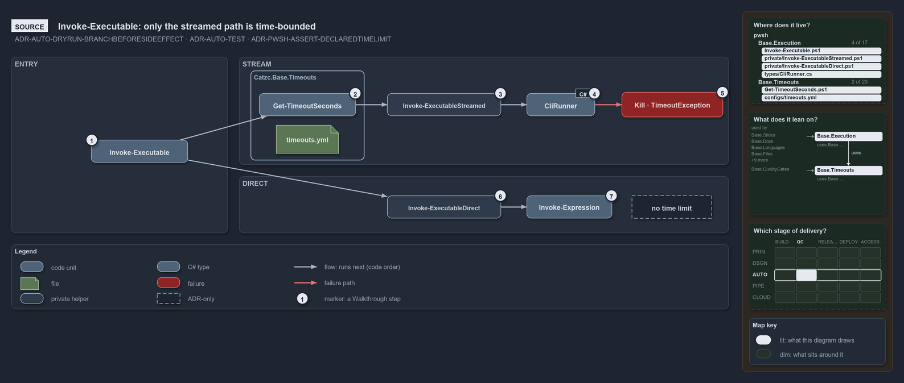

# Catzc.Base.Execution

The external-process boundary module. It **owns the complete lifecycle of running an external tool from PowerShell** — logging the exact
command before it executes (see [log-before-invoke](../../adr/automation/log-before-invoke.md)), capturing separated standard output and
error through the native `CliRunner` C# type (see [native-csharp-types](../../adr/automation/BCL/native-csharp-types.md)), managing the
exit-code boundary so a stale code can never leak across a call, and returning a structured `CliResult` when the caller needs to inspect
output programmatically. It also locates an executable and confirms its version before anything runs it, so a caller runs a managed tool by
its path and never by a bare name. Every CLI wrapper in the platform funnels through this module; no feature module ever spawns a process
directly. It is a member of the `Base` group alongside [Catzc.Base.Writers](catzc-base-writers.md),
[Catzc.Base.Repository](catzc-base-repository.md), and [Catzc.Base.Asserts](catzc-base-asserts.md).

## Responsibilities

| Responsibility   | Area      | Name                                                                       |
| ---------------- | --------- | -------------------------------------------------------------------------- |
| responsibility:1 | execution | [External process execution](#responsibility1--external-process-execution) |
| responsibility:2 | location  | [Executable location](#responsibility2--executable-location)               |
| responsibility:3 | exit-code | [Exit-code lifecycle](#responsibility3--exit-code-lifecycle)               |

### responsibility:1 — External process execution

How an external process is run. One wrapper owns the whole invocation lifecycle: it logs the exact command before it runs (see
[log-before-invoke](../../adr/automation/log-before-invoke.md)), captures separated standard output and error via the native `CliRunner`
type, resets and re-checks the exit code so a stale code can never leak across a call boundary, and supports a dry-run mode that returns the
command string instead of executing it — giving callers a testable, side-effect-free path through the same code. When a call is expected to
run long, a companion function wraps it with a liveness indicator. The `-PassThru` switch returns a `CliResult` object that separates stdout
from stderr for callers that need to inspect output programmatically, and `-AsBytes` returns stdout as its exact bytes for a binary stream
such as `git cat-file --batch`. Every run is bounded twice: a process that outlives its time limit is killed with its whole tree, and a
process that exits while something it started still holds its output open fails at once with an error that names the cause, instead of
hanging for that holder's lifetime.

### responsibility:2 — Executable location

Where an executable is and which version it is, answered cheaply and timed. The locate step starts no process: the first existing candidate
path wins, then PATH, and an excluded path never counts (for bash on Windows, the WSL launcher). Only a located executable runs its version
command, once per executable file per session (a lazy cache entry keyed by its path and last write time, see
[script-scope-caching](../../adr/pwsh/script-scope-caching.md)), so a reinstall is seen on the next check. The answer is one record: found,
path, method, version against the required one, the two timings, and the session actor. For a tool declared in `tools.yml`, the module reads
the entry itself — the candidates for the running platform and run environment, the exclusions, the version command and pin, and the devbox
version lever outside a pipeline — so a Base module locates a managed tool without depending on the tooling modules. The module owns
`tools.yml` and its `ToolsConfig`/`ToolConfig` types: the module furthest down the stack that reads the lock file owns it, so every bundle
that can run a process can also resolve the tools it runs. An execution engine's executable is located the way the engine model says
([ADR-AUTO-ENGINE](../../adr/automation/execution-engines.md)): pwsh beside the running PowerShell, never through PATH, and bash through its
`tools.yml` entry.

### responsibility:3 — Exit-code lifecycle

How the exit-code boundary is managed. `$LASTEXITCODE` in PowerShell is global and mutable: a prior external command can leave a non-zero
code that the next call inherits. This responsibility provides the two primitives the execution responsibility relies on internally, and
that any caller can use when orchestrating multiple commands: read the current code and reset it to a known state before a new invocation.
Together they are the mechanism that keeps each `Invoke-Executable` call exit-code-clean regardless of what ran before it.

## What the module does

The module is the platform's external-process boundary, and it is built around one invariant: before any tool runs, its full command is
logged. That rule — from [log-before-invoke](../../adr/automation/log-before-invoke.md) — means a failing run is always diagnosable from the
log alone, without reconstructing what was called. `Invoke-Executable` enforces it unconditionally; `Invoke-WithProgress` inherits it by
delegating there.

The process-running machinery lives in the native C# type `Catzc.Base.Execution.CliRunner` (see
[native-csharp-types](../../adr/automation/BCL/native-csharp-types.md)). `CliRunner` is what actually spawns the subprocess and captures its
streams; `Invoke-Executable` is the PowerShell wrapper that adds logging, exit-code hygiene, and dry-run. When the caller passes
`-PassThru`, the result comes back as `Catzc.Base.Execution.CliResult` — a typed object with separated `.Stdout` and `.Stderr` properties
rather than a mixed output stream. Feature module wrappers such as `Invoke-AzCli` use `-PassThru` when they need to parse tool output; plain
script calls omit it and let the streams flow through.

Executable location sits in front of execution. The generic check takes plain inputs and returns the `Catzc.Base.Execution.ExecutableProbe`
record; its version run goes through `Invoke-Executable` like any other process start. The tools.yml reading on top of it is global config
access, never guarded by module dependencies (see [module-config-loading](../../adr/configuration/module-config-loading.md)), which is what
lets the tooling modules' presence checks ([Catzc.Tooling.Core](catzc-tooling-core.md)) and the Base modules share one record and one
reading of an entry.

The exit-code responsibility (responsibility 3) is a supporting mechanism. `$LASTEXITCODE` is shared state: any external command can leave a
non-zero code behind. `Reset-LastExitCode` gives the invocation responsibility — and any caller that orchestrates a sequence of external
commands — explicit control over that boundary. `Invoke-Executable` always resets before it runs and checks after; callers that compose
multiple calls can use the same primitives to do the same.

The module depends on [Catzc.Base.Writers](catzc-base-writers.md) for the pre-invocation log line,
[Catzc.Base.Repository](catzc-base-repository.md) for the run environment and the session actor, and
[Catzc.Base.Asserts](catzc-base-asserts.md) for argument validation. Its one configuration file is `tools.yml`, the tool lock file the
tooling modules read as well.

The diagram below draws process invocation from the source. It has two paths. The default streamed path runs through the C# runner under the
executable's time limit from `timeouts.yml`, and kills the process tree when the limit runs out. The direct path, for interactive use, hands
the command to the console with no time limit. Its [description](.assets/invoke-executable-two-paths-one-bounded/diagram.drawio.md) walks it
step by step.

## Division

The module's public functions, sorted into the responsibilities above.

| Responsibility                                | Function                   |
| --------------------------------------------- | -------------------------- |
| responsibility:1 — External process execution | `Invoke-Executable`        |
|                                               | `Invoke-WithProgress`      |
| responsibility:2 — Executable location        | `Find-Executable`          |
|                                               | `Resolve-ToolExecutable`   |
|                                               | `Resolve-EngineExecutable` |
| config                                        | `tools.yml`                |
| responsibility:3 — Exit-code lifecycle        | `Reset-LastExitCode`       |
