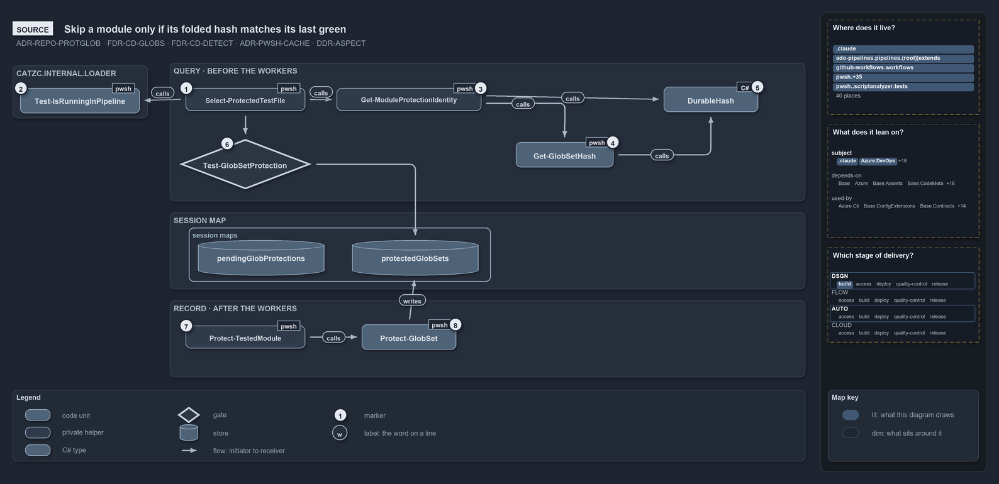

---
catzc:
  warning: "Header is generated by Format-FileMeta via Format-Code; do not change it"
  edges:
    cites:
      - ADR-AUTO-TEST-QUALITYGATE
      - FDR-CD-GLOBS-NOOVERLAPWITHINLAYER
    drs_total: 7
---

# Catzc.Base.Globs

The globset primitive: the single source of truth (`globs.yml`) mapping every deployable unit onto its files under version control, the
native path-filter projection that pipelines and workflows trigger on, the git-reflected "which areas of control did this change touch"
report, and the session-memory protection that skips a repeated local scan over an unchanged set. The governing decisions are
[durable-sha-globs](../../drs/flow/durable-sha-globs.md) and [protected-globs](../../drs/repository/protected-globs.md); the module owns the
glob dialect, the durable-SHA identity, the vendor projection, and the git-reflection query — pipelines carry generated registrations only,
never hand-authored source-path filters, and nothing is committed per set.

## Responsibilities

| Responsibility   | Area       | Name                                                                                       |
| ---------------- | ---------- | ------------------------------------------------------------------------------------------ |
| responsibility:1 | registry   | [The globset registry](#responsibility1--the-globset-registry)                             |
| responsibility:2 | identity   | [Membership and durable identity](#responsibility2--membership-and-durable-identity)       |
| responsibility:3 | triggers   | [Native triggers and git reflection](#responsibility3--native-triggers-and-git-reflection) |
| responsibility:4 | protection | [Protected scans](#responsibility4--protected-scans)                                       |

### responsibility:1 — The globset registry

Owning `configs/globs.yml` and its typed, strictly validated read: each globset is a kebab-case name, a description, a layer, include
patterns, and optional exclude patterns, compiled at load into `[Catzc.Base.Globs.GlobSet]` records (per-segment PowerShell wildcards, `**`
as the only cross-segment operator, case-sensitive). A layer is the kind of boundary the set maps: `deployable-unit` (a configurable unit
that ships) or `loose-fileset` (a cross-cutting surface — a track's root concern such as `automation`/`infrastructure`, a scan scope, the
whole-repository `repository` set, or a reserved umbrella); `module` (per-folder, with the `module-leftovers` catch-all) is derived from the
folders and never declared. Validation rejects unknown keys, malformed patterns, and cyclic or self-referential compose. Within every layer
but `loose-fileset` no two sets may overlap on their OWN contribution — a boundary never consumes a peer's files
(`FDR-CD-GLOBS-NOOVERLAPWITHINLAYER`); loose-filesets overlap the boundaries they cut across by design.

### responsibility:2 — Membership and durable identity

Resolving a globset to its actual members — the tracked-file universe (`git ls-files`) intersected with the set's membership, ordinally
sorted — and computing the durable SHA over them: per file, SHA-256 of the CR-stripped bytes; folded as `<path>|<digest>` lines; one
combined SHA-256. The identity is EOL-insensitive and rename-sensitive, computed live and never committed: it is the cross-machine identity
the session-memory protection map keys on (responsibility:4), not a trigger and not a committed artifact. Membership also answers what a
file is: its kind (its role, and a subkind where it has one) is the first entry of the file-kinds registry whose globs it matches.

### responsibility:3 — Native triggers and git reflection

The two derivations that replace a committed per-set marker. The **projection** renders a globset's flattened scan program into each
vendor's native path-filter dialect — GitHub `on.*.paths` with ordered `!` negation (exact), Azure DevOps `trigger.paths.include`/`exclude`
and branch-policy `filenamePatterns` (order-independent, last-select-per-pattern) — so a pipeline triggers, or does not start at all, on the
real files. Quality gates ([ADR-AUTO-TEST-QUALITYGATE](../../drs/automation/test-automation.md#rule-adr-auto-test-qualitygate)) guard the
projection: the drift quality gates compare each ADO pipeline's or GitHub workflow's declared trigger to the projection and report one issue
per drifted or missing pipeline, and the coverage quality gate confirms every member of a pipeline-bound set matches an ADO include pattern,
so an include-only trigger can never under-trigger. The **git reflection** answers "did this change touch the unit?" from git at the real
refs: it diffs a commit range (resolving the reference commit per context — post-commit first-parent `HEAD^1..HEAD`, PR merge-base, or local
working tree) and matches the changed paths against the registry, the same computation the in-pipeline "stop, nothing here for us" early
exit and the PR area-of-control report use. Because it reads the merged tree as it actually is, it is immune to squash-merge and
concurrent-merge staleness and correct across renames.

### responsibility:4 — Protected scans

The session-memory skip for heavy read-only scans: a (test, scope) key holds the durable identity of the last green run; a scope that has
not changed answers "protected" and the scan is skipped. Recording happens only after a green run, on the identity computed before the scan,
and in a pipeline the whole mechanism is ignored — CI always scans full. Every globset — the **declared** registry (responsibility:1) and
the **derived** sets the registry never lists (one per module folder by convention, one per internal `.psm1` module, the reserved infra
umbrellas `internal`/`vendor`/`compiled`/`scriptanalyzer`, and the `module-leftovers` catch-all) — scopes protection and blast-radius
through the same `Matches()` machinery, with nothing committed per set. The derived sets double as the building blocks `Test-Automation`
composes into per-module protection identities.

## What the module does

One configuration point defines what each deployable unit _is_; everything else derives. Because the identity and membership are pure
functions of tracked bytes, the module serves three consumers from one dialect: the native projection ADO and GitHub path filters trigger on
(generated, drift-checked), the git-reflected area-of-control the PR report and the in-pipeline early exit read, and the in-session
protection map that spares the local inner loop repeated proof. None of them parses vendor glob dialects — matching happens here, once,
against `git ls-files` — and none commits a per-set artifact, so a busy mainline never goes red from a stale marker.

The module sits in the Base cluster and stays primitive: it knows nothing about pipelines, Pester, or the scans it protects.
`Catzc.Base.QualityGates` consumes it from above (the trigger-drift and protected integrity tests); the pipeline YAML consumes its
projection from outside (generated `paths:` registrations).

The diagram below draws module protection from the source, as the test runner uses it. A module's tests are skipped only when its folded
globset hash matches the hash recorded after its last green run in this session. The hash is held as pending before the workers run and
promoted only after a green result. In a pipeline nothing is skipped.

```yml drawio
description:
  Before the workers start, a module's globset hashes fold into one identity that is compared with the identity recorded after its last
  green run; a match skips the module, the asked identity is held as pending, and a green result promotes it afterwards.
about:
  adrs: [ADR-REPO-PROTGLOB, FDR-CD-GLOBS, FDR-CD-DETECT, ADR-PWSH-CACHE, DDR-ASPECT]
  lens: source
content:
  title: Skip a module only if its folded hash matches its last green
  kind: reference
  flow: left-to-right
  relation: calls
  theme: dark
  bands:
    - { id: band-loader, label: CATZC.INTERNAL.LOADER }
    - { id: band-query, label: QUERY · BEFORE THE WORKERS }
    - { id: band-session, label: SESSION MAP }
    - { id: band-record, label: RECORD · AFTER THE WORKERS }
  groups:
    - { id: grp-session, label: session maps, in: band-session }
  glyphs:
    - { id: g-pipeline, kind: code, label: Test-IsRunningInPipeline, in: band-loader }
    - { id: g-select, kind: private, label: Select-ProtectedTestFile, in: band-query }
    - { id: g-identity, kind: private, label: Get-ModuleProtectionIdentity, in: band-query }
    - { id: g-glob-hash, kind: code, label: Get-GlobSetHash, in: band-query }
    - { id: t-durable, kind: type, label: DurableHash, in: band-query }
    - { id: g-protection, kind: gate, label: Test-GlobSetProtection, in: band-query }
    - { id: s-pending, kind: store, label: pendingGlobProtections, in: grp-session }
    - { id: s-protected, kind: store, label: protectedGlobSets, in: grp-session }
    - { id: g-tested, kind: private, label: Protect-TestedModule, in: band-record }
    - { id: g-protect, kind: code, label: Protect-GlobSet, in: band-record }
  edges:
    - { from: g-select, to: g-pipeline, kind: flow, label: "" }
    - { from: g-select, to: g-identity, kind: flow, label: "" }
    - { from: g-identity, to: g-glob-hash, kind: flow, label: "" }
    - { from: g-glob-hash, to: t-durable, kind: flow, label: "" }
    - { from: g-identity, to: t-durable, kind: flow, label: "" }
    - { from: g-select, to: g-protection, kind: flow, label: "" }
    - { from: g-protection, to: s-protected, kind: flow, label: "" }
    - { from: g-tested, to: g-protect, kind: flow, label: "" }
    - { from: g-protect, to: s-protected, kind: flow, label: "" }
  markers:
    - { at: g-select, number: 1 }
    - { at: g-pipeline, number: 2 }
    - { at: g-identity, number: 3 }
    - { at: g-glob-hash, number: 4 }
    - { at: t-durable, number: 5 }
    - { at: g-protection, number: 6 }
    - { at: g-tested, number: 7 }
    - { at: g-protect, number: 8 }
  legend: auto
  minimaps:
    code-locations:
      - cell: .claude/.claude/.
        by: [.claude/CLAUDE.md, FDR-CD-DETECT, FDR-CD-GLOBS]
      - cell: ado-pipelines/pipelines/.
        by:
          - .ado/pipelines/cd-apex.yaml
          - .ado/pipelines/cd-flux.yaml
          - .ado/pipelines/cd-nova.yaml
          - .ado/pipelines/cd-shared.yaml
          - .ado/pipelines/ci-infrastructure.yaml
          - .ado/pipelines/ci-pwsh.yaml
          - FDR-CD-GLOBS
      - cell: ado-pipelines/pipelines/extends
        by: [.ado/pipelines/extends/cd-customer.yaml, FDR-CD-GLOBS]
      - cell: docs/-/.
        by:
          - docs/drs/automation/pwsh/dora-explains.md
          - docs/drs/automation/pwsh/script-scope-caching.md
          - docs/drs/design/dora-explains.md
          - docs/drs/design/module-aspects.md
          - docs/drs/flow/dora-explains.md
          - docs/drs/flow/durable-sha-globs.md
          - docs/drs/flow/pipeline-detection.md
          - docs/drs/index.md
          - docs/drs/repository/dora-explains.md
          - docs/drs/repository/protected-globs.md
          - docs/how-to/automation/apply-environment-approvals.md
          - docs/how-to/pwsh/manual-test-plan/pipelines-and-globs.md
          - docs/references/ado/pipelines/cd-apex.yaml.md
          - docs/references/ado/pipelines/cd-flux.yaml.md
          - docs/references/ado/pipelines/cd-nova.yaml.md
          - docs/references/ado/pipelines/cd-shared.yaml.md
          - docs/references/ado/pipelines/ci-infrastructure.yaml.md
          - docs/references/ado/pipelines/ci-pwsh.yaml.md
          - docs/references/github/workflows/ci-pwsh.yml.md
          - docs/references/pwsh/catzc-azure-dev-ops-build-validation/Get-AdoBuildValidations.ps1.md
          - docs/references/pwsh/catzc-azure-dev-ops-build-validation/Register-AdoBuildValidation.ps1.md
          - docs/references/pwsh/catzc-azure-dev-ops-build-validation/Unregister-AdoBuildValidation.ps1.md
          - docs/references/pwsh/catzc-azure-dev-ops-build-validation/configs/build-validation.yml.md
          - docs/references/pwsh/catzc-azure-dev-ops-build-validation/private/Get-BuildValidationPathFilter.ps1.md
          - docs/references/pwsh/catzc-azure-dev-ops/Sync-AdoEnvironmentApprovals.ps1.md
          - docs/references/pwsh/catzc-azure-templates/Get-BicepDeploymentName.ps1.md
          - docs/references/pwsh/catzc-azure-templates/Get-BicepTemplates.ps1.md
          - docs/references/pwsh/catzc-base-config/Get-Config.ps1.md
          - docs/references/pwsh/catzc-base-config/private/Get-ConfigOverlayRoot.ps1.md
          - docs/references/pwsh/catzc-base-config/private/Get-ConfigRegistry.ps1.md
          - docs/references/pwsh/catzc-base-config/private/Resolve-ConfigEntry.ps1.md
          - docs/references/pwsh/catzc-base-docs/Get-Glossary.ps1.md
          - docs/references/pwsh/catzc-base-docs/private/Get-CatsRuleEnforcers.ps1.md
          - docs/references/pwsh/catzc-base-drs/Get-CatsDrsIndex.ps1.md
          - docs/references/pwsh/catzc-base-drs/Get-CatsDrsRuleIds.ps1.md
          - docs/references/pwsh/catzc-base-drs/Get-DrsCitationMap.ps1.md
          - docs/references/pwsh/catzc-base-drs/types/DrsConfig.cs.md
          - docs/references/pwsh/catzc-base-execution/Find-Executable.ps1.md
          - docs/references/pwsh/catzc-base-exporter/Get-CatzcContentHash.ps1.md
          - docs/references/pwsh/catzc-base-files/Get-GitTrackedPath.ps1.md
          - docs/references/pwsh/catzc-base-globs.md
          - docs/references/pwsh/catzc-base-globs/Clear-GlobSetProtection.ps1.md
          - docs/references/pwsh/catzc-base-globs/Get-ChangedGlobSet.ps1.md
          - docs/references/pwsh/catzc-base-globs/Get-GlobSet.ps1.md
          - docs/references/pwsh/catzc-base-globs/Get-GlobSetChangeRange.ps1.md
          - docs/references/pwsh/catzc-base-globs/Get-GlobSetFile.ps1.md
          - docs/references/pwsh/catzc-base-globs/Get-GlobSetHash.ps1.md
          - docs/references/pwsh/catzc-base-globs/Get-GlobSetTrigger.ps1.md
          - docs/references/pwsh/catzc-base-globs/Get-MarkerBlastRadius.ps1.md
          - docs/references/pwsh/catzc-base-globs/Get-ModuleGlobSet.ps1.md
          - docs/references/pwsh/catzc-base-globs/Get-TrackedFile.ps1.md
          - docs/references/pwsh/catzc-base-globs/Protect-GlobSet.ps1.md
          - docs/references/pwsh/catzc-base-globs/Test-AdoPipelineTriggerGlob.ps1.md
          - docs/references/pwsh/catzc-base-globs/Test-GitHubWorkflowTriggerGlob.ps1.md
          - docs/references/pwsh/catzc-base-globs/Test-GlobSetAffected.ps1.md
          - docs/references/pwsh/catzc-base-globs/Test-GlobSetIndependence.ps1.md
          - docs/references/pwsh/catzc-base-globs/Test-GlobSetProtection.ps1.md
          - docs/references/pwsh/catzc-base-globs/Test-GlobSetTriggerCoverage.ps1.md
          - docs/references/pwsh/catzc-base-globs/configs/globs.yml.md
          - docs/references/pwsh/catzc-base-globs/private/Get-ChangedFile.ps1.md
          - docs/references/pwsh/catzc-base-globs/private/Get-GlobSetMember.ps1.md
          - docs/references/pwsh/catzc-base-globs/private/Get-PipelineTrigger.ps1.md
          - docs/references/pwsh/catzc-base-globs/private/Test-GlobListEqual.ps1.md
          - docs/references/pwsh/catzc-base-globs/tests/Get-ChangedFile.Tests.ps1.md
          - docs/references/pwsh/catzc-base-globs/tests/Get-ChangedGlobSet.Tests.ps1.md
          - docs/references/pwsh/catzc-base-globs/tests/Get-GlobSetChangeRange.Tests.ps1.md
          - docs/references/pwsh/catzc-base-globs/tests/Get-GlobSetFile.Tests.ps1.md
          - docs/references/pwsh/catzc-base-globs/tests/Get-GlobSetHash.Tests.ps1.md
          - docs/references/pwsh/catzc-base-globs/tests/Get-GlobSetMember.Tests.ps1.md
          - docs/references/pwsh/catzc-base-globs/tests/Get-GlobSetTrigger.Tests.ps1.md
          - docs/references/pwsh/catzc-base-globs/tests/Get-ModuleGlobSet.Tests.ps1.md
          - docs/references/pwsh/catzc-base-globs/tests/Get-PipelineTrigger.Tests.ps1.md
          - docs/references/pwsh/catzc-base-globs/tests/Get-TrackedFile.Tests.ps1.md
          - docs/references/pwsh/catzc-base-globs/tests/GlobSet-Independence.Tests.ps1.md
          - docs/references/pwsh/catzc-base-globs/tests/GlobSetTrigger-Coverage.Tests.ps1.md
          - docs/references/pwsh/catzc-base-globs/tests/PipelineTrigger-Integrity.Tests.ps1.md
          - docs/references/pwsh/catzc-base-globs/tests/Test-GlobSetAffected.Tests.ps1.md
          - docs/references/pwsh/catzc-base-globs/tests/Test-GlobSetIndependence.Tests.ps1.md
          - docs/references/pwsh/catzc-base-globs/tests/Test-GlobSetProtection.Tests.ps1.md
          - docs/references/pwsh/catzc-base-globs/tests/types/Aspect.Tests.ps1.md
          - docs/references/pwsh/catzc-base-globs/tests/types/GlobPattern.Tests.ps1.md
          - docs/references/pwsh/catzc-base-globs/tests/types/GlobSet.Tests.ps1.md
          - docs/references/pwsh/catzc-base-globs/tests/types/GlobsConfig.Tests.ps1.md
          - docs/references/pwsh/catzc-base-globs/types/Aspect.cs.md
          - docs/references/pwsh/catzc-base-globs/types/DurableHash.cs.md
          - docs/references/pwsh/catzc-base-globs/types/GlobPattern.cs.md
          - docs/references/pwsh/catzc-base-globs/types/GlobSet.cs.md
          - docs/references/pwsh/catzc-base-globs/types/GlobsConfig.cs.md
          - docs/references/pwsh/catzc-base-maps/Get-LifecyclePositionMinimapData.ps1.md
          - docs/references/pwsh/catzc-base-maps/Get-ValueChainHighlight.ps1.md
          - docs/references/pwsh/catzc-base-maps/Get-WorldMap.ps1.md
          - docs/references/pwsh/catzc-base-maps/Get-WorldMapHighlight.ps1.md
          - docs/references/pwsh/catzc-base-module-system/Get-FunctionDependency.ps1.md
          - docs/references/pwsh/catzc-base-modules/Get-Aspect.ps1.md
          - docs/references/pwsh/catzc-base-quality-gates/Test-Automation.ps1.md
          - docs/references/pwsh/catzc-base-quality-gates/Test-ManagedGuids.ps1.md
          - docs/references/pwsh/catzc-base-quality-gates/private/Get-GuidScanFiles.ps1.md
          - docs/references/pwsh/catzc-base-quality-gates/private/Get-ModuleProtectionIdentity.ps1.md
          - docs/references/pwsh/catzc-base-quality-gates/private/Get-TestFileModule.ps1.md
          - docs/references/pwsh/catzc-base-quality-gates/private/Invoke-TestRun.ps1.md
          - docs/references/pwsh/catzc-base-quality-gates/private/Protect-TestedModule.ps1.md
          - docs/references/pwsh/catzc-base-quality-gates/private/Resolve-TestSuite.ps1.md
          - docs/references/pwsh/catzc-base-quality-gates/private/Select-ProtectedTestFile.ps1.md
          - docs/references/pwsh/catzc-base-quality-gates/tests/Get-ModuleProtectionIdentity.Tests.ps1.md
          - docs/references/pwsh/catzc-base-quality-gates/tests/Get-RepositoryGuids.Tests.ps1.md
          - docs/references/pwsh/catzc-base-quality-gates/tests/Test-Markdownlint.Tests.ps1.md
          - docs/references/pwsh/catzc-base-quality-gates/tests/Test-Spelling.Tests.ps1.md
          - docs/references/pwsh/catzc-base-variants/configs/variants.yml.md
          - docs/references/pwsh/catzc-base-variants/types/VariantAspect.cs.md
          - docs/references/pwsh/catzc-base-variants/types/VariantsConfig.cs.md
          - docs/references/pwsh/catzc-tooling-core/private/Assert-ToolVersion.ps1.md
          - ADR-PWSH-CACHE
          - ADR-REPO-PROTGLOB
          - DDR-ASPECT
          - FDR-CD-DETECT
          - FDR-CD-GLOBS
      - cell: github-workflows/workflows/.
        by: [.github/workflows/ci-pwsh.yml, FDR-CD-GLOBS]
      - cell: pwsh/-/.
        by: [pwsh/.scriptanalyzer/tests/NoBareCacheEntryRead.Tests.ps1, ADR-PWSH-CACHE]
      - cell: pwsh/Catzc.Azure.DevOps/.
        by: [pwsh/Catzc.Azure.DevOps/Sync-AdoEnvironmentApprovals.ps1, FDR-CD-DETECT, FDR-CD-GLOBS]
      - cell: pwsh/Catzc.Azure.DevOps.BuildValidation/.
        by:
          - pwsh/Catzc.Azure.DevOps.BuildValidation/Get-AdoBuildValidations.ps1
          - pwsh/Catzc.Azure.DevOps.BuildValidation/Register-AdoBuildValidation.ps1
          - pwsh/Catzc.Azure.DevOps.BuildValidation/Unregister-AdoBuildValidation.ps1
          - FDR-CD-GLOBS
      - cell: pwsh/Catzc.Azure.DevOps.BuildValidation/configs
        by: [pwsh/Catzc.Azure.DevOps.BuildValidation/configs/build-validation.yml, FDR-CD-GLOBS]
      - cell: pwsh/Catzc.Azure.DevOps.BuildValidation/private
        by: [pwsh/Catzc.Azure.DevOps.BuildValidation/private/Get-BuildValidationPathFilter.ps1, FDR-CD-GLOBS]
      - cell: pwsh/Catzc.Azure.Templates/.
        by:
          - pwsh/Catzc.Azure.Templates/Get-BicepDeploymentName.ps1
          - pwsh/Catzc.Azure.Templates/Get-BicepTemplates.ps1
          - ADR-PWSH-CACHE
          - FDR-CD-DETECT
      - cell: pwsh/Catzc.Base.Config/.
        by: [pwsh/Catzc.Base.Config/Get-Config.ps1, ADR-PWSH-CACHE]
      - cell: pwsh/Catzc.Base.Config/private
        by:
          - pwsh/Catzc.Base.Config/private/Get-ConfigOverlayRoot.ps1
          - pwsh/Catzc.Base.Config/private/Get-ConfigRegistry.ps1
          - pwsh/Catzc.Base.Config/private/Resolve-ConfigEntry.ps1
          - ADR-PWSH-CACHE
      - cell: pwsh/Catzc.Base.Docs/.
        by: [pwsh/Catzc.Base.Docs/Get-Glossary.ps1, ADR-PWSH-CACHE]
      - cell: pwsh/Catzc.Base.Docs/private
        by: [pwsh/Catzc.Base.Docs/private/Get-CatsRuleEnforcers.ps1, ADR-PWSH-CACHE]
      - cell: pwsh/Catzc.Base.Drs/.
        by:
          - pwsh/Catzc.Base.Drs/Get-CatsDrsIndex.ps1
          - pwsh/Catzc.Base.Drs/Get-CatsDrsRuleIds.ps1
          - pwsh/Catzc.Base.Drs/Get-DrsCitationMap.ps1
          - ADR-PWSH-CACHE
      - cell: pwsh/Catzc.Base.Drs/configs
        by: [pwsh/Catzc.Base.Drs/configs/drs.yml, ADR-PWSH-CACHE, ADR-REPO-PROTGLOB, DDR-ASPECT, FDR-CD-DETECT, FDR-CD-GLOBS]
      - cell: pwsh/Catzc.Base.Drs/types
        by: [pwsh/Catzc.Base.Drs/types/DrsConfig.cs, FDR-CD-DETECT, FDR-CD-GLOBS]
      - cell: pwsh/Catzc.Base.Execution/.
        by: [pwsh/Catzc.Base.Execution/Find-Executable.ps1, ADR-PWSH-CACHE]
      - cell: pwsh/Catzc.Base.Exporter/.
        by: [pwsh/Catzc.Base.Exporter/Get-CatzcContentHash.ps1, FDR-CD-GLOBS]
      - cell: pwsh/Catzc.Base.Files/.
        by: [pwsh/Catzc.Base.Files/Get-GitTrackedPath.ps1, ADR-PWSH-CACHE]
      - cell: pwsh/Catzc.Base.Globs/.
        by:
          - pwsh/Catzc.Base.Globs/Clear-GlobSetProtection.ps1
          - pwsh/Catzc.Base.Globs/Get-ChangedGlobSet.ps1
          - pwsh/Catzc.Base.Globs/Get-GlobSet.ps1
          - pwsh/Catzc.Base.Globs/Get-GlobSetChangeRange.ps1
          - pwsh/Catzc.Base.Globs/Get-GlobSetFile.ps1
          - pwsh/Catzc.Base.Globs/Get-GlobSetHash.ps1
          - pwsh/Catzc.Base.Globs/Get-GlobSetTrigger.ps1
          - pwsh/Catzc.Base.Globs/Get-MarkerBlastRadius.ps1
          - pwsh/Catzc.Base.Globs/Get-ModuleGlobSet.ps1
          - pwsh/Catzc.Base.Globs/Get-TrackedFile.ps1
          - pwsh/Catzc.Base.Globs/Protect-GlobSet.ps1
          - pwsh/Catzc.Base.Globs/Test-AdoPipelineTriggerGlob.ps1
          - pwsh/Catzc.Base.Globs/Test-GitHubWorkflowTriggerGlob.ps1
          - pwsh/Catzc.Base.Globs/Test-GlobSetAffected.ps1
          - pwsh/Catzc.Base.Globs/Test-GlobSetIndependence.ps1
          - pwsh/Catzc.Base.Globs/Test-GlobSetProtection.ps1
          - pwsh/Catzc.Base.Globs/Test-GlobSetTriggerCoverage.ps1
          - ADR-PWSH-CACHE
          - ADR-REPO-PROTGLOB
          - DDR-ASPECT
          - FDR-CD-DETECT
          - FDR-CD-GLOBS
      - cell: pwsh/Catzc.Base.Globs/configs
        by: [pwsh/Catzc.Base.Globs/configs/globs.yml, ADR-REPO-PROTGLOB, FDR-CD-GLOBS]
      - cell: pwsh/Catzc.Base.Globs/private
        by:
          - pwsh/Catzc.Base.Globs/private/Get-ChangedFile.ps1
          - pwsh/Catzc.Base.Globs/private/Get-GlobSetMember.ps1
          - pwsh/Catzc.Base.Globs/private/Get-PipelineTrigger.ps1
          - pwsh/Catzc.Base.Globs/private/Test-GlobListEqual.ps1
          - FDR-CD-GLOBS
      - cell: pwsh/Catzc.Base.Globs/tests
        by:
          - pwsh/Catzc.Base.Globs/tests/Get-ChangedFile.Tests.ps1
          - pwsh/Catzc.Base.Globs/tests/Get-ChangedGlobSet.Tests.ps1
          - pwsh/Catzc.Base.Globs/tests/Get-GlobSetChangeRange.Tests.ps1
          - pwsh/Catzc.Base.Globs/tests/Get-GlobSetFile.Tests.ps1
          - pwsh/Catzc.Base.Globs/tests/Get-GlobSetHash.Tests.ps1
          - pwsh/Catzc.Base.Globs/tests/Get-GlobSetMember.Tests.ps1
          - pwsh/Catzc.Base.Globs/tests/Get-GlobSetTrigger.Tests.ps1
          - pwsh/Catzc.Base.Globs/tests/Get-ModuleGlobSet.Tests.ps1
          - pwsh/Catzc.Base.Globs/tests/Get-PipelineTrigger.Tests.ps1
          - pwsh/Catzc.Base.Globs/tests/Get-TrackedFile.Tests.ps1
          - pwsh/Catzc.Base.Globs/tests/GlobSet-Independence.Tests.ps1
          - pwsh/Catzc.Base.Globs/tests/GlobSetTrigger-Coverage.Tests.ps1
          - pwsh/Catzc.Base.Globs/tests/PipelineTrigger-Integrity.Tests.ps1
          - pwsh/Catzc.Base.Globs/tests/Test-GlobSetAffected.Tests.ps1
          - pwsh/Catzc.Base.Globs/tests/Test-GlobSetIndependence.Tests.ps1
          - pwsh/Catzc.Base.Globs/tests/Test-GlobSetProtection.Tests.ps1
          - ADR-REPO-PROTGLOB
          - DDR-ASPECT
          - FDR-CD-DETECT
          - FDR-CD-GLOBS
      - cell: pwsh/Catzc.Base.Globs/tests/types
        by:
          - pwsh/Catzc.Base.Globs/tests/types/Aspect.Tests.ps1
          - pwsh/Catzc.Base.Globs/tests/types/GlobPattern.Tests.ps1
          - pwsh/Catzc.Base.Globs/tests/types/GlobSet.Tests.ps1
          - pwsh/Catzc.Base.Globs/tests/types/GlobsConfig.Tests.ps1
          - DDR-ASPECT
          - FDR-CD-GLOBS
      - cell: pwsh/Catzc.Base.Globs/types
        by:
          - pwsh/Catzc.Base.Globs/types/Aspect.cs
          - pwsh/Catzc.Base.Globs/types/DurableHash.cs
          - pwsh/Catzc.Base.Globs/types/GlobPattern.cs
          - pwsh/Catzc.Base.Globs/types/GlobSet.cs
          - pwsh/Catzc.Base.Globs/types/GlobsConfig.cs
          - ADR-REPO-PROTGLOB
          - DDR-ASPECT
          - FDR-CD-GLOBS
      - cell: pwsh/Catzc.Base.Maps/.
        by:
          - pwsh/Catzc.Base.Maps/Get-LifecyclePositionMinimapData.ps1
          - pwsh/Catzc.Base.Maps/Get-ValueChainHighlight.ps1
          - pwsh/Catzc.Base.Maps/Get-WorldMap.ps1
          - pwsh/Catzc.Base.Maps/Get-WorldMapHighlight.ps1
          - ADR-PWSH-CACHE
          - FDR-CD-DETECT
          - FDR-CD-GLOBS
      - cell: pwsh/Catzc.Base.Maps/tests
        by: [pwsh/Catzc.Base.Maps/tests/Get-WorldMapHighlight.Tests.ps1, FDR-CD-DETECT, FDR-CD-GLOBS]
      - cell: pwsh/Catzc.Base.Modules/.
        by: [pwsh/Catzc.Base.Modules/Get-Aspect.ps1, DDR-ASPECT]
      - cell: pwsh/Catzc.Base.Modules/tests
        by: [pwsh/Catzc.Base.Modules/tests/Get-Aspect.Tests.ps1, DDR-ASPECT]
      - cell: pwsh/Catzc.Base.ModuleSystem/.
        by: [pwsh/Catzc.Base.ModuleSystem/Get-FunctionDependency.ps1, ADR-PWSH-CACHE]
      - cell: pwsh/Catzc.Base.QualityGates/.
        by:
          - pwsh/Catzc.Base.QualityGates/Test-Automation.ps1
          - pwsh/Catzc.Base.QualityGates/Test-ManagedGuids.ps1
          - ADR-REPO-PROTGLOB
          - FDR-CD-GLOBS
      - cell: pwsh/Catzc.Base.QualityGates/configs
        by:
          - pwsh/Catzc.Base.QualityGates/configs/analyzer-drs-map.yml
          - pwsh/Catzc.Base.QualityGates/configs/terminology.yml
          - ADR-PWSH-CACHE
          - ADR-REPO-PROTGLOB
          - FDR-CD-DETECT
          - FDR-CD-GLOBS
      - cell: pwsh/Catzc.Base.QualityGates/private
        by:
          - pwsh/Catzc.Base.QualityGates/private/Get-GuidScanFiles.ps1
          - pwsh/Catzc.Base.QualityGates/private/Get-ModuleProtectionIdentity.ps1
          - pwsh/Catzc.Base.QualityGates/private/Get-TestFileModule.ps1
          - pwsh/Catzc.Base.QualityGates/private/Invoke-TestRun.ps1
          - pwsh/Catzc.Base.QualityGates/private/Protect-TestedModule.ps1
          - pwsh/Catzc.Base.QualityGates/private/Resolve-TestSuite.ps1
          - pwsh/Catzc.Base.QualityGates/private/Select-ProtectedTestFile.ps1
          - ADR-REPO-PROTGLOB
          - DDR-ASPECT
          - FDR-CD-GLOBS
      - cell: pwsh/Catzc.Base.QualityGates/tests
        by:
          - pwsh/Catzc.Base.QualityGates/tests/Get-ModuleProtectionIdentity.Tests.ps1
          - pwsh/Catzc.Base.QualityGates/tests/Get-RepositoryGuids.Tests.ps1
          - pwsh/Catzc.Base.QualityGates/tests/Test-Markdownlint.Tests.ps1
          - pwsh/Catzc.Base.QualityGates/tests/Test-Spelling.Tests.ps1
          - ADR-REPO-PROTGLOB
      - cell: pwsh/Catzc.Base.Variants/configs
        by: [pwsh/Catzc.Base.Variants/configs/variants.yml, DDR-ASPECT]
      - cell: pwsh/Catzc.Base.Variants/types
        by: [pwsh/Catzc.Base.Variants/types/VariantAspect.cs, pwsh/Catzc.Base.Variants/types/VariantsConfig.cs, DDR-ASPECT]
      - cell: pwsh/Catzc.Internal.Tests/.
        by: [pwsh/.internal/tests/Write-LoadTime.Tests.ps1, ADR-PWSH-CACHE]
      - cell: pwsh/Catzc.Tooling.Core/private
        by: [pwsh/Catzc.Tooling.Core/private/Assert-ToolVersion.ps1, ADR-PWSH-CACHE]
    module-neighbourhood:
      - cell: subject/.claude
        by: [.claude/CLAUDE.md, FDR-CD-DETECT, FDR-CD-GLOBS]
      - cell: subject/Catzc.Azure.DevOps
        by: [pwsh/Catzc.Azure.DevOps/Sync-AdoEnvironmentApprovals.ps1, FDR-CD-DETECT, FDR-CD-GLOBS]
      - cell: subject/Catzc.Azure.DevOps.BuildValidation
        by:
          - pwsh/Catzc.Azure.DevOps.BuildValidation/Get-AdoBuildValidations.ps1
          - pwsh/Catzc.Azure.DevOps.BuildValidation/Register-AdoBuildValidation.ps1
          - pwsh/Catzc.Azure.DevOps.BuildValidation/Unregister-AdoBuildValidation.ps1
          - pwsh/Catzc.Azure.DevOps.BuildValidation/configs/build-validation.yml
          - pwsh/Catzc.Azure.DevOps.BuildValidation/private/Get-BuildValidationPathFilter.ps1
          - FDR-CD-GLOBS
      - cell: subject/Catzc.Azure.Templates
        by:
          - pwsh/Catzc.Azure.Templates/Get-BicepDeploymentName.ps1
          - pwsh/Catzc.Azure.Templates/Get-BicepTemplates.ps1
          - ADR-PWSH-CACHE
          - FDR-CD-DETECT
      - cell: subject/Catzc.Base.Config
        by:
          - pwsh/Catzc.Base.Config/Get-Config.ps1
          - pwsh/Catzc.Base.Config/private/Get-ConfigOverlayRoot.ps1
          - pwsh/Catzc.Base.Config/private/Get-ConfigRegistry.ps1
          - pwsh/Catzc.Base.Config/private/Resolve-ConfigEntry.ps1
          - ADR-PWSH-CACHE
      - cell: subject/Catzc.Base.Docs
        by: [pwsh/Catzc.Base.Docs/Get-Glossary.ps1, pwsh/Catzc.Base.Docs/private/Get-CatsRuleEnforcers.ps1, ADR-PWSH-CACHE]
      - cell: subject/Catzc.Base.Drs
        by:
          - pwsh/Catzc.Base.Drs/Get-CatsDrsIndex.ps1
          - pwsh/Catzc.Base.Drs/Get-CatsDrsRuleIds.ps1
          - pwsh/Catzc.Base.Drs/Get-DrsCitationMap.ps1
          - pwsh/Catzc.Base.Drs/configs/drs.yml
          - pwsh/Catzc.Base.Drs/types/DrsConfig.cs
          - ADR-PWSH-CACHE
          - ADR-REPO-PROTGLOB
          - DDR-ASPECT
          - FDR-CD-DETECT
          - FDR-CD-GLOBS
      - cell: subject/Catzc.Base.Execution
        by: [pwsh/Catzc.Base.Execution/Find-Executable.ps1, ADR-PWSH-CACHE]
      - cell: subject/Catzc.Base.Exporter
        by: [pwsh/Catzc.Base.Exporter/Get-CatzcContentHash.ps1, FDR-CD-GLOBS]
      - cell: subject/Catzc.Base.Files
        by: [pwsh/Catzc.Base.Files/Get-GitTrackedPath.ps1, ADR-PWSH-CACHE]
      - cell: subject/Catzc.Base.Globs
        by:
          - pwsh/Catzc.Base.Globs/Clear-GlobSetProtection.ps1
          - pwsh/Catzc.Base.Globs/Get-ChangedGlobSet.ps1
          - pwsh/Catzc.Base.Globs/Get-GlobSet.ps1
          - pwsh/Catzc.Base.Globs/Get-GlobSetChangeRange.ps1
          - pwsh/Catzc.Base.Globs/Get-GlobSetFile.ps1
          - pwsh/Catzc.Base.Globs/Get-GlobSetHash.ps1
          - pwsh/Catzc.Base.Globs/Get-GlobSetTrigger.ps1
          - pwsh/Catzc.Base.Globs/Get-MarkerBlastRadius.ps1
          - pwsh/Catzc.Base.Globs/Get-ModuleGlobSet.ps1
          - pwsh/Catzc.Base.Globs/Get-TrackedFile.ps1
          - pwsh/Catzc.Base.Globs/Protect-GlobSet.ps1
          - pwsh/Catzc.Base.Globs/Test-AdoPipelineTriggerGlob.ps1
          - pwsh/Catzc.Base.Globs/Test-GitHubWorkflowTriggerGlob.ps1
          - pwsh/Catzc.Base.Globs/Test-GlobSetAffected.ps1
          - pwsh/Catzc.Base.Globs/Test-GlobSetIndependence.ps1
          - pwsh/Catzc.Base.Globs/Test-GlobSetProtection.ps1
          - pwsh/Catzc.Base.Globs/Test-GlobSetTriggerCoverage.ps1
          - pwsh/Catzc.Base.Globs/configs/globs.yml
          - pwsh/Catzc.Base.Globs/private/Get-ChangedFile.ps1
          - pwsh/Catzc.Base.Globs/private/Get-GlobSetMember.ps1
          - pwsh/Catzc.Base.Globs/private/Get-PipelineTrigger.ps1
          - pwsh/Catzc.Base.Globs/private/Test-GlobListEqual.ps1
          - pwsh/Catzc.Base.Globs/tests/Get-ChangedFile.Tests.ps1
          - pwsh/Catzc.Base.Globs/tests/Get-ChangedGlobSet.Tests.ps1
          - pwsh/Catzc.Base.Globs/tests/Get-GlobSetChangeRange.Tests.ps1
          - pwsh/Catzc.Base.Globs/tests/Get-GlobSetFile.Tests.ps1
          - pwsh/Catzc.Base.Globs/tests/Get-GlobSetHash.Tests.ps1
          - pwsh/Catzc.Base.Globs/tests/Get-GlobSetMember.Tests.ps1
          - pwsh/Catzc.Base.Globs/tests/Get-GlobSetTrigger.Tests.ps1
          - pwsh/Catzc.Base.Globs/tests/Get-ModuleGlobSet.Tests.ps1
          - pwsh/Catzc.Base.Globs/tests/Get-PipelineTrigger.Tests.ps1
          - pwsh/Catzc.Base.Globs/tests/Get-TrackedFile.Tests.ps1
          - pwsh/Catzc.Base.Globs/tests/GlobSet-Independence.Tests.ps1
          - pwsh/Catzc.Base.Globs/tests/GlobSetTrigger-Coverage.Tests.ps1
          - pwsh/Catzc.Base.Globs/tests/PipelineTrigger-Integrity.Tests.ps1
          - pwsh/Catzc.Base.Globs/tests/Test-GlobSetAffected.Tests.ps1
          - pwsh/Catzc.Base.Globs/tests/Test-GlobSetIndependence.Tests.ps1
          - pwsh/Catzc.Base.Globs/tests/Test-GlobSetProtection.Tests.ps1
          - pwsh/Catzc.Base.Globs/tests/types/Aspect.Tests.ps1
          - pwsh/Catzc.Base.Globs/tests/types/GlobPattern.Tests.ps1
          - pwsh/Catzc.Base.Globs/tests/types/GlobSet.Tests.ps1
          - pwsh/Catzc.Base.Globs/tests/types/GlobsConfig.Tests.ps1
          - pwsh/Catzc.Base.Globs/types/Aspect.cs
          - pwsh/Catzc.Base.Globs/types/DurableHash.cs
          - pwsh/Catzc.Base.Globs/types/GlobPattern.cs
          - pwsh/Catzc.Base.Globs/types/GlobSet.cs
          - pwsh/Catzc.Base.Globs/types/GlobsConfig.cs
          - ADR-PWSH-CACHE
          - ADR-REPO-PROTGLOB
          - DDR-ASPECT
          - FDR-CD-DETECT
          - FDR-CD-GLOBS
      - cell: subject/Catzc.Base.Maps
        by:
          - pwsh/Catzc.Base.Maps/Get-LifecyclePositionMinimapData.ps1
          - pwsh/Catzc.Base.Maps/Get-ValueChainHighlight.ps1
          - pwsh/Catzc.Base.Maps/Get-WorldMap.ps1
          - pwsh/Catzc.Base.Maps/Get-WorldMapHighlight.ps1
          - pwsh/Catzc.Base.Maps/tests/Get-WorldMapHighlight.Tests.ps1
          - ADR-PWSH-CACHE
          - FDR-CD-DETECT
          - FDR-CD-GLOBS
      - cell: subject/Catzc.Base.ModuleSystem
        by: [pwsh/Catzc.Base.ModuleSystem/Get-FunctionDependency.ps1, ADR-PWSH-CACHE]
      - cell: subject/Catzc.Base.Modules
        by: [pwsh/Catzc.Base.Modules/Get-Aspect.ps1, pwsh/Catzc.Base.Modules/tests/Get-Aspect.Tests.ps1, DDR-ASPECT]
      - cell: subject/Catzc.Base.QualityGates
        by:
          - pwsh/Catzc.Base.QualityGates/Test-Automation.ps1
          - pwsh/Catzc.Base.QualityGates/Test-ManagedGuids.ps1
          - pwsh/Catzc.Base.QualityGates/configs/analyzer-drs-map.yml
          - pwsh/Catzc.Base.QualityGates/configs/terminology.yml
          - pwsh/Catzc.Base.QualityGates/private/Get-GuidScanFiles.ps1
          - pwsh/Catzc.Base.QualityGates/private/Get-ModuleProtectionIdentity.ps1
          - pwsh/Catzc.Base.QualityGates/private/Get-TestFileModule.ps1
          - pwsh/Catzc.Base.QualityGates/private/Invoke-TestRun.ps1
          - pwsh/Catzc.Base.QualityGates/private/Protect-TestedModule.ps1
          - pwsh/Catzc.Base.QualityGates/private/Resolve-TestSuite.ps1
          - pwsh/Catzc.Base.QualityGates/private/Select-ProtectedTestFile.ps1
          - pwsh/Catzc.Base.QualityGates/tests/Get-ModuleProtectionIdentity.Tests.ps1
          - pwsh/Catzc.Base.QualityGates/tests/Get-RepositoryGuids.Tests.ps1
          - pwsh/Catzc.Base.QualityGates/tests/Test-Markdownlint.Tests.ps1
          - pwsh/Catzc.Base.QualityGates/tests/Test-Spelling.Tests.ps1
          - ADR-PWSH-CACHE
          - ADR-REPO-PROTGLOB
          - DDR-ASPECT
          - FDR-CD-DETECT
          - FDR-CD-GLOBS
      - cell: subject/Catzc.Base.Variants
        by:
          - pwsh/Catzc.Base.Variants/configs/variants.yml
          - pwsh/Catzc.Base.Variants/types/VariantAspect.cs
          - pwsh/Catzc.Base.Variants/types/VariantsConfig.cs
          - DDR-ASPECT
      - cell: subject/Catzc.Internal.Tests
        by: [pwsh/.internal/tests/Write-LoadTime.Tests.ps1, ADR-PWSH-CACHE]
      - cell: subject/Catzc.Tooling.Core
        by: [pwsh/Catzc.Tooling.Core/private/Assert-ToolVersion.ps1, ADR-PWSH-CACHE]
      - cell: subject/pipelines
        by:
          - .ado/pipelines/cd-apex.yaml
          - .ado/pipelines/cd-flux.yaml
          - .ado/pipelines/cd-nova.yaml
          - .ado/pipelines/cd-shared.yaml
          - .ado/pipelines/ci-infrastructure.yaml
          - .ado/pipelines/ci-pwsh.yaml
          - .ado/pipelines/extends/cd-customer.yaml
          - FDR-CD-GLOBS
      - cell: subject/workflows
        by: [.github/workflows/ci-pwsh.yml, FDR-CD-GLOBS]
    axis:
      - cell: DSGN/build
        by: [DDR-ASPECT]
      - cell: DSGN/*
        by: [FDR-CD-DETECT, FDR-CD-GLOBS]
      - cell: AUTO/*
        by: [ADR-PWSH-CACHE, ADR-REPO-PROTGLOB]
layout:
  band-loader: { x: 20, y: 88, w: 215, h: 84 }
  band-query: { x: 270, y: 84, w: 1010, h: 220 }
  band-session: { x: 270, y: 322, w: 1010, h: 122 }
  band-record: { x: 270, y: 462, w: 1010, h: 122 }
  g-pipeline: { x: 32, y: 124, w: 190, h: 40 }
  g-select: { x: 295, y: 124, w: 190, h: 36 }
  g-identity: { x: 535, y: 124, w: 230, h: 36 }
  g-glob-hash: { x: 820, y: 210, w: 155, h: 40 }
  t-durable: { x: 1055, y: 122, w: 150, h: 40 }
  g-protection: { x: 285, y: 205, w: 210, h: 80 }
  grp-session: { x: 300, y: 346, w: 480, h: 86 }
  s-pending: { x: 315, y: 366, w: 200, h: 56 }
  s-protected: { x: 560, y: 366, w: 200, h: 56 }
  g-tested: { x: 295, y: 502, w: 190, h: 36 }
  g-protect: { x: 575, y: 500, w: 150, h: 40 }
```



## Division

The module's public surface, indexed by responsibility.

| Responsibility                                        | Function                         |
| ----------------------------------------------------- | -------------------------------- |
| responsibility:1 — The globset registry               | `Get-GlobSet`                    |
|                                                       | `Test-GlobSetIndependence`       |
| config                                                | `globs.yml`                      |
| responsibility:2 — Membership and durable identity    | `Get-TrackedFile`                |
|                                                       | `Get-GlobSetFile`                |
|                                                       | `Get-GlobSetHash`                |
|                                                       | `Get-FileKind`                   |
| config                                                | `file-kinds.yml`                 |
| responsibility:3 — Native triggers and git reflection | `Get-GlobSetTrigger`             |
|                                                       | `Test-AdoPipelineTriggerGlob`    |
|                                                       | `Test-GitHubWorkflowTriggerGlob` |
|                                                       | `Test-GlobSetTriggerCoverage`    |
|                                                       | `Get-ChangedGlobSet`             |
|                                                       | `Get-GlobSetChangeRange`         |
|                                                       | `Test-GlobSetAffected`           |
|                                                       | `Get-MarkerBlastRadius`          |
| responsibility:4 — Protected scans                    | `Test-GlobSetProtection`         |
|                                                       | `Protect-GlobSet`                |
|                                                       | `Clear-GlobSetProtection`        |
|                                                       | `Get-ModuleGlobSet`              |
