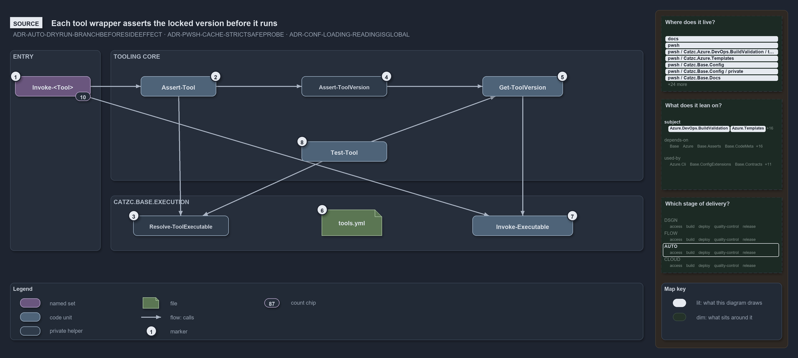

---
catzc:
  warning: "Header is generated by Format-FileMeta via Format-Code; do not change it"
  edges:
    drs_total: 3
---

# Catzc.Tooling.Core

The foundation of the Tooling group. It owns the generic, tool-agnostic engine that reads the single source of truth for which external
command-line tool is locked to which version — the `tools.yml` config and the `ToolConfig` type that models it, both owned by
[Catzc.Base.Execution](catzc-base-execution.md), the module furthest down the stack that reads them — to assert a tool's presence, install
it, and uninstall it through the right mechanism. Every other Tooling module is built on this one; it knows nothing about any specific tool,
only how to drive one from its config. The rationale is in
[controlling-systemwide-deps](../../drs/automation/controlling-systemwide-deps.md) and
[uv-python-handler](../../drs/automation/uv-python-handler.md), and the config is modelled as a native type per
[native-csharp-types](../../drs/automation/BCL/native-csharp-types.md).

## Responsibilities

| Responsibility   | Area    | Name                                                                               |
| ---------------- | ------- | ---------------------------------------------------------------------------------- |
| responsibility:1 | config  | [Tool configuration and mapping](#responsibility1--tool-configuration-and-mapping) |
| responsibility:2 | verify  | [Presence and version control](#responsibility2--presence-and-version-control)     |
| responsibility:3 | engine  | [Install and uninstall engine](#responsibility3--install-and-uninstall-engine)     |
| responsibility:4 | session | [Session tool reconciliation](#responsibility4--session-tool-reconciliation)       |
| responsibility:5 | parity  | [Per-engine fixture tables](#responsibility5--per-engine-fixture-tables)           |

### responsibility:1 — Tool configuration and mapping

Reading `tools.yml` and resolving, for any named tool, its locked version, the command it provides (and the per-platform command suffix that
command takes), and the order tools must be installed in to satisfy their declared dependencies. `tools.yml` is the single source of truth;
the `ToolConfig` C# type is its in-memory shape (see [native-csharp-types](../../drs/automation/BCL/native-csharp-types.md)). Both live in
[Catzc.Base.Execution](catzc-base-execution.md), so a bundle without the Tooling group still locates every managed tool. Because every fact
about a tool lives in config — its install mechanism, dependencies, and any devbox version relaxation or session PATH hint — adding or
upgrading one is an edit here, not new install code.

### responsibility:2 — Presence and version control

Deciding whether a tool is present at the locked version — in a throwing (assert) and a querying (test) form, both honouring the optional
`devbox_version` relaxation outside CI — and whether it was installed by the manager the platform expects rather than by some stray system
install. This is the gate every tool invocation passes before it runs.

A tool whose `tools.yml` entry declares candidate paths (`windows_probes`, `unix_probes`, and their `*_pipeline_probes` lists) is located
without starting a process: the candidates for the running platform and run environment first (a pipeline reads the pipeline list, a devbox
the devbox list), then PATH, skipping every path in `probe_excludes` (for bash, the WSL launcher). Only a located executable runs its
version command, once per executable file per session (a lazy cache entry), so a check costs file lookups after the first. The probe itself
is generic and lives in [Catzc.Base.Execution](catzc-base-execution.md), which also reads the entry, so a Base module finds a managed tool
the same way; this module keeps the presence and version decision on top of it. `Test-Tool -PassThru` returns the check as a record (where,
how, which version against the pin, and the timings), and `Write-ToolProbeReport` renders such records as a table.

### responsibility:3 — Install and uninstall engine

The generic mechanism that installs the locked version idempotently and uninstalls a managed install. It drives the platform's native
package manager (winget / brew / apt), installs Python-based CLIs as isolated uv tools (`Install-UvTool`) or into the uv-managed Python,
runs uv through a single asserted wrapper (`Invoke-Uv`), resolves the install scope and script-install directory, checksum-verifies a
download before it is trusted, and hard-removes a system installation placed outside the manager. Idempotence is a requirement here, not a
nicety (see [idempotent-state-functions](../../drs/automation/idempotent-state-functions.md)); the mechanism follows the tool's declared
kind (see [uv-python-handler](../../drs/automation/uv-python-handler.md) and
[use-proper-package-managers](../../drs/automation/use-proper-package-managers.md)).

### responsibility:4 — Session tool reconciliation

Keeping the current session's PATH pointing at the tools that are actually present. A post-import pass rebuilds PATH so a freshly installed
or relocated tool resolves without a shell restart, uses each tool's declared PATH hints to recover a tool installed outside the installer
layer (e.g. nvm-managed node, or winget's alias directory), and reports on one line any tool running from a location the installer layer
does not own. It is advisory and session-only — it never writes the persistent environment.

### responsibility:5 — Per-engine fixture tables

Holding test cases for the repository's three execution engines, pwsh, bash and zsh, side by side. A per-engine fixture table is a YAML file
under a module's `tests/assets/engine-cases/`: a subject, then one case per row with a column per engine. Every column holds the case's
fields for that engine, or says why the case does not apply there (`n/a: <reason>`), so a behaviour can never quietly cover one engine only.
The `EngineCaseTable` type validates the shape — its columns are the engines the `ExecutionEngines` model declares — and
`Get-EngineCaseTable` loads a table as rows shaped for Pester's `-ForEach`. Any subject can use the same shape: the time safeguard's command
grammar is the first, and an integrity test holds every table in the repository to it.

## What the module does

The module is a config-driven dispatcher with no tools of its own. `tools.yml` is the single source of truth: each entry names a tool's
locked version, the command it provides, how to read its installed version, and the mechanism to install it — a native package manager
(winget on Windows, Homebrew on macOS, apt on Linux), uv for the Python family (`uv_tool` / `uv_python` / uv-pip), a vendored install
script, or an OS-provided prerequisite (`system_provided`, e.g. winget) that is asserted rather than installed. A small set of generic
engine helpers reads that config and selects the right mechanism, so the per-tool surface in the rest of the group stays thin — each
concrete tool repeats the same lifecycle shape over this shared engine.

The four responsibilities stack cleanly. Configuration and mapping turns a tool name into facts; presence and version control reads those
facts against the live machine; the engine acts on the gap between them; and session reconciliation keeps what is installed resolvable on
PATH. The per-engine fixture tables sit beside them: the engines are tools too, and the tables keep their parity testable. The `ToolConfig`
type that carries those facts derives from the shared `DictionaryRecord` base in [Catzc.Base.Objects](catzc-base-objects.md), so it gets a
dictionary view and the extraction helpers without a per-module copy.

The sibling Tooling modules — [Catzc.Tooling.Python](catzc-tooling-python.md), [Catzc.Tooling.Node](catzc-tooling-node.md),
[Catzc.Tooling.Toolchain](catzc-tooling-toolchain.md), and [Catzc.Tooling.Provisioning](catzc-tooling-provisioning.md) — all depend on this
module and only this module within the group. Core is the engine; they are the per-ecosystem and orchestration surfaces over it.

The diagram below draws tool invocation from the source. Every tool wrapper asserts the locked version from `tools.yml` before it runs the
tool. The assertion either probes for the executable or checks the command and reads its version. The query form shares the same pieces.

```yml drawio
description:
  "Every Invoke-Tool wrapper asserts the locked version before it runs the tool: Assert-Tool either probes for the executable or checks the
  command and reads its version, and Test-Tool shares the same pieces as a boolean."
about:
  adrs: [ADR-AUTO-DRYRUN-BRANCHBEFORESIDEEFFECT, ADR-PWSH-CACHE-STRICTSAFEPROBE, ADR-CONF-LOADING-READINGISGLOBAL]
  lens: source
content:
  title: Each tool wrapper asserts the locked version before it runs
  kind: reference
  flow: left-to-right
  relation: calls
  theme: dark
  bands:
    - { id: band-entry, label: ENTRY }
    - { id: band-core, label: TOOLING CORE }
    - { id: band-execution, label: CATZC.BASE.EXECUTION }
  glyphs:
    - { id: g-wrappers, kind: set, label: Invoke-<Tool>, in: band-entry }
    - { id: g-assert-tool, kind: code, label: Assert-Tool, in: band-core }
    - { id: g-assert-version, kind: private, label: Assert-ToolVersion, in: band-core }
    - { id: g-get-version, kind: code, label: Get-ToolVersion, in: band-core }
    - { id: g-test-tool, kind: code, label: Test-Tool, in: band-core }
    - { id: g-resolve, kind: private, label: Resolve-ToolExecutable, in: band-execution }
    - { id: f-tools-yml, kind: file, label: tools.yml, in: band-execution }
    - { id: g-invoke, kind: code, label: Invoke-Executable, in: band-execution }
  edges:
    - { from: g-wrappers, to: g-assert-tool, kind: flow, label: "" }
    - { from: g-wrappers, to: g-invoke, kind: flow, label: "" }
    - { from: g-assert-tool, to: g-assert-version, kind: flow, label: "" }
    - { from: g-assert-tool, to: g-resolve, kind: flow, label: "" }
    - { from: g-assert-version, to: g-get-version, kind: flow, label: "" }
    - { from: g-get-version, to: g-invoke, kind: flow, label: "" }
    - { from: g-test-tool, to: g-get-version, kind: flow, label: "" }
    - { from: g-test-tool, to: g-resolve, kind: flow, label: "" }
  markers:
    - { at: g-wrappers, number: 1 }
    - { at: g-assert-tool, number: 2 }
    - { at: g-resolve, number: 3 }
    - { at: g-assert-version, number: 4 }
    - { at: g-get-version, number: 5 }
    - { at: f-tools-yml, number: 6 }
    - { at: g-invoke, number: 7 }
    - { at: g-test-tool, number: 8 }
  chips:
    - { at: g-wrappers, kind: count, text: "10" }
  legend: auto
  minimaps:
    code-locations:
      - cell: docs/-/.
        by:
          - docs/drs/automation/dora-explains.md
          - docs/drs/automation/dry-run.md
          - docs/drs/automation/pwsh/dora-explains.md
          - docs/drs/automation/pwsh/script-scope-caching.md
          - docs/drs/configuration/dora-explains.md
          - docs/drs/configuration/module-config-loading.md
          - docs/drs/index.md
          - docs/references/pwsh/catzc-azure-dev-ops-build-validation/tests/Register-AdoBuildValidation.Tests.ps1.md
          - docs/references/pwsh/catzc-azure-dev-ops-build-validation/tests/Unregister-AdoBuildValidation.Tests.ps1.md
          - docs/references/pwsh/catzc-azure-templates/Deploy-Bicep.ps1.md
          - docs/references/pwsh/catzc-azure-templates/Get-BicepTemplates.ps1.md
          - docs/references/pwsh/catzc-azure-templates/Set-BicepTemplateConfiguration.ps1.md
          - docs/references/pwsh/catzc-azure-templates/Set-BicepTrackingTagSet.ps1.md
          - docs/references/pwsh/catzc-base-config/Get-Config.ps1.md
          - docs/references/pwsh/catzc-base-config/private/Get-ConfigOverlayRoot.ps1.md
          - docs/references/pwsh/catzc-base-config/private/Get-ConfigRegistry.ps1.md
          - docs/references/pwsh/catzc-base-config/private/Resolve-ConfigEntry.ps1.md
          - docs/references/pwsh/catzc-base-docs/Build-GitKeep.ps1.md
          - docs/references/pwsh/catzc-base-docs/Build-Readme.ps1.md
          - docs/references/pwsh/catzc-base-docs/Get-Glossary.ps1.md
          - docs/references/pwsh/catzc-base-docs/private/Get-CatsRuleEnforcers.ps1.md
          - docs/references/pwsh/catzc-base-docs/types/DocsConfig.cs.md
          - docs/references/pwsh/catzc-base-drs/Build-DrsCodeDictionary.ps1.md
          - docs/references/pwsh/catzc-base-drs/Build-DrsIndex.ps1.md
          - docs/references/pwsh/catzc-base-drs/Get-CatsDrsIndex.ps1.md
          - docs/references/pwsh/catzc-base-drs/Get-CatsDrsRuleIds.ps1.md
          - docs/references/pwsh/catzc-base-drs/Get-DrsCitationMap.ps1.md
          - docs/references/pwsh/catzc-base-drs/Update-DrsCitation.ps1.md
          - docs/references/pwsh/catzc-base-execution/Find-Executable.ps1.md
          - docs/references/pwsh/catzc-base-execution/Invoke-Executable.ps1.md
          - docs/references/pwsh/catzc-base-execution/Resolve-ToolExecutable.ps1.md
          - docs/references/pwsh/catzc-base-exporter/Build-Modules.ps1.md
          - docs/references/pwsh/catzc-base-exporter/Install-Catzc.ps1.md
          - docs/references/pwsh/catzc-base-files/Get-GitTrackedPath.ps1.md
          - docs/references/pwsh/catzc-base-files/Invoke-GitCommit.ps1.md
          - docs/references/pwsh/catzc-base-files/Write-FileIfChanged.ps1.md
          - docs/references/pwsh/catzc-base-git/Import-RepositoryWithHistory.ps1.md
          - docs/references/pwsh/catzc-base-git/Reset-GitCleanFxd.ps1.md
          - docs/references/pwsh/catzc-base-git/private/Get-AutoControlledGlobs.ps1.md
          - docs/references/pwsh/catzc-base-git/types/GitIgnoreConfig.cs.md
          - docs/references/pwsh/catzc-base-globs/Protect-GlobSet.ps1.md
          - docs/references/pwsh/catzc-base-globs/Test-GlobSetProtection.ps1.md
          - docs/references/pwsh/catzc-base-maps/Get-WorldMap.ps1.md
          - docs/references/pwsh/catzc-base-module-system/Copy-CatzcModule.ps1.md
          - docs/references/pwsh/catzc-base-module-system/Get-FunctionDependency.ps1.md
          - docs/references/pwsh/catzc-base-quality-gates/Build-EnglishDictionary.ps1.md
          - docs/references/pwsh/catzc-base-quality-gates/Build-TerminologyDictionary.ps1.md
          - docs/references/pwsh/catzc-base-quality-gates/Export-SpellingTriage.ps1.md
          - docs/references/pwsh/catzc-base-quality-gates/Format-FileMeta.ps1.md
          - docs/references/pwsh/catzc-base-quality-gates/Format-MarkdownTitle.ps1.md
          - docs/references/pwsh/catzc-base-quality-gates/private/Get-LiveIdentityTokens.ps1.md
          - docs/references/pwsh/catzc-base-root-config/Build-RootConfig.ps1.md
          - docs/references/pwsh/catzc-base-root-config/types/RootConfigFiles.cs.md
          - docs/references/pwsh/catzc-tooling-core/private/Assert-ToolVersion.ps1.md
          - docs/references/pwsh/catzc-tooling-provisioning/Clear-TempFolders.ps1.md
          - docs/references/pwsh/catzc-tooling-provisioning/Initialize-GitClone.ps1.md
          - ADR-AUTO-DRYRUN-BRANCHBEFORESIDEEFFECT
          - ADR-CONF-LOADING-READINGISGLOBAL
          - ADR-PWSH-CACHE-STRICTSAFEPROBE
      - cell: pwsh/-/.
        by: [pwsh/.scriptanalyzer/tests/NoBareCacheEntryRead.Tests.ps1, ADR-PWSH-CACHE-STRICTSAFEPROBE]
      - cell: pwsh/Catzc.Azure.DevOps.BuildValidation/tests
        by:
          - pwsh/Catzc.Azure.DevOps.BuildValidation/tests/Register-AdoBuildValidation.Tests.ps1
          - pwsh/Catzc.Azure.DevOps.BuildValidation/tests/Unregister-AdoBuildValidation.Tests.ps1
          - ADR-AUTO-DRYRUN-BRANCHBEFORESIDEEFFECT
      - cell: pwsh/Catzc.Azure.Templates/.
        by:
          - pwsh/Catzc.Azure.Templates/Deploy-Bicep.ps1
          - pwsh/Catzc.Azure.Templates/Get-BicepTemplates.ps1
          - pwsh/Catzc.Azure.Templates/Set-BicepTemplateConfiguration.ps1
          - pwsh/Catzc.Azure.Templates/Set-BicepTrackingTagSet.ps1
          - ADR-AUTO-DRYRUN-BRANCHBEFORESIDEEFFECT
          - ADR-PWSH-CACHE-STRICTSAFEPROBE
      - cell: pwsh/Catzc.Base.Config/.
        by: [pwsh/Catzc.Base.Config/Get-Config.ps1, ADR-PWSH-CACHE-STRICTSAFEPROBE]
      - cell: pwsh/Catzc.Base.Config/private
        by:
          - pwsh/Catzc.Base.Config/private/Get-ConfigOverlayRoot.ps1
          - pwsh/Catzc.Base.Config/private/Get-ConfigRegistry.ps1
          - pwsh/Catzc.Base.Config/private/Resolve-ConfigEntry.ps1
          - ADR-PWSH-CACHE-STRICTSAFEPROBE
      - cell: pwsh/Catzc.Base.Docs/.
        by:
          - pwsh/Catzc.Base.Docs/Build-GitKeep.ps1
          - pwsh/Catzc.Base.Docs/Build-Readme.ps1
          - pwsh/Catzc.Base.Docs/Get-Glossary.ps1
          - ADR-AUTO-DRYRUN-BRANCHBEFORESIDEEFFECT
          - ADR-CONF-LOADING-READINGISGLOBAL
          - ADR-PWSH-CACHE-STRICTSAFEPROBE
      - cell: pwsh/Catzc.Base.Docs/private
        by: [pwsh/Catzc.Base.Docs/private/Get-CatsRuleEnforcers.ps1, ADR-CONF-LOADING-READINGISGLOBAL, ADR-PWSH-CACHE-STRICTSAFEPROBE]
      - cell: pwsh/Catzc.Base.Docs/types
        by: [pwsh/Catzc.Base.Docs/types/DocsConfig.cs, ADR-CONF-LOADING-READINGISGLOBAL]
      - cell: pwsh/Catzc.Base.Drs/.
        by:
          - pwsh/Catzc.Base.Drs/Build-DrsCodeDictionary.ps1
          - pwsh/Catzc.Base.Drs/Build-DrsIndex.ps1
          - pwsh/Catzc.Base.Drs/Get-CatsDrsIndex.ps1
          - pwsh/Catzc.Base.Drs/Get-CatsDrsRuleIds.ps1
          - pwsh/Catzc.Base.Drs/Get-DrsCitationMap.ps1
          - pwsh/Catzc.Base.Drs/Update-DrsCitation.ps1
          - ADR-AUTO-DRYRUN-BRANCHBEFORESIDEEFFECT
          - ADR-PWSH-CACHE-STRICTSAFEPROBE
      - cell: pwsh/Catzc.Base.Drs/configs
        by:
          - pwsh/Catzc.Base.Drs/configs/drs.yml
          - ADR-AUTO-DRYRUN-BRANCHBEFORESIDEEFFECT
          - ADR-CONF-LOADING-READINGISGLOBAL
          - ADR-PWSH-CACHE-STRICTSAFEPROBE
      - cell: pwsh/Catzc.Base.Drs/tests
        by: [pwsh/Catzc.Base.Drs/tests/Update-DrsCitation.Tests.ps1, ADR-AUTO-DRYRUN-BRANCHBEFORESIDEEFFECT]
      - cell: pwsh/Catzc.Base.Execution/.
        by:
          - pwsh/Catzc.Base.Execution/Find-Executable.ps1
          - pwsh/Catzc.Base.Execution/Invoke-Executable.ps1
          - pwsh/Catzc.Base.Execution/Resolve-ToolExecutable.ps1
          - ADR-AUTO-DRYRUN-BRANCHBEFORESIDEEFFECT
          - ADR-CONF-LOADING-READINGISGLOBAL
          - ADR-PWSH-CACHE-STRICTSAFEPROBE
      - cell: pwsh/Catzc.Base.Exporter/.
        by: [pwsh/Catzc.Base.Exporter/Build-Modules.ps1, pwsh/Catzc.Base.Exporter/Install-Catzc.ps1, ADR-AUTO-DRYRUN-BRANCHBEFORESIDEEFFECT]
      - cell: pwsh/Catzc.Base.Files/.
        by:
          - pwsh/Catzc.Base.Files/Get-GitTrackedPath.ps1
          - pwsh/Catzc.Base.Files/Invoke-GitCommit.ps1
          - pwsh/Catzc.Base.Files/Write-FileIfChanged.ps1
          - ADR-AUTO-DRYRUN-BRANCHBEFORESIDEEFFECT
          - ADR-PWSH-CACHE-STRICTSAFEPROBE
      - cell: pwsh/Catzc.Base.Git/.
        by:
          - pwsh/Catzc.Base.Git/Import-RepositoryWithHistory.ps1
          - pwsh/Catzc.Base.Git/Reset-GitCleanFxd.ps1
          - ADR-AUTO-DRYRUN-BRANCHBEFORESIDEEFFECT
      - cell: pwsh/Catzc.Base.Git/private
        by: [pwsh/Catzc.Base.Git/private/Get-AutoControlledGlobs.ps1, ADR-CONF-LOADING-READINGISGLOBAL]
      - cell: pwsh/Catzc.Base.Git/types
        by: [pwsh/Catzc.Base.Git/types/GitIgnoreConfig.cs, ADR-CONF-LOADING-READINGISGLOBAL]
      - cell: pwsh/Catzc.Base.Globs/.
        by: [pwsh/Catzc.Base.Globs/Protect-GlobSet.ps1, pwsh/Catzc.Base.Globs/Test-GlobSetProtection.ps1, ADR-PWSH-CACHE-STRICTSAFEPROBE]
      - cell: pwsh/Catzc.Base.Maps/.
        by: [pwsh/Catzc.Base.Maps/Get-WorldMap.ps1, ADR-PWSH-CACHE-STRICTSAFEPROBE]
      - cell: pwsh/Catzc.Base.ModuleSystem/.
        by:
          - pwsh/Catzc.Base.ModuleSystem/Copy-CatzcModule.ps1
          - pwsh/Catzc.Base.ModuleSystem/Get-FunctionDependency.ps1
          - ADR-CONF-LOADING-READINGISGLOBAL
          - ADR-PWSH-CACHE-STRICTSAFEPROBE
      - cell: pwsh/Catzc.Base.QualityGates/.
        by:
          - pwsh/Catzc.Base.QualityGates/Build-EnglishDictionary.ps1
          - pwsh/Catzc.Base.QualityGates/Build-TerminologyDictionary.ps1
          - pwsh/Catzc.Base.QualityGates/Export-SpellingTriage.ps1
          - pwsh/Catzc.Base.QualityGates/Format-FileMeta.ps1
          - pwsh/Catzc.Base.QualityGates/Format-MarkdownTitle.ps1
          - ADR-AUTO-DRYRUN-BRANCHBEFORESIDEEFFECT
      - cell: pwsh/Catzc.Base.QualityGates/configs
        by: [pwsh/Catzc.Base.QualityGates/configs/analyzer-drs-map.yml, ADR-PWSH-CACHE-STRICTSAFEPROBE]
      - cell: pwsh/Catzc.Base.QualityGates/private
        by: [pwsh/Catzc.Base.QualityGates/private/Get-LiveIdentityTokens.ps1, ADR-CONF-LOADING-READINGISGLOBAL]
      - cell: pwsh/Catzc.Base.QualityGates/tests
        by:
          - pwsh/Catzc.Base.QualityGates/tests/Move-FunctionHelp.Tests.ps1
          - pwsh/Catzc.Base.QualityGates/tests/Sync-FileMeta.Tests.ps1
          - ADR-AUTO-DRYRUN-BRANCHBEFORESIDEEFFECT
      - cell: pwsh/Catzc.Base.RootConfig/.
        by: [pwsh/Catzc.Base.RootConfig/Build-RootConfig.ps1, ADR-AUTO-DRYRUN-BRANCHBEFORESIDEEFFECT]
      - cell: pwsh/Catzc.Base.RootConfig/types
        by: [pwsh/Catzc.Base.RootConfig/types/RootConfigFiles.cs, ADR-CONF-LOADING-READINGISGLOBAL]
      - cell: pwsh/Catzc.Base.Slides/tests
        by: [pwsh/Catzc.Base.Slides/tests/Build-Diagrams.Tests.ps1, ADR-AUTO-DRYRUN-BRANCHBEFORESIDEEFFECT]
      - cell: pwsh/Catzc.Internal.Tests/.
        by: [pwsh/.internal/tests/Write-LoadTime.Tests.ps1, ADR-PWSH-CACHE-STRICTSAFEPROBE]
      - cell: pwsh/Catzc.Tooling.Core/private
        by: [pwsh/Catzc.Tooling.Core/private/Assert-ToolVersion.ps1, ADR-PWSH-CACHE-STRICTSAFEPROBE]
      - cell: pwsh/Catzc.Tooling.Provisioning/.
        by:
          - pwsh/Catzc.Tooling.Provisioning/Clear-TempFolders.ps1
          - pwsh/Catzc.Tooling.Provisioning/Initialize-GitClone.ps1
          - ADR-AUTO-DRYRUN-BRANCHBEFORESIDEEFFECT
    module-neighbourhood:
      - cell: subject/Catzc.Azure.DevOps.BuildValidation
        by:
          - pwsh/Catzc.Azure.DevOps.BuildValidation/tests/Register-AdoBuildValidation.Tests.ps1
          - pwsh/Catzc.Azure.DevOps.BuildValidation/tests/Unregister-AdoBuildValidation.Tests.ps1
          - ADR-AUTO-DRYRUN-BRANCHBEFORESIDEEFFECT
      - cell: subject/Catzc.Azure.Templates
        by:
          - pwsh/Catzc.Azure.Templates/Deploy-Bicep.ps1
          - pwsh/Catzc.Azure.Templates/Get-BicepTemplates.ps1
          - pwsh/Catzc.Azure.Templates/Set-BicepTemplateConfiguration.ps1
          - pwsh/Catzc.Azure.Templates/Set-BicepTrackingTagSet.ps1
          - ADR-AUTO-DRYRUN-BRANCHBEFORESIDEEFFECT
          - ADR-PWSH-CACHE-STRICTSAFEPROBE
      - cell: subject/Catzc.Base.Config
        by:
          - pwsh/Catzc.Base.Config/Get-Config.ps1
          - pwsh/Catzc.Base.Config/private/Get-ConfigOverlayRoot.ps1
          - pwsh/Catzc.Base.Config/private/Get-ConfigRegistry.ps1
          - pwsh/Catzc.Base.Config/private/Resolve-ConfigEntry.ps1
          - ADR-PWSH-CACHE-STRICTSAFEPROBE
      - cell: subject/Catzc.Base.Docs
        by:
          - pwsh/Catzc.Base.Docs/Build-GitKeep.ps1
          - pwsh/Catzc.Base.Docs/Build-Readme.ps1
          - pwsh/Catzc.Base.Docs/Get-Glossary.ps1
          - pwsh/Catzc.Base.Docs/private/Get-CatsRuleEnforcers.ps1
          - pwsh/Catzc.Base.Docs/types/DocsConfig.cs
          - ADR-AUTO-DRYRUN-BRANCHBEFORESIDEEFFECT
          - ADR-CONF-LOADING-READINGISGLOBAL
          - ADR-PWSH-CACHE-STRICTSAFEPROBE
      - cell: subject/Catzc.Base.Drs
        by:
          - pwsh/Catzc.Base.Drs/Build-DrsCodeDictionary.ps1
          - pwsh/Catzc.Base.Drs/Build-DrsIndex.ps1
          - pwsh/Catzc.Base.Drs/Get-CatsDrsIndex.ps1
          - pwsh/Catzc.Base.Drs/Get-CatsDrsRuleIds.ps1
          - pwsh/Catzc.Base.Drs/Get-DrsCitationMap.ps1
          - pwsh/Catzc.Base.Drs/Update-DrsCitation.ps1
          - pwsh/Catzc.Base.Drs/configs/drs.yml
          - pwsh/Catzc.Base.Drs/tests/Update-DrsCitation.Tests.ps1
          - ADR-AUTO-DRYRUN-BRANCHBEFORESIDEEFFECT
          - ADR-CONF-LOADING-READINGISGLOBAL
          - ADR-PWSH-CACHE-STRICTSAFEPROBE
      - cell: subject/Catzc.Base.Execution
        by:
          - pwsh/Catzc.Base.Execution/Find-Executable.ps1
          - pwsh/Catzc.Base.Execution/Invoke-Executable.ps1
          - pwsh/Catzc.Base.Execution/Resolve-ToolExecutable.ps1
          - ADR-AUTO-DRYRUN-BRANCHBEFORESIDEEFFECT
          - ADR-CONF-LOADING-READINGISGLOBAL
          - ADR-PWSH-CACHE-STRICTSAFEPROBE
      - cell: subject/Catzc.Base.Exporter
        by: [pwsh/Catzc.Base.Exporter/Build-Modules.ps1, pwsh/Catzc.Base.Exporter/Install-Catzc.ps1, ADR-AUTO-DRYRUN-BRANCHBEFORESIDEEFFECT]
      - cell: subject/Catzc.Base.Files
        by:
          - pwsh/Catzc.Base.Files/Get-GitTrackedPath.ps1
          - pwsh/Catzc.Base.Files/Invoke-GitCommit.ps1
          - pwsh/Catzc.Base.Files/Write-FileIfChanged.ps1
          - ADR-AUTO-DRYRUN-BRANCHBEFORESIDEEFFECT
          - ADR-PWSH-CACHE-STRICTSAFEPROBE
      - cell: subject/Catzc.Base.Git
        by:
          - pwsh/Catzc.Base.Git/Import-RepositoryWithHistory.ps1
          - pwsh/Catzc.Base.Git/Reset-GitCleanFxd.ps1
          - pwsh/Catzc.Base.Git/private/Get-AutoControlledGlobs.ps1
          - pwsh/Catzc.Base.Git/types/GitIgnoreConfig.cs
          - ADR-AUTO-DRYRUN-BRANCHBEFORESIDEEFFECT
          - ADR-CONF-LOADING-READINGISGLOBAL
      - cell: subject/Catzc.Base.Globs
        by: [pwsh/Catzc.Base.Globs/Protect-GlobSet.ps1, pwsh/Catzc.Base.Globs/Test-GlobSetProtection.ps1, ADR-PWSH-CACHE-STRICTSAFEPROBE]
      - cell: subject/Catzc.Base.Maps
        by: [pwsh/Catzc.Base.Maps/Get-WorldMap.ps1, ADR-PWSH-CACHE-STRICTSAFEPROBE]
      - cell: subject/Catzc.Base.ModuleSystem
        by:
          - pwsh/Catzc.Base.ModuleSystem/Copy-CatzcModule.ps1
          - pwsh/Catzc.Base.ModuleSystem/Get-FunctionDependency.ps1
          - ADR-CONF-LOADING-READINGISGLOBAL
          - ADR-PWSH-CACHE-STRICTSAFEPROBE
      - cell: subject/Catzc.Base.QualityGates
        by:
          - pwsh/Catzc.Base.QualityGates/Build-EnglishDictionary.ps1
          - pwsh/Catzc.Base.QualityGates/Build-TerminologyDictionary.ps1
          - pwsh/Catzc.Base.QualityGates/Export-SpellingTriage.ps1
          - pwsh/Catzc.Base.QualityGates/Format-FileMeta.ps1
          - pwsh/Catzc.Base.QualityGates/Format-MarkdownTitle.ps1
          - pwsh/Catzc.Base.QualityGates/configs/analyzer-drs-map.yml
          - pwsh/Catzc.Base.QualityGates/private/Get-LiveIdentityTokens.ps1
          - pwsh/Catzc.Base.QualityGates/tests/Move-FunctionHelp.Tests.ps1
          - pwsh/Catzc.Base.QualityGates/tests/Sync-FileMeta.Tests.ps1
          - ADR-AUTO-DRYRUN-BRANCHBEFORESIDEEFFECT
          - ADR-CONF-LOADING-READINGISGLOBAL
          - ADR-PWSH-CACHE-STRICTSAFEPROBE
      - cell: subject/Catzc.Base.RootConfig
        by:
          - pwsh/Catzc.Base.RootConfig/Build-RootConfig.ps1
          - pwsh/Catzc.Base.RootConfig/types/RootConfigFiles.cs
          - ADR-AUTO-DRYRUN-BRANCHBEFORESIDEEFFECT
          - ADR-CONF-LOADING-READINGISGLOBAL
      - cell: subject/Catzc.Base.Slides
        by: [pwsh/Catzc.Base.Slides/tests/Build-Diagrams.Tests.ps1, ADR-AUTO-DRYRUN-BRANCHBEFORESIDEEFFECT]
      - cell: subject/Catzc.Internal.Tests
        by: [pwsh/.internal/tests/Write-LoadTime.Tests.ps1, ADR-PWSH-CACHE-STRICTSAFEPROBE]
      - cell: subject/Catzc.Tooling.Core
        by: [pwsh/Catzc.Tooling.Core/private/Assert-ToolVersion.ps1, ADR-PWSH-CACHE-STRICTSAFEPROBE]
      - cell: subject/Catzc.Tooling.Provisioning
        by:
          - pwsh/Catzc.Tooling.Provisioning/Clear-TempFolders.ps1
          - pwsh/Catzc.Tooling.Provisioning/Initialize-GitClone.ps1
          - ADR-AUTO-DRYRUN-BRANCHBEFORESIDEEFFECT
    axis:
      - cell: AUTO/*
        by: [ADR-AUTO-DRYRUN-BRANCHBEFORESIDEEFFECT, ADR-CONF-LOADING-READINGISGLOBAL, ADR-PWSH-CACHE-STRICTSAFEPROBE]
layout:
  band-entry: { x: 20, y: 84, w: 180, h: 400 }
  band-core: { x: 220, y: 84, w: 1060, h: 260 }
  band-execution: { x: 220, y: 374, w: 1060, h: 110 }
  g-wrappers: { x: 30, y: 136, w: 150, h: 40 }
  g-assert-tool: { x: 280, y: 136, w: 150, h: 40 }
  g-assert-version: { x: 600, y: 136, w: 170, h: 40 }
  g-get-version: { x: 960, y: 136, w: 160, h: 40 }
  g-test-tool: { x: 600, y: 266, w: 170, h: 40 }
  g-resolve: { x: 265, y: 414, w: 190, h: 40 }
  f-tools-yml: { x: 640, y: 402, w: 120, h: 52 }
  g-invoke: { x: 940, y: 414, w: 200, h: 40 }
```



## Division

The module's public functions and configuration, sorted into the responsibilities above.

| Responsibility                                    | Function                      |
| ------------------------------------------------- | ----------------------------- |
| responsibility:1 — Tool configuration and mapping | `Get-ToolConfig`              |
|                                                   | `Get-ToolVersion`             |
|                                                   | `Get-ToolCommandSuffix`       |
|                                                   | `Get-ToolInstallOrder`        |
| responsibility:2 — Presence and version control   | `Assert-Tool`                 |
|                                                   | `Test-Tool`                   |
|                                                   | `Test-ExpectedPackageManager` |
|                                                   | `Write-ToolProbeReport`       |
| responsibility:3 — Install and uninstall engine   | `Install-Tool`                |
|                                                   | `Uninstall-Tool`              |
|                                                   | `Install-UvTool`              |
|                                                   | `Uninstall-UvTool`            |
|                                                   | `Install-UvVenvTool`          |
|                                                   | `Uninstall-UvVenvTool`        |
|                                                   | `Invoke-Uv`                   |
|                                                   | `Save-VerifiedDownload`       |
|                                                   | `Remove-SystemInstallation`   |
|                                                   | `Remove-LinuxToolInstall`     |
|                                                   | `Remove-MacToolInstall`       |
|                                                   | `Get-InstallScope`            |
|                                                   | `Test-ToolRequiresElevation`  |
|                                                   | `Get-ScriptInstallDir`        |
| responsibility:4 — Session tool reconciliation    | `Sync-SessionTools`           |
| responsibility:5 — Per-engine fixture tables      | `Get-EngineCaseTable`         |
