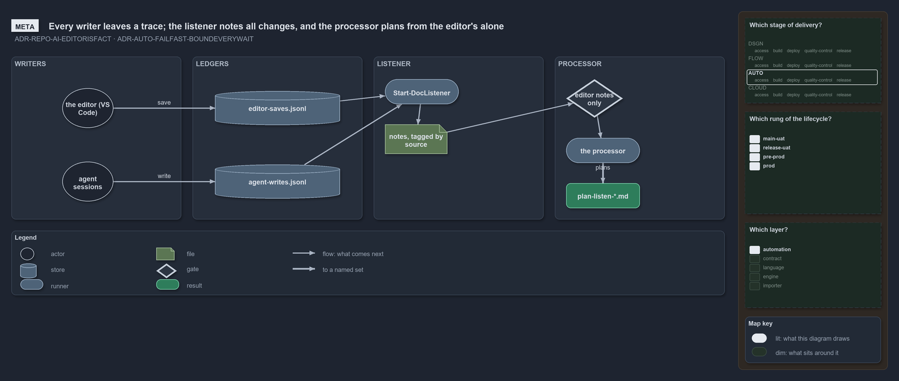

# Catzc.Tooling.Listen

The listen mode's module of the Tooling group: it notes every change the editor makes to the docs by hand, as raw fact, so the processor
agent can turn each correction into repository-wide plans ([ai-agent-contract](../../drs/repository/ai-agent-contract.md)). It owns the
listener, a command with no model, and the reads the processor and its scouts make; it interprets nothing, and it never reads git state to
decide what changed. Like [Catzc.Tooling.Inspiration](catzc-tooling-inspiration.md), it installs nothing, so it rests only on the `Base`
group.

## Responsibilities

| Responsibility   | Area      | Name                                                                                 |
| ---------------- | --------- | ------------------------------------------------------------------------------------ |
| responsibility:1 | note      | [Note every change](#responsibility1--note-every-change)                             |
| responsibility:2 | detect    | [Detect the changes on disk](#responsibility2--detect-the-changes-on-disk)           |
| responsibility:3 | ledger    | [Hand the notes to the processor](#responsibility3--hand-the-notes-to-the-processor) |
| responsibility:4 | reference | [Search the committed reference](#responsibility4--search-the-committed-reference)   |
| responsibility:5 | declare   | [Declare the session settings](#responsibility5--declare-the-session-settings)       |

### responsibility:1 — Note every change

Write one note per settled change of the watched folder, once, and never again: the path, the kind of change, the file kind and tier, the
rules the file cites, the commit the reference is pinned at, and two diffs, the change itself and the file's arc over the session. The
listener runs in a terminal of its own until stopped, and a stopped listener loses nothing, since every note is on disk once written.

### responsibility:2 — Detect the changes on disk

Keep a session's two copies of the watched folder: a baseline frozen at the start and a seen copy that moves forward as changes are noted. A
change is a file whose bytes on disk differ from the seen copy; a save of the same bytes is none, and a deleted and an added file with the
same bytes are one rename. A change counts once it has stayed the same for a quiet window, so a burst of saves is one change. Every change
also says who made its bytes, from two write ledgers in `out/`: an agent session, which the Record-AgentWrite hook records for every tool
write and Bash call; the editor, which the catzc-save-ledger extension records for every save; or nobody either ledger knows. The listener
notes them all, and the processor plans from the editor's alone.

### responsibility:3 — Hand the notes to the processor

List the notes and whether each is processed, wait for an unprocessed one within a bound, and record a processed note in the processor's own
ledger. The listener writes the notes and the processor writes the ledger, one writer per file, so either side stops or restarts without the
other.

### responsibility:4 — Search the committed reference

Search the repository as committed at the session's pinned commit, never the live tree, tier by tier, so every scout reads the same truth
and every match is stated at one commit.

### responsibility:5 — Declare the session settings

The watched folder, the output folder, the poll, the quiet window, the wait bounds and the tiers are entries in `configs/listen.yml`, each
default declared once on its config type ([sensible-defaults](../../drs/automation/sensible-defaults.md)). A tier is a set of file kinds,
the kinds `file-kinds.yml` already declares, so the module adds no doc type of its own.

## What the module does

The module is the deterministic half of the listen mode. The editor's corrections are fact
([ai-agent-contract](../../drs/repository/ai-agent-contract.md)), and noting them needs no judgment, so the listener is a command: tested,
free to run, and never late because something was thinking. Understanding stays with the processor agent, which reads the notes on its own
time.

Detection compares the disk with the session's copies and their indexes, hashing only the files whose length or write time moved; git is
read once, at the start, to pin the reference, which is the repository at HEAD with committed files only. Every wait is bounded
([fail-fast-with-asserts](../../drs/automation/fail-fast-with-asserts.md)): the listener waits again after a bound runs out, and the
processor's wait sits under the background roof of the time safeguard.

## Division

The module's public functions, sorted into the responsibilities above.

| Responsibility                                     | Function             |
| -------------------------------------------------- | -------------------- |
| responsibility:1 — Note every change               | `Start-DocListener`  |
|                                                    | `New-DocNote`        |
| responsibility:2 — Detect the changes on disk      | `New-DocSnapshot`    |
|                                                    | `Get-DocChange`      |
|                                                    | `Wait-DocChange`     |
|                                                    | `Update-DocSnapshot` |
| responsibility:3 — Hand the notes to the processor | `Get-DocNote`        |
|                                                    | `Wait-DocNote`       |
|                                                    | `Complete-DocNote`   |
| responsibility:4 — Search the committed reference  | `Find-DocPattern`    |
| responsibility:5 — Declare the session settings    | `listen.yml`         |
