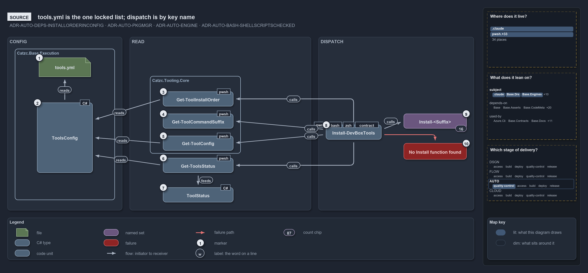

# Catzc.Tooling.Provisioning

The orchestration module of the Tooling group. It converges a whole development workstation to the complete locked tool set in dependency
order, reports and asserts the aggregate status of every tool, and keeps the machine clean of package managers the platform refuses to
depend on. It also ships two bespoke installers — Git and Postman — that do not fit Core's generic engine, and it owns the
`ToolStatus`/`ToolStatusKind` types its status report is built on. It is the layer over the per-tool surfaces in
[Catzc.Tooling.Core](../tooling-core/index.md), [Catzc.Tooling.Python](../tooling-python/index.md),
[Catzc.Tooling.Node](../tooling-node/index.md), and [Catzc.Tooling.Toolchain](../tooling-toolchain/index.md). The rationale is in
[controlling-systemwide-deps](../../../drs/automation/controlling-systemwide-deps.md) and
[idempotent-state-functions](../../../drs/automation/idempotent-state-functions.md); the status types are native per
[native-csharp-types](../../../drs/automation/BCL/native-csharp-types.md).

## Responsibilities

| Responsibility   | Area          | Name                                                                     |
| ---------------- | ------------- | ------------------------------------------------------------------------ |
| responsibility:1 | orchestration | [Workstation orchestration](#responsibility1--workstation-orchestration) |
| responsibility:2 | hygiene       | [Workstation hygiene](#responsibility2--workstation-hygiene)             |
| responsibility:3 | bespoke       | [Bespoke tool installers](#responsibility3--bespoke-tool-installers)     |

### responsibility:1 — Workstation orchestration

The whole machine rather than one tool: install (and uninstall) the complete locked tool set in the order declared dependencies require,
report each tool's aggregate status — correct, usable-but-wrong-manager, wrong-version, missing, or unwanted — through the
`ToolStatus`/`ToolStatusKind` types (see [native-csharp-types](../../../drs/automation/BCL/native-csharp-types.md)), and assert that status
is clean. It sits over the per-tool engines, diagnosing and converging.

### responsibility:2 — Workstation hygiene

Keeping the workstation free of what the platform will not depend on: removing Chocolatey — a package manager the estate refuses (see
[controlling-systemwide-deps](../../../drs/automation/controlling-systemwide-deps.md)) — and clearing accumulated temporary files.

### responsibility:3 — Bespoke tool installers

Git and Postman, whose installers do not fit Core's config-driven engine and so are written by hand here. Each still exposes the same
install and uninstall shape as a managed tool, so it fits into the orchestration above and the status report sees it like any other.

## What the module does

The module depends on [Catzc.Tooling.Core](../tooling-core/index.md) and the three ecosystem modules; it reaches their per-tool installers
by dynamic dispatch rather than a static call, so converging a workstation is just running the lifecycle for every tool in dependency order
and then reporting where reality diverges from the lock. The status report is the surface a human or an assertion reads to see at a glance
what needs installing, upgrading, or removing. Install and uninstall are dry-run-able so a run can be previewed before it mutates the
machine (see [dry-run](../../../drs/automation/dry-run.md)). The same functions run locally and in CI, with no separate provisioning script
(see [cross-platform](../../../drs/automation/cross-platform.md)).

Provisioning is also where the platform's package-manager support matters for enterprise and air-gapped networks, because the locked tools
must still install where the public registries are unreachable. The support is uneven by manager: apt-get has full Artifactory support, so
its repositories can be mirrored and pinned behind a private proxy; Homebrew is partial, in that bottle caching can be redirected with
`HOMEBREW_BOTTLE_DOMAIN` but formula metadata still resolves upstream; and winget has none, so the practical options are to store the
installers in a Generic repository and point at a private REST feed, or to pre-install the tools in the base image.

The diagram below draws the devbox install from the source. `tools.yml` is the one locked list of tools. The install walks it in dependency
order and dispatches each key by name to the install function whose name it derives, in whichever tooling module defines it. Keys the system
provides are checked and skipped before the dispatch.

## Division

The module's public functions, sorted into the responsibilities above.

| Responsibility                               | Function                   |
| -------------------------------------------- | -------------------------- |
| responsibility:1 — Workstation orchestration | `Install-DevBoxTools`      |
|                                              | `Uninstall-DevBoxTools`    |
|                                              | `Get-ToolsStatus`          |
|                                              | `Assert-DevBoxToolsStatus` |
|                                              | `Initialize-GitClone`      |
| responsibility:2 — Workstation hygiene       | `Uninstall-Chocolatey`     |
|                                              | `Clear-TempFolders`        |
| responsibility:3 — Bespoke tool installers   | `Install-Git`              |
|                                              | `Uninstall-Git`            |
|                                              | `Install-Postman`          |
|                                              | `Uninstall-Postman`        |
|                                              | `Install-Zsh`              |
|                                              | `Uninstall-Zsh`            |
